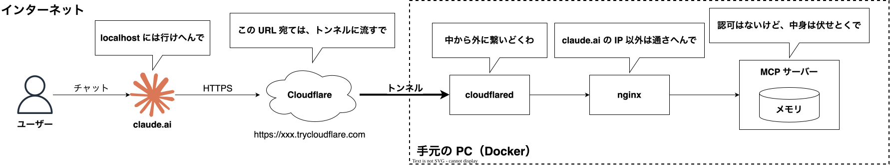

# 12/2 最新の MCP 仕様の最小 MCP サーバーを自作して、claude.ai に繋いでみる

<!-- TODO: Qiita の記事を公開したらリンク -->

## 動かす

Docker と make が要ります。

```sh
make tunnel   # MCP サーバー・nginx・cloudflared を立ち上げて、登録する URL を表示する
make logs     # 届いたリクエストのログを見る
make down     # 試し終わったら、必ずトンネルごと止める
```

`make tunnel` が表示する `https://….trycloudflare.com/mcp` を、claude.ai のカスタムコネクターに「サインインなし」で登録すると繋がります。

トンネルを使わずに手元だけで試すなら、こうします。

```sh
make up       # MCP サーバー（127.0.0.1:8080）と nginx（127.0.0.1:8081）を立ち上げる
make smoke    # curl で一通り叩く
```

記事の「壊してみる」で使うモードは、`BREAK` で切り替えます。

```sh
make down && make tunnel BREAK=no-initialize   # 古い版の initialize だけに「そんなメソッドはない」と返す
make down && make tunnel BREAK=no-discover     # 新しい版の server/discover だけに「そんなメソッドはない」と返す
make down && make tunnel BREAK=bad-version     # 対応する版として、存在しない版を返す
make down && make tunnel BREAK=bad-schema      # ツールの inputSchema を null にする
```

## 構成

<p align="center"></p>

- cloudflared：quick tunnel で一時的な `https://….trycloudflare.com` の URL を出す
- nginx：Anthropic が繋ぎに来る IP の範囲（[公開されている範囲](https://platform.claude.com/docs/en/api/ip-addresses)）だけを通す
- MCP サーバー：メモはメモリに置くだけなので、止めると消える

| パス | 中身 |
|---|---|
| `cmd/mcp/` | MCP サーバー本体（`main.go`：HTTP、`rpc.go`：JSON-RPC と新旧の版、`tools.go`：ツール） |
| `internal/notes/` | メモの保存（メモリ） |
| `deploy/local/` | Docker Compose、nginx の設定、smoke テスト |
