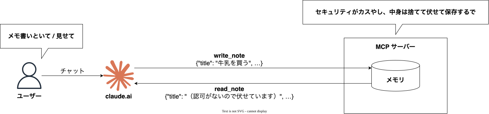
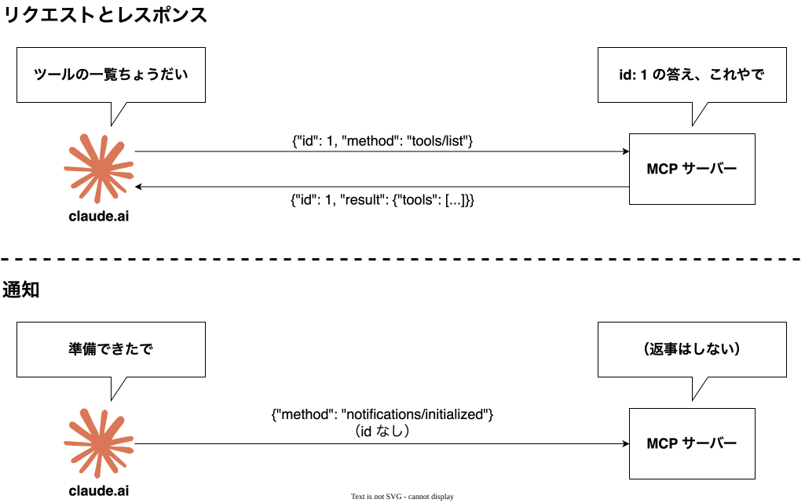
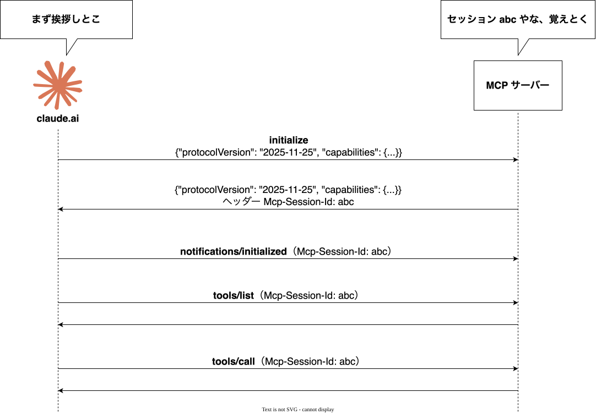
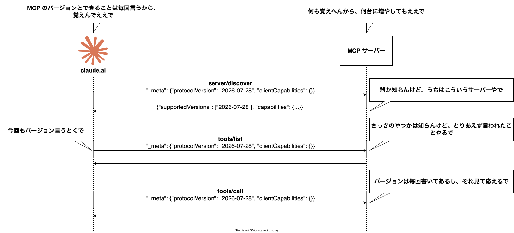

# 12/2 SDK なしで、claude.ai に登録できる最小の MCP サーバーを作る

<!-- TODO: Qiita の記事を公開したらリンク -->

SDK を使わずに JSON-RPC を直接書いた、最小の MCP サーバーです。ツールはメモを読む `read_note` と、書く `write_note` の2つだけです。

- MCP 仕様 2026-07-28（`initialize` なし、毎回 `_meta` でバージョンを送る）に応えます。`initialize` から始める 2025-11-25 以前のクライアントにも応えます。
- 認可はありません。誰が書いても `owner` は `anonymous` です。
- 認可なしで公開するので、書かれたタイトルと本文は捨てて、伏せた文言に置き換えて保存します。

<p align="center"></p>

## 動かす

Docker と make が要ります。

```sh
make tunnel   # MCP サーバー・nginx・cloudflared を立ち上げて、登録する URL を表示する
make logs     # 届いたリクエストのログを見る
make down     # 試し終わったら、トンネルごと止める
```

`make tunnel` が表示する `https://….trycloudflare.com/mcp` を、claude.ai のカスタムコネクターに「サインインなし」で登録すると繋がります。

トンネルを使わずに手元だけで試すなら、こうします。

```sh
make up       # MCP サーバー（127.0.0.1:8080）と nginx（127.0.0.1:8081）を立ち上げる
make smoke    # curl で一通り叩く
```

## 構成

<p align="center"></p>

- cloudflared：quick tunnel で一時的な `https://….trycloudflare.com` の URL を出す
- nginx：Anthropic が繋ぎに来る IP の範囲（[公開されている範囲](https://platform.claude.com/docs/en/api/ip-addresses)）だけを通す
- MCP サーバー：メモはメモリに置くだけなので、止めると消える

| パス | 中身 |
|---|---|
| `cmd/mcp/` | MCP サーバー本体（`main.go`：HTTP、`rpc.go`：JSON-RPC と新旧の版、`tools.go`：ツール） |
| `internal/notes/` | メモの保存（メモリ） |
| `deploy/local/` | Docker Compose、nginx の設定、smoke テスト |

## プロトコル

MCP のメッセージは JSON-RPC 2.0 です。リクエストには同じ `id` でレスポンスを返し、通知には返事をしません（HTTP では 202）。

<p align="center"></p>

2025-11-25 までは、最初に `initialize` で決めたことを、サーバーがセッションとして覚えていました。

<p align="center"></p>

2026-07-28 からは、毎回のリクエストの `_meta` でバージョンと機能を送るので、サーバーは何も覚えません。このサーバーは両方に応えます。

<p align="center"></p>

## 壊してみる

記事の「壊してみる」で使うモードです。`BREAK` で切り替えます。

```sh
make down && make tunnel BREAK=no-initialize   # initialize / server/discover に「そんなメソッドはない」と返す
make down && make tunnel BREAK=bad-version     # 対応する版として、存在しない版を返す
make down && make tunnel BREAK=bad-schema      # ツールの inputSchema を null にする
```

## 注意

- 認可のないサーバーを公開します。試し終わったら、必ず `make down` でトンネルを閉じてください。
