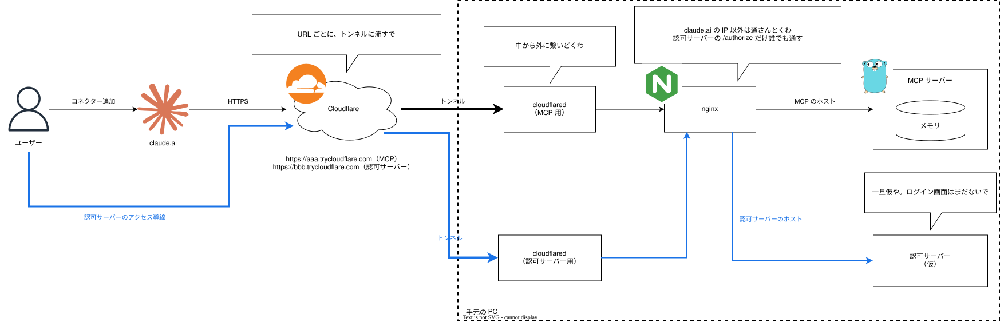

# 12/3 MCP サーバーに 401 を返させて、claude.ai が認可サーバーを探す足取りを一歩ずつ確かめた

記事：https://qiita.com/kou1046/items/dcdedf12db7a88f255a7

12/2 の MCP サーバーに、401 と Protected Resource Metadata（RFC 9728）を足しました。トークンの検証はまだしないので、MCP の URL へのリクエストはすべて 401 になります。その先は、仮の認可サーバー（`authserver`）が受けます。

## 動かす

Docker と make が要ります。

```sh
make tunnel   # MCP サーバー・仮の認可サーバー・nginx・cloudflared（2本）を立ち上げて、登録する URL を表示する
make logs     # 届いたリクエストのログを見る
make down     # 試し終わったら、必ずトンネルごと止める
```

`make tunnel` が表示する `https://….trycloudflare.com/mcp` を、claude.ai のカスタムコネクターに登録します。ブラウザが仮の認可サーバーの `/authorize` に着いて、「ここまで来ました」と表示されたら、そこで終わりです。

仮の認可サーバーがメタデータで広告する登録の方式は、`DCR` と `CIMD` で切り替えます。

```sh
make down && make tunnel CIMD=false             # CIMD を広告しない
make down && make tunnel DCR=false              # DCR を広告しない（/register も受け付けない）
make down && make tunnel DCR=false CIMD=false   # どちらも広告しない
```

トンネルを使わずに手元だけで試すなら、こうします。

```sh
make up       # MCP サーバー（127.0.0.1:8080）と nginx（127.0.0.1:8081、8082）を立ち上げる
make smoke    # curl で一通り叩く
```

## 構成

<p align="center"></p>

- cloudflared：MCP サーバー用と認可サーバー用の2本。それぞれ別の `https://….trycloudflare.com` の URL を出す
- nginx：ポートでホストを分ける（80：MCP のホスト、81：認可サーバーのホスト）。Anthropic が繋ぎに来る IP の範囲（[公開されている範囲](https://platform.claude.com/docs/en/api/ip-addresses)）だけを通す。ただし、ユーザーのブラウザが開く `/authorize` だけは誰でも通す
- MCP サーバー：401 と `WWW-Authenticate`、メタデータを返す。メタデータの `authorization_servers` には、`make tunnel` が認可サーバーのトンネルの URL を渡す
- 仮の認可サーバー：メタデータ（RFC 8414）、`/register`、`/authorize` に応えて、届いたリクエストをログに出す

| パス | 中身 |
|---|---|
| `cmd/mcp/` | MCP サーバー本体（`main.go`：HTTP、`auth.go`：401 とメタデータ、`rpc.go`：JSON-RPC と新旧の版、`tools.go`：ツール） |
| `cmd/authserver/` | 仮の認可サーバー |
| `internal/notes/` | メモの保存（メモリ） |
| `deploy/local/` | Docker Compose、nginx の設定、smoke テスト |
