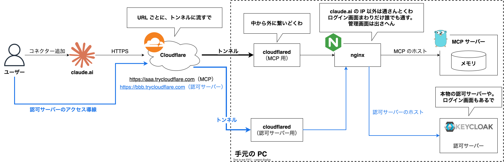

# 12/6 MCP サーバーでトークンを検証して断ると、claude.ai はどう足掻くか

記事：https://qiita.com/kou1046/items/a9ac5eca52b1d9671959

12/5 の構成で、MCP サーバーが届いたトークンを確かめるようにします。署名・`iss`・`aud`・`exp` を確かめ、ダメなら 401（`error="invalid_token"`）で断ります。Keycloak には、トークンの `aud` に MCP サーバーの URL を入れる設定を足します。さらに、本物のトークンをよそ宛てとみなす演技をさせて、断られた claude.ai がどうするかを試します。

## 動かす

Docker、make、jq が要ります。

```sh
make tunnel   # MCP サーバー・Keycloak・nginx・cloudflared（2本）を立ち上げて、登録する URL を表示する
make logs     # 届いたリクエストのログを見る（MCP サーバーは断った理由、nginx は /token の本文）
make down     # 試し終わったら、必ずトンネルごと止める
```

`make tunnel` が表示する `https://….trycloudflare.com/mcp` を、claude.ai のカスタムコネクターに登録します。ログイン画面では、ユーザー `alice`、パスワード `alice` でログインできます。

`aud` が違うときの claude.ai を見る実験は、トンネルを立てたまま MCP サーバーだけ作り直します。トークンは本物のまま、MCP サーバーに別の URL を自分だと思い込ませて断らせます。

```sh
make audience AUDIENCE=https://example.com/mcp   # 本物のトークンを、よそ宛てとみなす
make audience                                     # 自分の URL に戻す
```

nginx のログには `/token` の本文（`code`、`code_verifier`、リフレッシュトークン、シークレットなど）が出ます。試し終わったら `make down` でログごと消してください。

Keycloak の管理画面は外に出していません。手元の http://127.0.0.1:8180/admin/ から開きます（`admin` / `admin`）。

トンネルを使わずに手元だけで試すなら、こうします。

```sh
make up       # MCP サーバー（127.0.0.1:8080）、Keycloak（127.0.0.1:8180）、nginx（127.0.0.1:8081、8082）を立ち上げる
make smoke    # curl で一通り叩く（本物のトークンは 200、でたらめや書き換えたトークンは 401）
```

## 構成

<p align="center"></p>

- cloudflared：MCP サーバー用と認可サーバー用の2本
- nginx：12/5 と同じ
- MCP サーバー：トークンの署名・`iss`・`aud`・`exp` を確かめる。ダメなら 401 と `WWW-Authenticate`（`error="invalid_token"`、`error_description`）を返す。公開鍵は、コンテナの中から Keycloak の JWKS を読む。`-audience` で、自分宛てとみなす `aud` を変えられる
- Keycloak：Audience マッパー付きのクライアントスコープを realm の既定にして、DCR で登録された claude.ai のトークンにも `aud`（MCP サーバーの URL）が入るようにする

トークンの検証は、中身を見るために標準ライブラリだけで書いています（`cmd/mcp/token.go`）。本番では、ちゃんとした JWT のライブラリを使ってください。

| パス | 中身 |
|---|---|
| `cmd/mcp/` | MCP サーバー本体（`token.go` が 12/6 で足した検証、`auth.go` が 401 の返し方） |
| `internal/notes/` | メモの保存（メモリ） |
| `deploy/local/` | Docker Compose、nginx の設定、Keycloak の設定スクリプト、smoke テスト |
