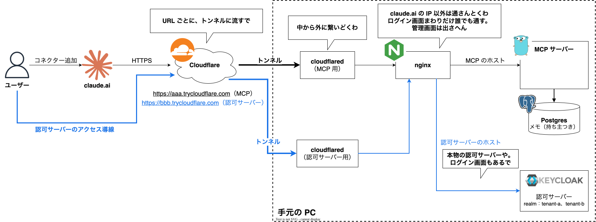

# 12/7 MCP サーバーに認可サーバーを2つ並べても、claude.ai は1つ目しか見ない

記事：https://qiita.com/kou1046/items/15c81d7decf9dddd874e

12/6 の構成で、メモを Postgres に置き、持ち主（トークンの `iss` と `sub`）で絞って、自分のメモだけ読み書きできるようにします。Keycloak には、テナントに見立てた realm を2つ（`tenant-a`、`tenant-b`）作り、MCP サーバーのメタデータの `authorization_servers` に両方を並べて、claude.ai がどちらへ行くかを試します。

## 動かす

Docker、make、jq が要ります。

```sh
make tunnel   # MCP サーバー・Postgres・Keycloak・nginx・cloudflared（2本）を立ち上げて、登録する URL とパスワードを表示する
make logs     # 届いたリクエストのログを見る
make down     # 試し終わったら、必ずトンネルごと止める
```

`make tunnel` が表示する `https://….trycloudflare.com/mcp` を、claude.ai のカスタムコネクターに登録します。ログインに使うユーザーは3人です。パスワードは起動のたびにランダムに作り、表示したうえで `.passwords` にも書き出します（リポジトリには入れません）。

| realm | ユーザー |
|---|---|
| `tenant-a` | `alice`、`bob` |
| `tenant-b` | `carol` |

認可サーバーの並び順を変えたり、止めたりする実験は、トンネルを立てたまま行います。

```sh
make order REALMS=tenant-b,tenant-a   # authorization_servers の並び順を入れ替える（MCP サーバーだけ作り直す）
make order                            # 元の順（tenant-a、tenant-b）に戻す
make realm-off REALM=tenant-b         # その realm へのリクエストに、nginx で 503 を返す（認可サーバーが止まって見える）
make realm-on REALM=tenant-b          # 戻す
```

claude.ai は、一度繋いだ MCP サーバーの URL では、前に使った認可サーバーを覚えています。並び順を変えて試すときは、MCP サーバーのトンネルを立て直して、新しい URL で登録してください。

nginx のログには `/token` の本文（`code`、`code_verifier`、リフレッシュトークン、シークレットなど）が出ます。試し終わったら `make down` でログごと消してください。

Keycloak の管理画面は外に出していません。手元の http://127.0.0.1:8180/admin/ から開きます（`admin` / `admin`）。

トンネルを使わずに手元だけで試すなら、こうします。

```sh
make up       # MCP サーバー（127.0.0.1:8080）、Postgres（127.0.0.1:5432）、Keycloak（127.0.0.1:8180）、nginx（127.0.0.1:8081、8082）を立ち上げる
make smoke    # curl で一通り叩く（alice・bob・carol のメモが混ざらないこと）
```

## 構成

<p align="center"></p>

- cloudflared：MCP サーバー用と認可サーバー用の2本（realm が2つでも、Keycloak は1台なので増えない）
- nginx：12/6 と同じ。realm 2つ分の入口を通す。`make realm-off` で、止めた realm に 503 を返す
- MCP サーバー：トークンを確かめたあと、`iss` と `sub` を持ち主にして、自分のメモだけ読み書きさせる。他人のメモの ID には「見つかりません」と返す。`-authorization-server` にカンマ区切りで渡した認可サーバーをすべて信じ、メタデータにもその順で並べる
- Postgres：メモを置く。起動時に `db/schema.sql` を流す。ボリュームは持たないので、作り直すと中身は消える
- Keycloak：realm `tenant-a` と `tenant-b`。どちらも DCR で claude.ai を登録でき、`aud` に MCP サーバーの URL を入れる

SQL は `db/query.sql` に書き、[sqlc](https://sqlc.dev/) で `internal/notes/db` に Go のコードを作っています。SQL を変えたら、作り直してください（作ったコードはリポジトリに入れてあります）。

```sh
docker run --rm -v "$PWD":/src -w /src sqlc/sqlc:1.31.1 generate
```

| パス | 中身 |
|---|---|
| `cmd/mcp/` | MCP サーバー本体（`tools.go` が持ち主で絞るところ、`auth.go` が認可サーバーを選ぶところ） |
| `db/` | テーブル（`schema.sql`）とクエリ（`query.sql`） |
| `internal/notes/` | メモの保存（Postgres。`db/` は sqlc が作ったコード） |
| `deploy/local/` | Docker Compose、nginx の設定、Keycloak の設定スクリプト、realm を止めるスクリプト、smoke テスト |
