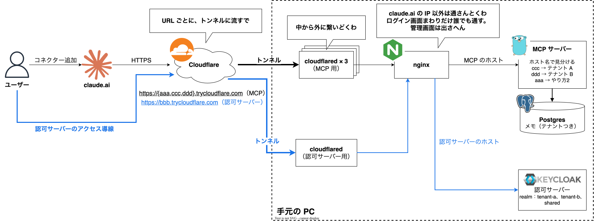

# 12/8 マルチテナントの MCP サーバー、テナントを URL から見るか？ログインから見るか？ claude.ai で両方試す

記事：https://qiita.com/kou1046/items/edd5128cedd69bf2660c

12/7 の構成で、メモをテナントでも絞ります。テナントの選ばせ方を2つ、1つの MCP サーバーにホスト名で同居させて、2つのテナントに属する dave がどう選ぶことになるかを試します。

| | やり方1：URL で選ばせる | やり方2：ログイン画面で選ばせる |
|---|---|---|
| MCP サーバーの URL | テナントごとのホスト（`https://<テナント A のホスト>/mcp` など） | 1つ（`https://<やり方2 のホスト>/mcp`） |
| 認可サーバー | realm `tenant-a`、`tenant-b` | realm `shared`（Organizations をオン） |
| テナントの決め方 | ホスト名と `iss` | トークンの `organization` クレーム |

## 動かす

Docker、make、jq が要ります。

```sh
make tunnel   # MCP サーバー・Postgres・Keycloak・nginx・cloudflared（4本）を立ち上げて、登録する URL とパスワードを表示する
make logs     # 届いたリクエストのログを見る
make down     # 試し終わったら、必ずトンネルごと止める
```

`make tunnel` が表示する URL を、claude.ai のカスタムコネクターに登録します。URL は3つ出ます。

- やり方1：テナント A 用とテナント B 用の `https://….trycloudflare.com/mcp`（ホストが別々）
- やり方2：`https://….trycloudflare.com/mcp`

ログインに使うユーザーは、次のとおりです。パスワードは起動のたびにランダムに作り、表示したうえで `.passwords` にも書き出します（リポジトリには入れません）。

| realm | ユーザー |
|---|---|
| `tenant-a` | `alice`、`bob`、`dave` |
| `tenant-b` | `carol`、`dave` |
| `shared` | `alice`（組織 `tenant-a`）、`dave`（組織 `tenant-a` と `tenant-b`） |

`dave` は、やり方1 では realm ごとに別のアカウントです（パスワードも別）。やり方2 では、1つのアカウントで2つの組織に属します。

nginx のログには `/token` の本文（`code`、`code_verifier`、リフレッシュトークン、シークレットなど）が出ます。試し終わったら `make down` でログごと消してください。

Keycloak の管理画面は外に出していません。手元の http://127.0.0.1:8180/admin/ から開きます（`admin` / `admin`）。

トンネルを使わずに手元だけで試すなら、こうします。

```sh
make up       # MCP サーバー（127.0.0.1:8080）、Postgres（127.0.0.1:5432）、Keycloak（127.0.0.1:8180）、nginx（127.0.0.1:8081、8082）を立ち上げる
make smoke    # curl で一通り叩く（テナントと持ち主の両方で絞られていること）
```

## 構成

<p align="center"></p>

- cloudflared：MCP サーバー用が3本（やり方2 用、テナント A 用、テナント B 用）と、認可サーバー用が1本
  - はじめはパス（`/t/tenant-a/mcp`）でテナントを分けたが、claude.ai ではログインまで進んだあと繋がらなかった。そのため、ホスト名で分けている
- nginx：12/7 と同じ。MCP のトンネル3本は、同じ口（80）で受ける。realm 3つ分の入口を通す
- MCP サーバー：ホストごとに、メタデータ・信じる認可サーバー（`iss`）・自分の URL（`aud`）が違う。トークンを確かめたあと、テナントを決めて、テナントと持ち主（`iss` と `sub`）でメモを絞る
  - やり方1：テナントはホスト名で決まる。そのホストには、そのテナントの realm のトークンしか通さない
  - やり方2：テナントはトークンの `organization` クレームで決まる。1つならそれ、2つ以上ならツールの引数 `tenant` をクレームと突き合わせる、なければ「テナントがわかりません」
  - ツールの結果には、どのテナントとして読み書きしたか（`tenant`）を入れる
- Postgres：メモを置く。`notes` に `tenant` の列がある。起動時に `db/schema.sql` を流す。ボリュームは持たないので、作り直すと中身は消える
- Keycloak：realm `tenant-a`、`tenant-b`、`shared`。どれも DCR で claude.ai を登録でき、`aud` に、その realm 用の MCP サーバーの URL を入れる。`shared` には組織 `tenant-a` と `tenant-b` がある

SQL は `db/query.sql` に書き、[sqlc](https://sqlc.dev/) で `internal/notes/db` に Go のコードを作っています。SQL を変えたら、作り直してください（作ったコードはリポジトリに入れてあります）。

```sh
docker run --rm -v "$PWD":/src -w /src sqlc/sqlc:1.31.1 generate
```

| パス | 中身 |
|---|---|
| `cmd/mcp/` | MCP サーバー本体（`main.go` がホスト名の出し分け、`auth.go` がホストごとのトークンの検証、`tools.go` がテナントを決めて絞るところ） |
| `db/` | テーブル（`schema.sql`）とクエリ（`query.sql`） |
| `internal/notes/` | メモの保存（Postgres。`db/` は sqlc が作ったコード） |
| `deploy/local/` | Docker Compose、nginx の設定、Keycloak の設定スクリプト、smoke テスト |
