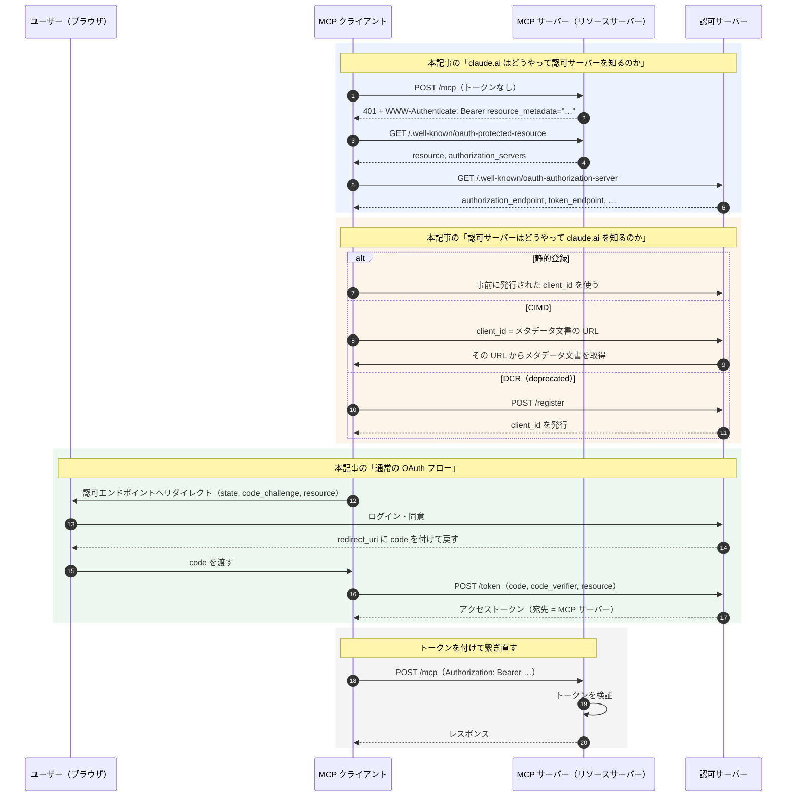

## 今日の問い

みなさん、claude.ai でコネクターを追加したことはありますか？コネクターの一覧は https://claude.ai/plugins から開けます。追加の仕方は大きく2つあります。

- 公式コネクター：Google や GitHub など、Claude が公式に用意しているもの。一覧から選んで「連携」を押すと OAuth の認可画面が表示される。


***図1：公式コネクター。「連携」を押すと Google の同意画面が開く***

- カスタムコネクター：自作の MCP サーバーや、まだ公式として用意されていない MCP サーバーを、`https://` の URL を入力して登録するもの


***図2：カスタムコネクターの追加画面。名前と URL を入れて「続ける」を押すと、認証の設定が出る***

公式コネクターは、Claude 側であらかじめ連携の準備がされているので、利用者は「連携」を押すだけで済みます。この記事で扱うのは、もう一方のカスタムコネクターの方です。

ちなみに、カスタムコネクターの正体は remote の MCP サーバーで、入力する URL は MCP サーバーの URL そのものです。以降は、画面の名前を指すとき以外は「MCP サーバー」と呼びます。

図2を見ると、カスタムコネクターには設定項目が色々あることがわかりますね。

- 認証：今すぐサインイン／必要なときにサインイン／サインインなし
- OAuth クライアント：Claude の公開アイデンティティを使用／自動的に登録／独自の OAuth クライアントを使用する
- リクエストヘッダー：最大4つまで追加できる

どれを選べばいいのでしょうか。そもそも、それぞれの設定項目は何なのでしょうか。この記事では、このうち OAuth クライアントに絞って見ていきます。

この OAuth クライアントの設定によって、URL を入力して「追加」を押してから、ログイン画面が出るまでの「裏の流れ」が変わってきます。ここで、claude.ai が知っているのは入力した URL だけです。「その URL に問い合わせに行けばいいだけでは？」と思うかもしれませんね。それは半分正解で、claude.ai はまず、入力された URL に問い合わせに行きます。

ただ、その URL にいるのは MCP サーバーです。MCP サーバーがログイン画面（view）を返すことは考えにくいですよね。claude.ai は、なんらかの手段でその URL から MCP の認可サーバーを特定し、ログイン画面の view を受け取っているはずです。

では、claude.ai はどうやって認可サーバーを特定しているのでしょうか。

## claude.ai が認可サーバーにたどり着くまで

ここでは MCP 仕様 **2026-07-28** の [Authorization](https://modelcontextprotocol.io/specification/2026-07-28/basic/authorization) を前提にします。

<!-- TODO(執筆時に確認): 12/1 時点の最新版。新しい版が出ていたら差分を一言書く -->

### claude.ai はどうやって認可サーバーを知るのか

答えは、「MCP サーバー自身が教えてくれる」です。


***図3：claude.ai は MCP サーバー、認可サーバーの順に問い合わせて、ログイン画面の場所までたどり着く***

① ユーザーが、MCP サーバーの URL を claude.ai に登録します。claude.ai が知っているのは、この URL だけです。

② claude.ai は、まずトークンを持たずに MCP サーバーへリクエストを送ります。認可が必要な MCP サーバーは、ここで 401 を返し、`WWW-Authenticate` ヘッダーで「自分の情報はここにあるよ」という URL を伝えます。

```http
HTTP/1.1 401 Unauthorized
WWW-Authenticate: Bearer resource_metadata="https://mcp.example.com/.well-known/oauth-protected-resource"
```

その URL を取りに行くと、MCP サーバーのメタデータが返ってきます。ここに、認可サーバーの URL が書かれています。この仕組みは [RFC 9728（OAuth 2.0 Protected Resource Metadata）](https://www.rfc-editor.org/rfc/rfc9728)で決められています。

```json
{
  "resource": "https://mcp.example.com/mcp",
  "authorization_servers": ["https://auth.example.com"]
}
```

③ 認可サーバーの URL が分かったら、次は認可サーバーのメタデータを取りに行きます。こちらは [RFC 8414（OAuth 2.0 Authorization Server Metadata）](https://www.rfc-editor.org/rfc/rfc8414)で決められていて、ログイン画面（認可エンドポイント）やトークン発行（トークンエンドポイント）の URL が書かれています。

```json
{
  "issuer": "https://auth.example.com",
  "authorization_endpoint": "https://auth.example.com/authorize",
  "token_endpoint": "https://auth.example.com/token",
  "registration_endpoint": "https://auth.example.com/register",
  "client_id_metadata_document_supported": true
}
```

MCP サーバーのメタデータ、認可サーバーのメタデータと2段階たどることで、claude.ai は URL 1つからログイン画面の場所までたどり着けるわけですね。

### 認可サーバーはどうやって claude.ai を知るのか

ログイン画面の場所が分かっても、まだすぐにはログインに進めません。OAuth では、認可サーバーが「どのクライアントからの依頼か」を知っている必要があるからです。具体的には、クライアントの ID（`client_id`）と、ログイン後に戻る先（`redirect_uri`）です。

ここで、OAuth のクライアントは claude.ai です。では、claude.ai の client ID（とシークレット）は、いつ、誰が発行したのでしょうか。従来の OAuth では、クライアントの開発者が認可サーバーの管理画面で、事前に登録しておくのが普通でした。ただ、MCP ではこれが難しくなります。なぜか。

**MCP サーバーは無数にあって、認可サーバーもそれぞれ別です。claude.ai がそのすべてを事前に登録しておくことはできませんし、MCP サーバーの側も、繋いでくるかもしれないクライアントを全部登録しておくわけにはいきません。**

来るかもしれないクライアントを全部事前に登録しておくのは、現実的ではありませんよね。

そこで出てくるのが、図2の「OAuth クライアント」の3択です。claude.ai が認可サーバーにどう名乗るかを、この設定で選んでいます。


***図4：OAuth クライアントの設定で選ぶ3つの方式。認可サーバーのクライアント一覧の増え方が違う***

図4のいちばん下の段、認可サーバーのクライアント一覧に注目してみてください。方式によって、一覧の増え方がまったく違いますね。1つずつ見ていきましょう。

#### 静的登録

仕様：[RFC 6749 Section 2（Client Registration）](https://www.rfc-editor.org/rfc/rfc6749#section-2)。MCP の仕様では pre-registration と呼ばれています。

画面で「独自の OAuth クライアントを使用する」を選ぶと、OAuth クライアント ID（と、必要ならシークレット）の入力欄が出てきます。ここに入れるのは、認可サーバーの管理者が、あらかじめ claude.ai 用に登録しておいた ID です。

さっきの「claude.ai の client ID は、いつ、誰が発行したのか」への、いちばん素直な答えがこれです。MCP サーバー側の管理者が、事前に発行しておくわけですね。

従来の OAuth と同じやり方なので、仕組みとしては一番わかりやすいです。誰をクライアントとして認めるか、ログイン後にどこへ戻してよいかを、管理者が完全に握れるのも安心なところですね。

ただ、例えば企業向けに MCP サーバーを提供する場合、静的登録だとどうなるでしょうか。ちょっと考えてみてください。

企業向けのサービスでは、顧客企業ごとに認可サーバーを分けていることがよくあります。Keycloak なら realm、Okta なら org を、企業ごとに用意するイメージです。そして client ID は、発行した認可サーバーの中でしか通用しません。

この前提の場合、MCP 提供者は、**顧客企業ごとに client ID とシークレットを発行して、その企業の管理者に渡す必要があります**。顧客が数社ならまだしも、数十社、数百社と増えていったら……。契約のたびに、発行して渡す作業が人手で発生しますよね。しかも claude.ai 以外のクライアントから使いたいという声もいくらでも来ます。そうなると（顧客企業 × クライアントの数）だけ発行しないといけないわけで、手が追いつかなくなるのは目に見えています。

#### DCR

仕様：[RFC 7591（OAuth 2.0 Dynamic Client Registration Protocol）](https://www.rfc-editor.org/rfc/rfc7591)

静的登録の手間をなくすには、クライアントが自分で自分を登録できればいいですよね。それを実現するのが、DCR（Dynamic Client Registration）です。画面で「自動的に登録」を選ぶと、claude.ai が認可サーバーの登録エンドポイント（`POST /register`）を呼んで、自分で自分を登録します。

最初の問い「claude.ai の client ID は、いつ、誰が発行したのか」に当てはめると、DCR の答えは「接続したその場で、認可サーバー自身が発行する」です。「無数の MCP サーバー × 無数のクライアント」の組み合わせを、人の手ではなく、自動で埋めていく仕組みと言えます。

DCR 自体は、新しい仕組みではありません。RFC 7591 として策定されたのは 2015 年です。私も最初は MCP の登場で追加されたものだと思っていたのですが、実は昔からある仕組みなんですね。どんなクライアントが来るか分からない MCP では、「事前に登録しておけない」という悩みがまさにど真ん中にあるので、改めて注目されるようになったと言えそうです。

**動的登録になるので手間はなくなります。ただし、claude.ai は接続のたびに登録しに来るので、そのたびに認可サーバーにクライアントが作られていきます。同じ claude.ai なのに、認可サーバーから見ると別々のクライアントがずらりと並ぶわけです**。

図2の画面にも「アクセスの多いサーバーでは多数のクライアント登録が作成されます」と注意書きがありましたね。

そのせいもあってか、今の MCP 仕様では、DCR はもう主役ではありません。[2025-11-25 の仕様](https://modelcontextprotocol.io/specification/2025-11-25/basic/authorization)で推奨（SHOULD）が次の CIMD に移り、DCR は後方互換のための任意（MAY）の扱いになりました。さらに最新の [2026-07-28 の仕様](https://modelcontextprotocol.io/specification/2026-07-28/basic/authorization)では、DCR ははっきり非推奨（deprecated）とされ、「CIMD に対応していない認可サーバーとの後方互換のために残している」という位置づけです。

#### CIMD

仕様：[OAuth Client ID Metadata Document（Internet-Draft）](https://datatracker.ietf.org/doc/draft-ietf-oauth-client-id-metadata-document/)

「Claude の公開アイデンティティを使用」を選ぶと、CIMD（Client ID Metadata Document）になります。claude.ai の default もこれです。

CIMD では、`client_id` が URL そのものになります。claude.ai は、その URL に自分の自己紹介を書いた JSON 文書を置いています。実際に https://claude.ai/oauth/mcp-oauth-client-metadata を開いてみると、こんな中身が返ってきます（2026年11月時点）。

```json
{
  "client_id": "https://claude.ai/oauth/mcp-oauth-client-metadata",
  "client_name": "Claude",
  "client_uri": "https://claude.ai",
  "redirect_uris": ["https://claude.ai/api/mcp/auth_callback"],
  "grant_types": ["authorization_code", "refresh_token", "urn:ietf:params:oauth:grant-type:jwt-bearer"],
  "response_types": ["code"],
  "token_endpoint_auth_method": "none"
}
```

`client_id` に、この文書自身の URL が書かれているのが面白いところですね。ChatGPT も同じように、https://chatgpt.com/oauth/client.json で自分の文書を公開しています。

認可サーバーは、登録を受け付ける代わりに、`client_id` として渡された URL をその場で取りに行き、「名前は Claude、戻り先はここ」と確認します。この文書は claude.ai のソフトウェアとして1枚だけなので、**ユーザーが何人いても、何回繋いでも、認可サーバーのクライアント一覧は増えません**。DCR が「来店のたびに会員登録させられて、店の台帳が埋まっていく」方式だとすると、CIMD は「名刺の URL を見せたら、店がその場で確かめるだけ」の方式です。

いいことずくめに見えますが、代わりに考えることも増えます。認可サーバーが、クライアントに言われた URL を取りに行くことになるので、内部のアドレスを指定されると SSRF の入口になりかねません。また、「その URL のドメインを持っている人がそのクライアント」という扱いになるので、どのドメインを信頼するかは認可サーバー側で決める必要があります。

### 通常の OAuth フロー

仕様：[OAuth 2.1（Internet-Draft）](https://datatracker.ietf.org/doc/draft-ietf-oauth-v2-1/)

クライアントの名乗り方が決まれば、そこから先は MCP 独自の仕組みではなく、おなじみの OAuth 2.1 の認可コードフローです。


***図5：認可コードフロー。引換券（code）と合言葉（code_verifier）でトークンを受け取り、MCP サーバーに繋ぎ直す***

1. claude.ai が、ユーザーのブラウザを認可サーバーのログイン画面へリダイレクトする
2. ユーザーがログインし、アクセスを許可する
3. 認可サーバーが、ブラウザを claude.ai の `redirect_uri` に戻す。このとき、URL に認可コード（`code`）が付いている
4. claude.ai が、認可コードを認可サーバーのトークンエンドポイントに渡し、アクセストークンと交換する
5. claude.ai が、アクセストークンを付けて MCP サーバーにリクエストし直す

OAuth 2.1 では、[PKCE（RFC 7636）](https://www.rfc-editor.org/rfc/rfc7636)（認可コードの横取り対策）がすべてのクライアントに必須になっています。MCP はそれをそのまま受け継いだうえで、`resource` パラメーター（[RFC 8707](https://www.rfc-editor.org/rfc/rfc8707)）を必ず付けて、「このトークンはどの MCP サーバー宛てか」を指定する決まりを足しています。

ちなみに、ログイン画面を開くのは claude.ai ではなく、ユーザーのブラウザです。

### まとめ：全体のシーケンス

ここまでの流れを1枚の図にすると、こうなります。



登場した仕様をまとめると、こんな感じです。MCP の認可は、[OAuth 2.1](https://datatracker.ietf.org/doc/draft-ietf-oauth-v2-1/) をベースに、これらの RFC やドラフトを組み合わせてできています。

| 役割 | 仕様 |
| --- | --- |
| MCP サーバーが「自分の認可サーバーはここ」と広告する | [RFC 9728 OAuth 2.0 Protected Resource Metadata](https://www.rfc-editor.org/rfc/rfc9728) |
| 認可サーバーが自分のエンドポイントを広告する | [RFC 8414](https://www.rfc-editor.org/rfc/rfc8414) / [OpenID Connect Discovery](https://openid.net/specs/openid-connect-discovery-1_0.html) |
| クライアント登録 | 静的登録（[RFC 6749 Section 2](https://www.rfc-editor.org/rfc/rfc6749#section-2)）/ [CIMD](https://datatracker.ietf.org/doc/draft-ietf-oauth-client-id-metadata-document/) / [RFC 7591 DCR](https://www.rfc-editor.org/rfc/rfc7591)（deprecated） |
| 認可コードの横取り対策 | [PKCE（RFC 7636）](https://www.rfc-editor.org/rfc/rfc7636)（S256 必須） |
| トークンの宛先を MCP サーバーに縛る | [RFC 8707 Resource Indicators](https://www.rfc-editor.org/rfc/rfc8707) |

## 感想

ここまで調べてみての、個人的な感想を2つ書いておきます。

### クライアントは claude.ai であり、自社のアプリではない

OAuth の登場人物を、よくある自社サービスと比べてみましょう。

| OAuth の役割 | 自社サービスでよくある形 | 今回（MCP） |
| --- | --- | --- |
| エンドユーザー | 自社サービスのユーザー | claude.ai を使うユーザー |
| クライアント | 自社のアプリ（Web / スマホ） | claude.ai（他社のソフトウェア） |
| 認可サーバー | 状況による（自前、IDaaS など） | 状況による（自前、IDaaS など） |
| リソースサーバー | 自社の API | 自分の MCP サーバー |

自社サービスで OAuth を使うときは、クライアントも自分たちで作っていることが多いですよね。全部が身内なので、クライアントは信用できますし、事前に登録しておくのも簡単です。

MCP では、クライアントは claude.ai です。自分が作るのは MCP サーバーの側で、クライアントは他社のソフトウェアになります。しかも、事前に何の関係もないクライアントが、URL を知っているだけでやってきます。図4で見た「認可サーバーはどうやって claude.ai を知るのか」がそもそも問題になるのは、このためなんですね。

### クライアントによって、対応も設定もまちまち

この記事では claude.ai を例にしましたが、MCP のクライアントは claude.ai だけではありません。そして、クライアントによって対応している方式も、設定項目もまちまちです。たとえば同じ Anthropic でも、Claude Code は claude.ai とは別の CIMD の文書を使い、戻り先も手元のマシン（loopback）です。ChatGPT は CIMD でも、シークレットの代わりに署名でクライアントを証明する方式（`private_key_jwt`）に対応しています。

気になったので、主なクライアントが今回紹介した3つの方式に対応しているかを調べてみました（2026年11月時点。各クライアントの公式ドキュメントやソースコードで確認）。

| クライアント | 静的登録 | DCR | CIMD |
| --- | --- | --- | --- |
| claude.ai | 対応 | 対応 | 対応 |
| Claude Code | 対応 | 対応 | 対応 |
| ChatGPT | 対応 | 対応 | 対応 |
| Codex CLI | 対応 | 対応 | 対応 |
| VS Code（GitHub Copilot） | 対応 | 対応 | 対応（※） |
| Cursor | 対応 | 対応 | 不明 |
| Gemini CLI | 対応 | 対応 | 非対応 |
| Zed | 不明 | 対応 | 対応 |

※ ソースコード上は対応していますが、公式ドキュメントにはまだ書かれていません。

（Meta の Muse も調べてみたのですが、MCP の OAuth についての情報は見つかりませんでした……）

DCR はどのクライアントも対応しているのに対して、CIMD はまだばらつきがあります。また、静的登録は claude.ai のように画面で入力できるものもあれば、Cursor や Gemini CLI のように設定ファイルにしか書けないものもあります。

**MCP サーバーを公開するなら、こうしたいろいろなクライアントが来ることを前提に考える必要がありそうです。**

## 次回

次回は、認可はいったん脇に置いて、claude.ai に登録できる MCP サーバーを自作してみます。SDK は使わず、生の JSON-RPC で `initialize` から `tools/call` までの4つのメッセージに応えるだけの、最低限のものです。

