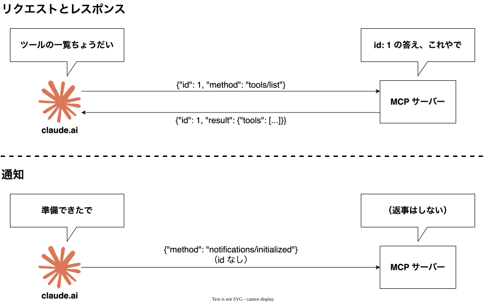
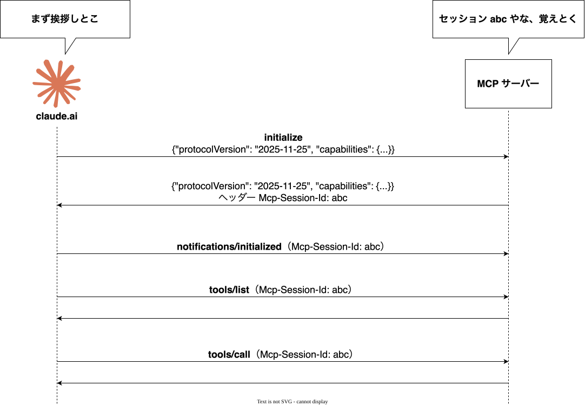
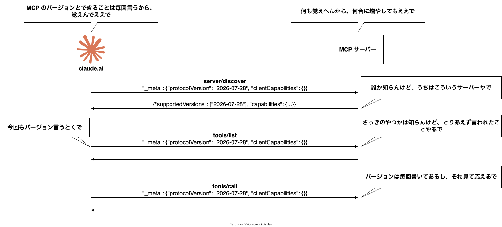
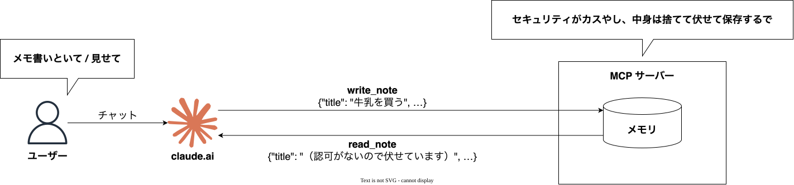
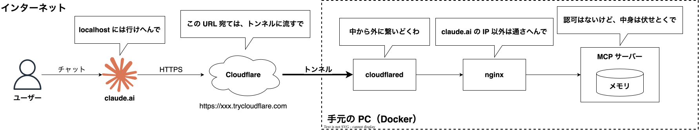
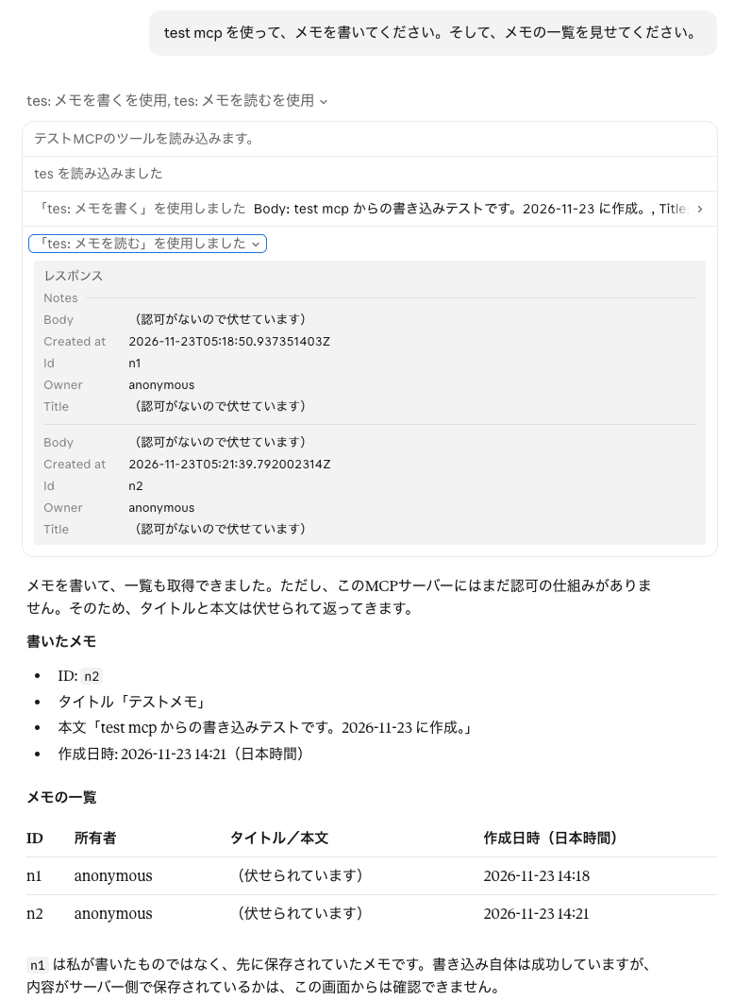
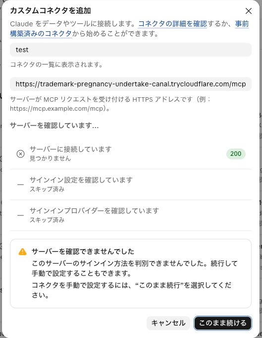
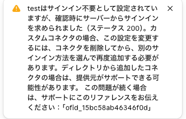
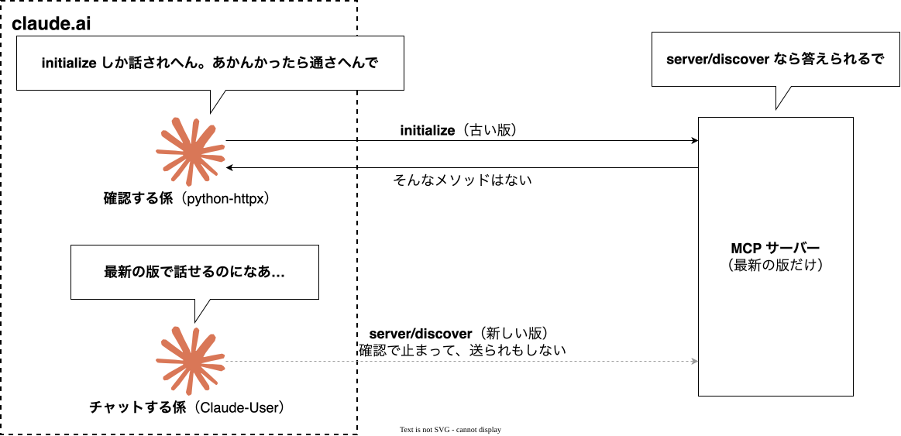

## 今日の問い

[前回](https://qiita.com/kou1046/items/8a45872acc41e9d14919)は、claude.ai にカスタムコネクターを登録するとき、裏で何が起きているのかを見ました。今回は認可をいったん脇に置いて、もっと手前のところを確かめてみます。

MCP サーバーとして claude.ai に認識してもらうには、最低限なにが要るのでしょうか。

SDK を使えば数行で書けてしまいますが、それだと中で何が行き来しているのかが見えませんよね。なので今回は、SDK を使わずに JSON-RPC を直接書いて、Go で MCP サーバーを作ってみます。ツールはメモを読む `read_note` と、書く `write_note` の2つだけです。

今回作るのは、「誰でも叩ける場所に置かれた、認可のない MCP サーバー」です。OAuth はまだ導入しません。まずは、これを動くところまで持っていきます。

## claude.ai に登録できる MCP サーバーに最低限要るもの

要るものは、大きく2つに分かれます。MCP として正しく話せること（プロトコルの要件）と、claude.ai から届く場所にいること（ネットワークの要件）です。

### プロトコルの要件

仕様：[MCP 2026-07-28](https://modelcontextprotocol.io/specification/2026-07-28)

#### JSON-RPC で話す

MCP のメッセージは [JSON-RPC 2.0](https://www.jsonrpc.org/specification) です。やりとりするメッセージは3種類あります。

- リクエスト：MCP サーバーに何かしてほしいときに送る。`id` と `method` を持ち、必ず返事が来る
- レスポンス：リクエストへの答え。同じ `id` に、`result`（成功）か `error`（失敗）を載せて返す
- 通知：MCP サーバーに伝えるだけで、返事のいらないときに送る。`id` がない。MCP の仕様では名前が `notifications/` で始まる

<p align="center"></p>
<p align="center"><sub>図1：リクエストには同じ id でレスポンスが返り、通知には返事がない</sub></p>

上から順に、リクエスト、レスポンス、通知の例です。

```json
{"jsonrpc": "2.0", "id": 1, "method": "tools/list", "params": {}}
{"jsonrpc": "2.0", "id": 1, "result": {"tools": []}}
{"jsonrpc": "2.0", "method": "notifications/initialized"}
```

remote の MCP サーバーでは、これを HTTP に載せます。1つの URL で POST を受けて、本文のメッセージに応えます。リクエストならレスポンスを返し（`application/json` か、SSE の `text/event-stream`）、通知なら本文なしの 202 を返すだけです。ここは最新の版でも変わりません。

#### 以前の流れ：最初に initialize する

変わったのは、会話の始め方です。2025-11-25 までの MCP は、最初に `initialize` でバージョンや機能を交換してから、ツールを呼ぶ流れでした。

<p align="center"></p>
<p align="center"><sub>図2：以前の流れ。initialize で決めたことを、サーバーがセッションとして覚えておく</sub></p>

この `initialize` は、JSON-RPC ではなく MCP が決めていたルールです。エディタと言語サーバーをつなぐ [LSP](https://microsoft.github.io/language-server-protocol/) にならった形で、最初に挨拶して「どの版で話すか」「お互い何ができるか」を決めてから、本題に入っていました。続く `notifications/initialized` は、さっきの通知です。「準備できました」と伝えるだけで、返事は待ちません。

ただ、決めた内容をサーバーが会話の間ずっと覚えておく必要があり、そのためにセッション ID も要っていました。これだとスケールさせにくそうです。サーバーを何台かに増やすと、同じセッションのリクエストを、覚えているサーバーに届け続けるか、セッションをサーバー同士で共有する仕組みが要ります。

#### 最新の流れ：毎回のリクエストで名乗る

ところが、最新の 2026-07-28 では、この `initialize` がなくなっています。代わりに、毎回のリクエストの `_meta` に、プロトコルのバージョンとクライアントの機能を載せます。

```json
{
  "jsonrpc": "2.0",
  "id": 2,
  "method": "tools/list",
  "params": {
    "_meta": {
      "io.modelcontextprotocol/protocolVersion": "2026-07-28",
      "io.modelcontextprotocol/clientCapabilities": {}
    }
  }
}
```

1回1回のリクエストで話が完結するので、サーバーは前のリクエストを覚えておく必要がありません。セッション ID（`Mcp-Session-Id`）も廃止されました。サーバーを何台に増やしても、どれが受けてもいいわけですね。

<p align="center"></p>
<p align="center"><sub>図3：最新の流れ。毎回 _meta で名乗るので、サーバーは何も覚えなくていい（キーの接頭辞 io.modelcontextprotocol/ は省略）</sub></p>

最新の版で、サーバーが応えるべきメソッドはこの3つです。

| メソッド | 役割 |
|---|---|
| `server/discover` | サーバーの名前、対応している版、機能（ツールを持っている、など）を返す。`initialize` の代わり |
| `tools/list` | ツールの一覧と、それぞれの引数の形（JSON Schema）を返す |
| `tools/call` | ツールを実行して、結果を返す |

HTTP のヘッダーにも決まりが増えています。`MCP-Protocol-Version`、`Mcp-Method`、`tools/call` なら `Mcp-Name` を付けて、本文の中身と同じ値にします。本文を読まずに振り分けたいプロキシのためのもので、食い違っていたらサーバーは 400 で断ります。

### ネットワークの要件

出典：[claude.ai のコネクターのトラブルシューティング](https://claude.com/docs/connectors/building/troubleshooting)

claude.ai は、手元の PC ではなく Anthropic のサーバーから繋いできます。なので、プロトコルを正しく話せても、届かなければ意味がありません。

- インターネットから届く `https://` の URL があること。`localhost` やプライベートなアドレス（`192.168.x.x` など）に解決される URL は、claude.ai の側で断られます
- IPv4 で届くこと。コネクターは IPv4 にしか繋がないので、IPv6 だけのホストには届きません
- 前に WAF やファイアウォールを置くなら、Anthropic が繋ぎに来る IP の範囲（[公開されています](https://platform.claude.com/docs/en/api/ip-addresses)）を通すこと

## 作ってみる

作るのは、メモを読み書きするだけの MCP サーバーです。サーバーは手元の PC で動かして、claude.ai から届くように、試すあいだだけインターネットに公開します。

ツールは2つです。

| ツール | 画面での名前 | 引数 | すること |
|---|---|---|---|
| `read_note` | メモを読む | `id`（省略できる） | `id` を渡すとその1件、省略すると一覧を返す |
| `write_note` | メモを書く | `title`、`body` | 新しいメモを書いて、その ID を返す |

メモはサーバーのメモリに置くだけなので、止めると消えます。誰でも書ける場所に出すので、タイトルは 100 文字、本文は 2000 文字までにしています。

もう1つ、今は認可なしで一般公開しているので、セキュリティはほぼありません。誰が何を書いてくるかわからず、書いたものも読んだものも、色々なプロンプトインジェクションの入り口になります。なので、認可を実装するまでは、タイトルと本文を全部伏せることにします。メモ自体は保存しますが、書かれたタイトルと本文は捨てて、伏せた文言に置き換えて保存します。

<p align="center"></p>
<p align="center"><sub>図4：作成する MCP サーバー</sub></p>

```json
{"id": "n1", "owner": "anonymous", "title": "（認可がないので伏せています）", "body": "（認可がないので伏せています）", "created_at": "…"}
```

### 公開する

<p align="center"></p>
<p align="center"><sub>図5：トンネルの URL を claude.ai に登録すると、Cloudflare → cloudflared → nginx を通って手元の MCP サーバーに届く</sub></p>

ネットワークの要件を満たすために、Cloudflare のトンネル（cloudflared）で一時的に外へ出しました。`https://….trycloudflare.com` の URL がもらえて、IPv4 でも届きます。

ただ、OAuth を使っていないので、URL を知っていれば誰でも書き込めてしまいます。そこで、前に nginx を置いて、claude.ai が繋ぎに来る IP の範囲だけを通しています。試し終わったら、トンネルは閉じておきましょう。

### 実際に作ったもの

作ったものはこちらです。

- https://github.com/kou1046/advent2026-mcp-authz/tree/main/days/12-02-minimal-mcp
<!-- TODO: リポジトリを公開したら、リンクが開けるか確かめる -->

Docker と make があれば、このディレクトリで同じものを動かせます。

```sh
make tunnel   # MCP サーバー・nginx・cloudflared を立ち上げて、登録する URL を表示する
make logs     # 届いたリクエストのログを見る
make down     # 試し終わったら、トンネルごと止める
```

`make tunnel` が表示する `https://….trycloudflare.com/mcp` を、claude.ai のカスタムコネクターに「サインインなし」で登録すれば繋がります。

## claude.ai から繋いでみる

カスタムコネクターに、トンネルの URL を「サインインなし」で登録しました。

### ツールを使わせてみる

チャットで「メモを書いて、それから一覧を見せて」と頼んでみました。

<p align="center"></p>
<p align="center"><sub>図6：「メモを書く」「メモを読む」を順に使ってくれた。「メモを読む」のレスポンスでは、タイトルと本文が伏せられている</sub></p>

画面には、ツール名の `write_note` ではなく「メモを書く」と出ていますね。`tools/list` で返した `title` が、そのまま表示に使われています。

「メモを読む」を開くと、サーバーが返したレスポンスがそのまま見られます。タイトルと本文は、ちゃんと伏せられていますね。「書いたメモ」の欄に中身が出ているのは、Claude が自分で送った内容を覚えているだけで、サーバーから返ってきたものではありません。

一覧には、Claude が書いた `n2` のほかに、`n1` も並んでいます。これは、その少し前に手元から curl で書いたメモです。どちらも `owner` は `anonymous` で、Claude も「`n1` は私が書いたものではない」としか言えていません。認証がないので、誰が書いたのかはサーバーにもわからないわけですね。

### 届いたリクエストを見てみる

裏でサーバーに何が届いていたのかも見てみます。まずは、登録したときです。

| 時刻 (UTC) | User-Agent | 版 | メソッド |
|---|---|---|---|
| 05:21:04 | python-httpx/0.28.1 | 2025-11-25 | `initialize` |
| 05:21:09 | python-httpx/0.28.1 | 2025-11-25 | `initialize` |
| 05:21:09 | Claude-User | 2026-07-28 | `server/discover` |
| 05:21:10 | Claude-User | 2026-07-28 | `tools/list` |
| 05:21:11 | Claude-User | 2026-07-28 | `server/discover` |
| 05:21:11 | Claude-User | 2026-07-28 | `tools/list` |

claude.ai は、もう新しい版で話しかけてきていました。`Claude-User` のリクエストは `server/discover` から始まっていて、`initialize` は使っていません。

ただ、その前に、別の User-Agent（`python-httpx`）から、古い版の謎の `initialize` も届いています。送ったきりで続きがないので、登録のときの疎通確認なのかな、と思っていますが、確かめたわけではありません。このサーバーは、`_meta` にバージョンが載っていれば新しい版、載っていなければ古い版として処理するようにしてあるので、こちらにも返事ができています。

続いて、チャットでツールを使ったときです。

| 時刻 (UTC) | メソッド | JSON-RPC の id |
|---|---|---|
| 05:21:35 | `server/discover` | `366981048` |
| 05:21:39 | `server/discover` | `"server-discover-probe-1"` |
| 05:21:39 | `tools/list` | `0` |
| 05:21:39 | `tools/call`（`write_note`） | `1` |
| 05:21:43 | `tools/call`（`read_note`） | `2` |

`server/discover` で確かめて、`tools/list` で一覧を取って、`tools/call` で呼ぶ。さっきの3つのメソッドが、そのまま順に使われています。

## 壊してみる

ここまで、最新の版（2026-07-28）に沿って「最低限要るもの」を見てきました。ところが、さっきのログでは、claude.ai は登録のときに、なぜか古い版の `initialize` も送ってきていました。本当に要るのはどっちなんでしょうか。片方ずつ壊して、claude.ai がどうなるかを見てみます。

### initialize だけ壊す

古い版の `initialize` にだけ、「そんなメソッドはない」と返すようにしました。`server/discover` は、ちゃんと動いたままです。

<!-- TODO: この2枚は initialize と server/discover を両方壊したときのもの（画面は同じ）。initialize だけ壊した版で撮り直すか、このままにするか。トーストの ofid_ は隠す -->

<p align="center"></p>
<p align="center"><sub>図7：「サーバーに接続しています」が「見つかりません」になる</sub></p>

追加のダイアログが、最初の「サーバーに接続しています」で止まりました。このとき届いていたのは、`python-httpx` の謎の `initialize` だけです。この確認の正体は、あの謎の `initialize` だったわけですね。

「このまま続ける」を押せば、手動で「サインインなし」を選んで追加まではできます。ただ、使おうとするとこう言われて、使えませんでした。

<p align="center"></p>
<p align="center"><sub>図8：サインインは求めていないのに、求められたことにされる</sub></p>

`Claude-User` は、最後まで一度も来ませんでした。正常な `server/discover` が待っているのに、呼ばれもしません。

### server/discover だけ壊す

今度は逆に、`server/discover` にだけ「そんなメソッドはない」と返すようにしました。

すると、登録はすんなり通りました。「サインインなし」も、最初から自動で選ばれています。チャットでも、普通にメモを読み書きできました。ログを見ると、こうなっていました。

| 時刻 (UTC) | 版 | メソッド | 返事 |
|---|---|---|---|
| 05:52:45 | 2026-07-28 | `server/discover`（id は `"server-discover-probe-1"`） | 404 |
| 05:52:45 | （なし） | `initialize` | 200 |
| 05:52:45 | 2025-11-25 | `notifications/initialized` | 202 |
| 05:52:46 | 2025-11-25 | `tools/list` | 200 |
| 05:52:46 | 2025-11-25 | `tools/call`（`write_note`） | 200 |
| 05:52:50 | 2025-11-25 | `tools/call`（`read_note`） | 200 |

claude.ai は、まず `server/discover` で新しい版を試して、だめなら `initialize` からの古い版に切り替えていました。`"server-discover-probe-1"` という id は、新しい版で話せるかの「お試し（probe）」だったようです。

| 壊したもの | 登録 | 使えるか |
|---|---|---|
| `initialize` だけ | 確認で止まる（手動で追加はできる） | 使えない |
| `server/discover` だけ | 通る（「サインインなし」も自動で選ばれる） | 使える（古い版で話す） |

### Claude のドキュメントも見てみた

念のため、Claude のコネクターのドキュメント（[Building connectors](https://claude.com/docs/connectors/building) まわり）も見てみました。2026-11-23 時点では、MCP の版は認可の仕様として 2025-11-25 までが挙がっているだけで、2026-07-28 も `server/discover` も出てきません。`initialize` のことは書いてあります。

最新の版に沿ってここまで書いてきましたが、今の claude.ai の本命は、まだ古い版の `initialize` でした。てへ。

## 感想

ログを見る限り、claude.ai の中では、登録のときに `initialize` で確認する係（`python-httpx`）と、チャットのときに話しかけてくる係（`Claude-User`）が分かれているんだろうな、と思います。User-Agent も、使う版も、送ってくるタイミングも違うからです。

そう考えると、いちばん面白かったのは、この2つの係のちぐはぐさです。

<p align="center"></p>
<p align="center"><sub>図9：チャットする係は最新の版で話せるのに、確認する係が古い版しか話せない</sub></p>

チャットする係の `Claude-User` は、新しい版をお試しして、だめなら古い版に落ちる、行儀のいい作りでした。それなのに、確認する係は古い版しか話せません。チャットする係は最新の版に追いついているのに、確認する係だけが取り残されている感じです。最新の版だけを実装したサーバーは、チャットする係が話しかける前に門前払いされてしまいます。

仕様は 2026-07-28 で大きく変わりましたが、クライアントもドキュメントも、まだ移り変わりの途中なんだと思います。仕様を読むだけでは、こういうことはわかりませんでした。SDK を使わずに書いて、届いたリクエストを1つずつ見たからこそ気づけたところです。

## まとめ：claude.ai に登録できる MCP サーバーに最低限要るもの

最新の仕様（2026-07-28）どおりなら、`initialize` はなくなり、`server/discover`・`tools/list`・`tools/call` の3つで足りるはずでした。ところが、2026-11-23 時点の claude.ai で試してみると、本当に最低限要ったのはこうでした。

- 1つの URL で POST を受けて、JSON-RPC で応える
- 古い版の `initialize` に応えて、`notifications/initialized` を受け取る。これがないと、確認する係に止められて、claude.ai は話しかけてこない
- `tools/list`：ツールの一覧と、引数の形（JSON Schema）を返す
- `tools/call`：ツールを実行して、結果を返す
- `server/discover`：あれば、claude.ai は最新の版で話してくれる。なくても古い版で動く

MCP の最新の仕様（2026-07-28）だけを見て実装すると、claude.ai には門前払いされてしまいます。

いちばんの教訓は、MCP サーバーを作る側は、どの版で話しかけられても応えられるようにしておく、ということです。仕様が新しくなっても、クライアントがすぐに追いつくとは限りません。今回は claude.ai で試しましたが、ChatGPT など別のクライアントなら、また違う結果になるはずです。どのクライアントが、どの版で来るかは、サーバーからは選べません。

## 次回

今回のサーバーは、公開されていて、OAuth を使っていません。claude.ai の IP だけに絞ったとはいえ、claude.ai を使う人なら誰でも、URL さえ知っていればこのサーバーに入れます。そして入ってきた人は、サーバーから見ると全員 `anonymous` です。

次回は、このサーバーに「認可が要る」と言わせてみます。401 を返したとき、claude.ai がどこへ何を探しに行くのかを見ていきます。
