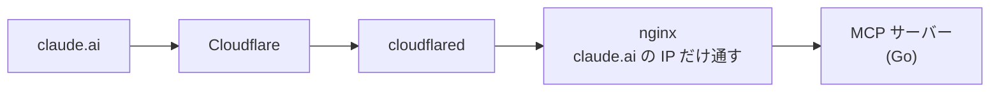

<!-- TODO: タイトルは仮 -->

## 今日の問い

前回は、claude.ai にカスタムコネクターを登録するとき、裏で何が起きているのかを見ました。今回は認可をいったん脇に置いて、もっと手前のところを確かめてみます。

MCP サーバーとして claude.ai に認識してもらうには、最低限なにが要るのでしょうか。

SDK を使えば数行で書けてしまいますが、それだと中で何が行き来しているのかが見えませんよね。なので今回は、SDK を使わずに JSON-RPC を直接書いて、Go で MCP サーバーを作ってみます。ツールはメモを読む `read_note` と、書く `write_note` の2つだけです。

## MCP サーバーに最低限要るもの

仕様：[MCP 2026-07-28](https://modelcontextprotocol.io/specification/2026-07-28)

MCP のメッセージは [JSON-RPC 2.0](https://www.jsonrpc.org/specification) です。remote の MCP サーバーなら、1つの URL で POST を受けて、JSON-RPC のリクエストに JSON-RPC のレスポンスを返します。ここまでは昔から変わりません。

変わったのは、会話の始め方です。2025-11-25 までの MCP は、最初に `initialize` でバージョンや機能を交換してから、ツールを呼ぶ流れでした。

```
initialize → notifications/initialized → tools/list → tools/call
```

ところが、最新の 2026-07-28 では、この `initialize` がなくなっています。代わりに、毎回のリクエストの `_meta` に、プロトコルのバージョンとクライアントの機能を載せます。

```json
{
  "jsonrpc": "2.0",
  "id": 2,
  "method": "tools/list",
  "params": {
    "_meta": {
      "io.modelcontextprotocol/protocolVersion": "2026-07-28",
      "io.modelcontextprotocol/clientCapabilities": {}
    }
  }
}
```

1回1回のリクエストで話が完結するので、サーバーは前のリクエストを覚えておく必要がありません。セッション ID（`Mcp-Session-Id`）も廃止されました。サーバーを何台に増やしても、どれが受けてもいいわけですね。

最新の版で、サーバーが応えるべきメソッドはこの3つです。

| メソッド | 役割 |
|---|---|
| `server/discover` | サーバーの名前、対応している版、機能（ツールを持っている、など）を返す。`initialize` の代わり |
| `tools/list` | ツールの一覧と、それぞれの引数の形（JSON Schema）を返す |
| `tools/call` | ツールを実行して、結果を返す |

HTTP のヘッダーにも決まりが増えています。`MCP-Protocol-Version`、`Mcp-Method`、`tools/call` なら `Mcp-Name` を付けて、本文の中身と同じ値にします。本文を読まずに振り分けたいプロキシのためのもので、食い違っていたらサーバーは 400 で断ります。

<!-- TODO: 他に細かい決まり（resultType、ttlMs / cacheScope、GET は 405、Origin の確認）をどこまで書くか。表にまとめるか削るか -->

## 作ったもの

<!-- TODO: 構成図（draw.io） -->



### 新旧どちらの版にも応える

作り始める前に、気になったことがありました。claude.ai は、もう新しい版で話しかけてくるのでしょうか。まだ `initialize` から始める古い版かもしれませんよね。

わからないので、両方に応えるようにしました。`_meta` にバージョンが載っていれば新しい版として、載っていなければ古い版として処理します。古い版で来たときも、セッション ID は発行せず、状態を持たないまま応えます。

### ツールの失敗と、プロトコルのエラーを分ける

書いていて面白かったのが、エラーの返し方が2種類あることです。

- プロトコルのエラー：知らないツール名や、形の崩れた引数。JSON-RPC の `error` で返す
- ツールとしての失敗：「そのメモは見つからない」「タイトルが長すぎる」。ふつうの結果として返し、`isError: true` を付ける

後者は、LLM に「失敗した理由」を読ませて、言い直させるためのものです。だから `error` ではなく、読める文章として結果に入れるわけですね。

```json
{"content": [{"type": "text", "text": "メモ n9 は見つかりません"}], "isError": true, "resultType": "complete"}
```

### 公開するときの守り

claude.ai は Anthropic のサーバーから繋いでくるので、手元の `localhost` には届きません。なので、Cloudflare のトンネル（cloudflared）で一時的に外へ出しています。

ただ、トンネルの URL は、知っていれば誰でも叩けてしまいます。このサーバーにはまだ認可がないので、何もしなければ書き込み放題です。なので、前に nginx を置いて、claude.ai が繋ぎに来る IP の範囲だけを通すようにしました。範囲は [Anthropic が公開しています](https://platform.claude.com/docs/en/api/ip-addresses)。

```nginx
# cloudflared から来たときだけ、Cloudflare が付ける本当の接続元を信じる。
set_real_ip_from 172.28.0.10;
real_ip_header   CF-Connecting-IP;

allow 160.79.104.0/21;
allow 153.61.208.0/20;
deny  all;
```

`CF-Connecting-IP` はただのヘッダーなので、誰が付けても信じてしまうと、接続元を偽れてしまいます。なので、信じるのは cloudflared のコンテナから来たときだけにしています。実際に、別のコンテナから claude.ai の IP を名乗らせてみると、ちゃんと 403 になりました。

nginx は 1.30.7 を使っています。2026-11 に HTTP/2 まわりの RCE（CVE-2026-123007 など）が直った版です。

これで「claude.ai を通さない人」は弾けます。ただ、claude.ai を使っている人なら、URL さえ知っていれば誰でも入れてしまいます。それがどういうことかは、次回確かめます。試し終わったらトンネルは閉じておきましょう。

## curl で叩いてみる

<!-- TODO: server/discover と tools/list のリクエスト・レスポンスを載せる（長いので一部を省略） -->

## claude.ai から繋いでみる

カスタムコネクターに、トンネルの URL を「サインインなし」で登録してみました。そのときサーバーに届いたリクエストがこちらです。

| 接続元 | User-Agent | 版 | メソッド |
|---|---|---|---|
| 160.79.106.183 | python-httpx/0.28.1 | 2025-11-25 | `initialize` |
| 160.79.106.175 | python-httpx/0.28.1 | 2025-11-25 | `initialize` |
| 160.79.106.181 | Claude-User | 2026-07-28 | `server/discover` |
| 160.79.106.161 | Claude-User | 2026-07-28 | `tools/list` |
| 160.79.106.165 | Claude-User | 2026-07-28 | `server/discover` |
| 160.79.106.24 | Claude-User | 2026-07-28 | `tools/list` |

claude.ai は、もう新しい版で話しかけてきていました。`Claude-User` のリクエストは `server/discover` から始まっていて、`initialize` は使っていません。

ただ、その前に、別の User-Agent（`python-httpx`）から古い版の `initialize` も届いています。こちらは `initialize` を送ったきりで、続きがありません。登録のときの疎通確認なのかな、と思っていますが、確かめたわけではありません。新旧どちらにも応えるようにしておいたので、気づけたところですね。

接続元の IP は、リクエストのたびに変わっていました。どれも公開されている範囲に入っていたので、nginx で絞っても claude.ai は困らないことがわかります。

<!-- TODO: tools/call のログと、claude.ai のチャット画面のスクショ（メモを書かせて、一覧を読ませる） -->

## 壊してみる

<!-- TODO: -break の3つを claude.ai で試した結果
- no-initialize：initialize / server/discover に「そんなメソッドはない」
- bad-version：存在しない版を返す
- bad-schema：inputSchema を null にする
-->

## 感想

<!-- TODO -->

## 次回

今回は claude.ai の IP だけに絞りました。でも、claude.ai を使う人なら誰でも、URL さえ知っていればこのサーバーに入れます。そして入ってきた人は、サーバーから見ると全員 `anonymous` です。

次回は、認可なしで公開するとどうなるのかを、実際に見てみます。
