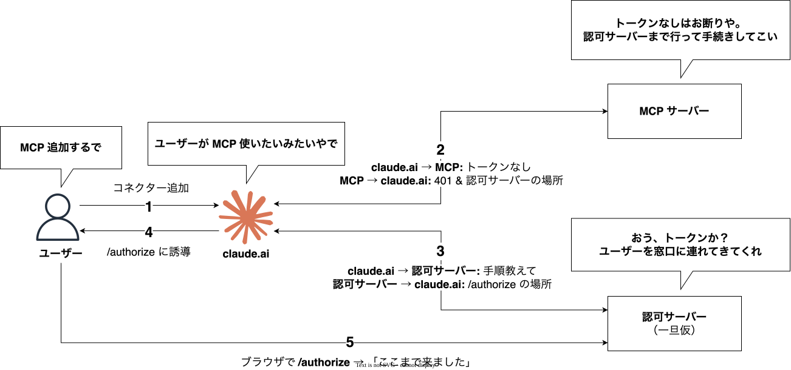
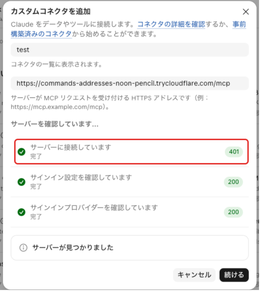
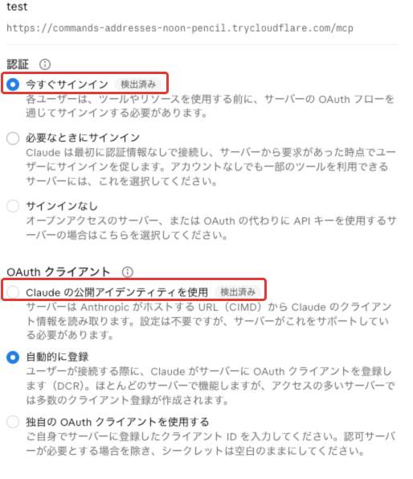
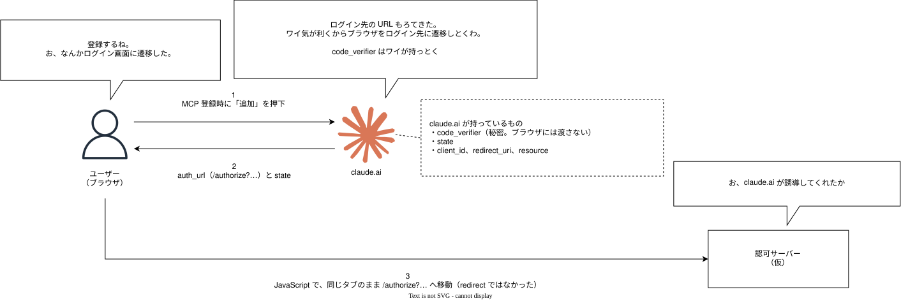
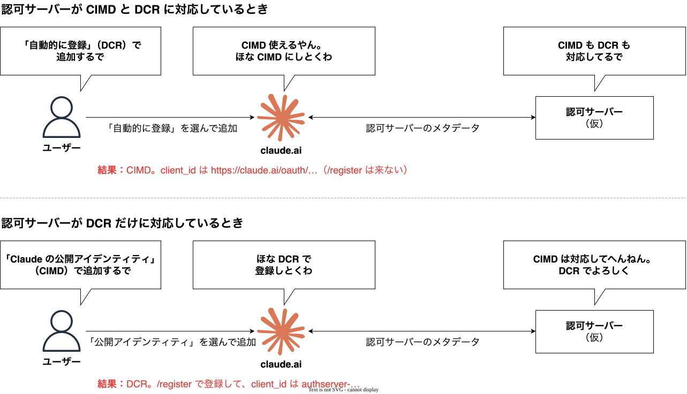

## 今日の問い

[前回](https://qiita.com/kou1046/items/e21d28ebeadb1e0a4292)は、認可のない MCP サーバーを作って、claude.ai に繋ぎました。繋がりはしましたが、サーバーから見ると、来る人は全員 `anonymous` です。

今回から、ここに認可を足していきます。最初の一歩は、サーバーが「認可が要る」と言えるようにすることです。

MCP サーバーが「認可が要る」と返したとき、claude.ai はどうやってログイン画面の場所を知るのでしょうか。

[前々回](https://qiita.com/kou1046/items/8a45872acc41e9d14919)で軽く説明しましたが、今回はそれを実際に動かして、claude.ai が本当にその流れをたどるのかを確かめます。トークンの検証もログイン画面も、まだ作りません。「認可が要る」と返して、claude.ai がどこへ何を探しに行くのかを、後ろからついて行きます。

## 「認可が要る」はどう伝わるのか

仕様：[MCP 2026-07-28 Authorization](https://modelcontextprotocol.io/specification/2026-07-28/basic/authorization)、[RFC 9728](https://www.rfc-editor.org/rfc/rfc9728)

前々回の流れを、おさらいしておきます。今回確かめるのは、このうちログイン画面の入口までです。

<p align="center"></p>
<p align="center"><sub>図1：①〜⑤の順に、MCP サーバー、認可サーバーとやりとりして、ログイン画面の入口にたどり着く</sub></p>

### 401 と WWW-Authenticate

トークンを持たずに来たリクエストに、MCP サーバーは 401 を返します。そのとき、`WWW-Authenticate` ヘッダーで「詳しくはここを見て」と、メタデータの場所を教えます。

```http
HTTP/1.1 401 Unauthorized
WWW-Authenticate: Bearer resource_metadata="https://example.com/.well-known/oauth-protected-resource/mcp"
```

### MCP サーバーのメタデータ（RFC 9728）

教えた場所には、「このサーバーを守っている認可サーバーはここ」と書いた JSON を置きます。これが Protected Resource Metadata です。

```json
{
  "resource": "https://example.com/mcp",
  "authorization_servers": ["https://auth.example.com"]
}
```

置き場所は `/.well-known/oauth-protected-resource` です。MCP のパスが `/mcp` なら、`/.well-known/oauth-protected-resource/mcp` のように、パスを後ろに足した場所にも置きます。

### その先：認可サーバーのメタデータ（RFC 8414）

`authorization_servers` を知ったクライアントは、今度は認可サーバーのメタデータを取りに行きます。そこに、ログイン画面の入口（`authorization_endpoint`）や、クライアントの登録方法が書いてあります。本物の認可サーバーは次回立てるので、今回は仮のもので受けます。

> [!NOTE]
> OAuth なのに、ログイン（認証）もするの？
>
> 「OAuth は認可の仕組みだから、ログイン（認証）に使うな」と聞いたことがある人は、最後にログイン画面が出てくるのに引っかかるかもしれません。あれは、トークンの中身を確かめられないクライアントが、「トークンをもらえた＝ログインした」とみなす使い方への注意です。MCP サーバーはトークンを受け取って確かめる側で、自分宛てのトークンかどうかも確かめられるので、トークンの持ち主を「誰か」として使えます。確かめ方は、もう少し先の回で、実際に壊しながらやってみます。

## 作ってみる

### 作るもの

前回の MCP サーバーに手を入れるのに加えて、今回は認可サーバーを新しく足します。ただし、認可サーバーは仮のものです。

<p align="center"></p>
<p align="center"><sub>図2：作成するもの。MCP サーバーは 401 とメタデータだけを返し、その先は仮の認可サーバーが受ける</sub></p>

#### MCP サーバー（前回のものに追加）

- MCP の URL へのリクエストには、401 と `WWW-Authenticate` を返す
- `/.well-known/oauth-protected-resource` で、メタデータを返す。`authorization_servers` には、別のホストで動かす認可サーバーの URL を書く

「トークン」は、`Authorization: Bearer …` ヘッダーで送られてくるものです。ただ、トークンの検証はまだしないので、付いていてもいなくても 401 にします。違うのは `WWW-Authenticate` の中身だけです。

| リクエスト | 返すもの |
|---|---|
| `Authorization` ヘッダーがない（または Bearer ではない） | 401、`WWW-Authenticate: Bearer resource_metadata="…"` |
| `Authorization: Bearer …` が付いている | 401、上に加えて `error="invalid_token"`（確かめられないので、無効として扱う） |
| `/.well-known/oauth-protected-resource`（GET） | 200、メタデータ。ここはトークンなしで読める |

`initialize` でも `server/discover` でも `tools/call` でも、メソッドを問わず同じです。通知（`notifications/…`）も 401 になります。

メタデータ（`GET /.well-known/oauth-protected-resource/mcp`）は、次のものを返します。

```jsonc
{
  // このメタデータが説明している MCP サーバー（MCP の URL）
  "resource": "https://aaa.trycloudflare.com/mcp",
  // トークンをもらいに行く認可サーバー。別のホストを指す
  "authorization_servers": ["https://bbb.trycloudflare.com"],
  // トークンは Authorization ヘッダーで送る
  "bearer_methods_supported": ["header"]
}
```

#### 認可サーバー（新規、仮）

本物の認可サーバーは次回立てるので、今回は、届いたリクエストをログに出しながら、それらしい返事をするだけの、仮のものを置きます。ログイン画面はありません。

| リクエスト | 返すもの |
|---|---|
| `/.well-known/oauth-authorization-server`（GET） | 200、認可サーバーのメタデータ。`/authorize` の場所や、対応している登録の方式（DCR、CIMD）を書く |
| `/register`（POST） | 201、送られてきた内容に `client_id` を付けて返す（DCR）。何も保存しない |
| `/authorize`（GET） | 200、「ここまで来ました」とだけ表示する |

`client_id` は確かめないので、どの登録の方式で来ても `/authorize` までは進めます。DCR と CIMD は、メタデータに書くかどうかを起動時に切り替えられるようにします。

メタデータ（`GET /.well-known/oauth-authorization-server`）は、次のものを返します。

```jsonc
{
  // この認可サーバーの名前（URL）
  "issuer": "https://bbb.trycloudflare.com",
  // ログイン画面の入口。ユーザーのブラウザが来る
  "authorization_endpoint": "https://bbb.trycloudflare.com/authorize",
  // code をトークンに換える場所。今回はここまで来ない
  "token_endpoint": "https://bbb.trycloudflare.com/token",
  // 登録の窓口。DCR に対応している、という広告（DCR=false で消える）
  "registration_endpoint": "https://bbb.trycloudflare.com/register",
  // client_id に URL を使ってよい、という広告（CIMD=false で消える）
  "client_id_metadata_document_supported": true,
  // 認可コードフローだけ
  "response_types_supported": ["code"],
  // 認可コードとリフレッシュトークンで、トークンを出す
  "grant_types_supported": ["authorization_code", "refresh_token"],
  // PKCE は S256
  "code_challenge_methods_supported": ["S256"],
  // クライアントは秘密（client_secret）を持たない
  "token_endpoint_auth_methods_supported": ["none"]
}
```

### 公開する

前回と同じく、cloudflared のトンネルと nginx の後ろに置きます。今回は、MCP サーバーと仮の認可サーバーを、別々のトンネル（＝別々のホスト）で公開します。

<p align="center"></p>
<p align="center"><sub>図3：MCP サーバーと仮の認可サーバーを、別々のトンネルで公開する。青い線は認可サーバーへの経路で、/authorize だけはユーザーのブラウザから直接来る</sub></p>

| ホスト | 行き先 |
|---|---|
| `https://aaa.trycloudflare.com` | MCP サーバー（`/mcp` とメタデータ） |
| `https://bbb.trycloudflare.com` | 仮の認可サーバー（メタデータ、`/register`、`/authorize` など） |

ふつう、MCP サーバーと認可サーバーは別のホストにいるので、今回も分けます。

もう1つ、前回と違うところがあります。誰が繋ぎに来るかが、1か所だけ違うのです。

| 行き先 | 繋ぎに来るのは | IP の制限 |
|---|---|---|
| MCP の URL、MCP サーバーのメタデータ | claude.ai（Anthropic のサーバー） | あり |
| 認可サーバーのメタデータ、`/register` | claude.ai（Anthropic のサーバー） | あり |
| `/authorize`（ログイン画面の入口） | ユーザーのブラウザ | なし |

ログイン画面は、ユーザー本人が見て操作するものです。なので claude.ai は、`/authorize` だけは自分で取りに行かず、ユーザーのブラウザをそこへ送り出します。前回と同じく claude.ai の IP だけを通していると、ユーザーのブラウザが門前払いされてしまうので、`/authorize` だけは制限を外しています。今回の中身は「ここまで来ました」の文字だけです。

### 実際に作ったもの

- https://github.com/kou1046/advent2026-mcp-authz/tree/main/days/12-03-protected-resource-metadata

```sh
make tunnel             # MCP サーバー・仮の認可サーバー・nginx・cloudflared（2本）を立ち上げる
make tunnel CIMD=false  # 仮の認可サーバーが CIMD を広告しないようにする（DCR=false も同じ）
make logs
make down
```

## claude.ai から繋いでみる

`make tunnel` で立ち上げて、MCP の URL をカスタムコネクターに登録してみます。まずは設定を変えずに、既定のまま進めます。

### 追加のダイアログ

URL を入れると、claude.ai はサーバーを3段階で確かめて、「サーバーが見つかりました」と表示しました。

<p align="center"></p>
<p align="center"><sub>図4：サーバーに接続（401）、サインイン設定を確認（200）、サインインプロバイダーを確認（200）の3段階で、サーバーが見つかる</sub></p>

1段目は 401 なのに、「完了」になっています。claude.ai にとって、この 401 は失敗ではなく、「サインインが要る」という合図だからです。

「続ける」を押すと、設定の画面に進みます。「認証」は「今すぐサインイン」に、「OAuth クライアント」は「Claude の公開アイデンティティを使用」（CIMD）に、「検出済み」と付いていました。

<p align="center"></p>
<p align="center"><sub>図5：「今すぐサインイン」と「Claude の公開アイデンティティを使用」（CIMD）に「検出済み」が付く（画面は、後で試す「自動的に登録」を選んだところ）</sub></p>

「追加」を押すと、ブラウザが仮の認可サーバーの `/authorize` に移って、「到達しました」と表示されました。

<!-- 画像：authserver: /authorize に到達しました。 -->

### 届いたリクエストを見てみる

ダイアログの3段階は、claude.ai から届いた3つのリクエストに、そのまま対応していました。

| 届いた順 | 誰が | どこへ | 返したもの | ダイアログの表示 |
|---|---|---|---|---|
| 1 | claude.ai | MCP サーバー：`POST /mcp`（古い版の `initialize`） | 401 | サーバーに接続しています |
| 2 | claude.ai | MCP サーバー：`GET /.well-known/oauth-protected-resource/mcp` | 200 | サインイン設定を確認しています |
| 3 | claude.ai | 認可サーバー：`GET /.well-known/oauth-authorization-server` | 200 | サインインプロバイダーを確認しています |
| 4 | ユーザー（ブラウザ） | 認可サーバー：`GET /authorize?…` | 200 | （「追加」を押した後） |

最初に届くのは、前回見た確認する係の、古い版の `initialize` です。今回はそこに 401 を返したので、その先へ進みました。

「追加」を押したときにも、1〜3 をもう一度たどってから、4 に進みました。「検出済み」は、この 1 の 401 と、3 のメタデータを見て付けたものです。

認可サーバーのメタデータは、`authorization_servers` に書いた別のホストへ、ちゃんと取りに来ていました。

> [!NOTE]
> 認可サーバーを MCP サーバーとは別のホストにして、確かめられたこと
>
> 同じホストに置いていたら、claude.ai がメタデータをたどったのか、「同じホストだろう」と当て推量で来たのか、区別がつきませんでした。古い MCP の仕様（2025-03-26）には、メタデータがなければ MCP サーバーと同じホストを認可サーバーとみなす、という決まりもありました。今回は、MCP サーバーのホストで認可サーバーを探すアクセスはなかったので、メタデータをたどったと言えます。

### ブラウザが /authorize に着くまで

<p align="center"></p>
<p align="center"><sub>図6：claude.ai は /authorize の URL だけを画面に渡し、code_verifier は自分で持っておく。ブラウザは、その URL へ移動する</sub></p>

ブラウザの開発者ツールで「追加」を押したときの通信を見ると、claude.ai の画面は、まず claude.ai のサーバーに、OAuth 認可の準備を頼んでいました（fetch）。返ってきたのは、こんな JSON です（値は一部省略）。

```json
{
  "auth_url": "https://bbb.trycloudflare.com/authorize?response_type=code&client_id=…",
  "state": "UHSPRFR134j5…",
  "prior_auth_status": "not_connected",
  "finish_in_app": false
}
```

画面は、この `auth_url` へ、JavaScript で同じタブのまま移動します。302 のリダイレクトだろうと予想していましたが、違いました。claude.ai のサーバーが URL を組み立て、画面がブラウザを移動させる、という分担です。

`auth_url` に付いていたものは、次のとおりです。

| パラメーター | 値 | 意味 |
|---|---|---|
| `response_type` | `code` | 認可コードをください |
| `client_id` | `https://claude.ai/oauth/mcp-oauth-client-metadata` | claude.ai の名乗り。CIMD なので URL |
| `redirect_uri` | `https://claude.ai/api/mcp/auth_callback` | ログインが終わったら、ここへ戻して |
| `code_challenge`、`code_challenge_method` | `…`、`S256` | PKCE |
| `state` | `…` | 戻ってきたときに、自分が始めたものか照らし合わせる |
| `resource` | `https://aaa.trycloudflare.com/mcp` | どの MCP サーバー宛てのトークンが欲しいか（RFC 8707） |

PKCE の `code_verifier`（`code_challenge` の元になる秘密の値）は、fetch の返事に入っていません。claude.ai のサーバーが持ったままです。ブラウザを通るのは見られても困らない値だけ、という分け方になっています。

## 登録の方式を変えてみる

「OAuth クライアント」の選び方と、仮の認可サーバーの広告（`CIMD=false`）を変えながら、何通りか登録してみました。

<p align="center"></p>
<p align="center"><sub>図7：claude.ai は、画面で選んだ方式よりも、認可サーバーのメタデータを見て CIMD と DCR を選ぶ</sub></p>

| 認可サーバーの広告 | claude.ai で選んだもの | 実際に使われたもの | `client_id` |
|---|---|---|---|
| CIMD と DCR | Claude の公開アイデンティティ（既定） | CIMD | `https://claude.ai/oauth/mcp-oauth-client-metadata` |
| CIMD と DCR | 自動的に登録 | CIMD | 同上 |
| DCR だけ | 自動的に登録（既定） | DCR | `authserver-7d22…`（`/register` で払い出したもの） |
| DCR だけ | Claude の公開アイデンティティ | DCR | `authserver-0f76…` |
| DCR だけ | 独自の OAuth クライアント | 事前登録（静的） | `my-client`（入力したもの） |

「自動的に登録」（DCR）を選んでも、認可サーバーが CIMD を広告していれば CIMD で来ました。逆に、CIMD を広告していないと、「Claude の公開アイデンティティ」を選んでも DCR で来ました。どちらも、エラーや警告は出ません。CIMD と DCR のどちらになるかは、画面の選択ではなく、認可サーバーの広告で決まっているようです。「独自の OAuth クライアント」だけは選んだとおりで、`/register` は来ず、入力した `client_id` で `/authorize` に来ました。

`CIMD=false` にすると、設定の画面の「検出済み」も「自動的に登録」に移り、既定の選択も DCR になりました。

## 感想

### OAuth クライアントの登録の方式は、UI で選ばせなくてもいいのでは

CIMD と DCR のどちらにするかを claude.ai が認可サーバーを見て決めてくれるなら、画面で選ばせなくてもいいのでは、と思いました。選んでも効かない選択肢は、むしろ迷わせます。意味があるのは、「独自の OAuth クライアント」を使うかどうかだけでした。

Claude の[ドキュメント](https://claude.com/docs/connectors/building/authentication)には、認可サーバーが CIMD に対応していれば CIMD、そうでなければ DCR に落ちる、と書いてあります。ただ、画面で別の方式を選んだらどうなるかは、[コネクターの追加のページ](https://claude.com/docs/connectors/custom/add-unlisted)にも「『検出済み』はそのままにしておいて」とあるだけで、選択が上書きされるとはどこにも書いていませんでした。

### /authorize へ連れて行く方法は、302 だけじゃない

クライアントのサーバーから、ユーザーのブラウザを `/authorize` へ連れて行くには、OAuth の説明でよく見る 302 のリダイレクトしかないと思っていました。でも claude.ai は、サーバーは URL を返すだけで、移動は画面の JavaScript に任せていました。OAuth の仕様が決めているのは「ブラウザを `/authorize` へ向かわせる」ことだけで、手段は自由です。ChatGPT や Gemini など、ほかの MCP クライアントはどうやっているのか、気になります。

## まとめ

- claude.ai はメタデータをたどって別のホストの認可サーバーまで来て、ブラウザを `/authorize` まで連れて行ってくれた
- そのために、MCP サーバーに 401 とメタデータを返す仕組みを足し、仮の認可サーバーも立てた
- 登録の方式は、画面で選んでも、claude.ai が認可サーバーに合わせて選び直してくれた（おせっかい）

## 次回

今回、claude.ai はログイン画面の入口まで来て止まりました。仮の認可サーバーには、ログイン画面がないからです。

次回は、本物の認可サーバー（Keycloak）を立てて、ログイン画面を出すところまで進めます。
