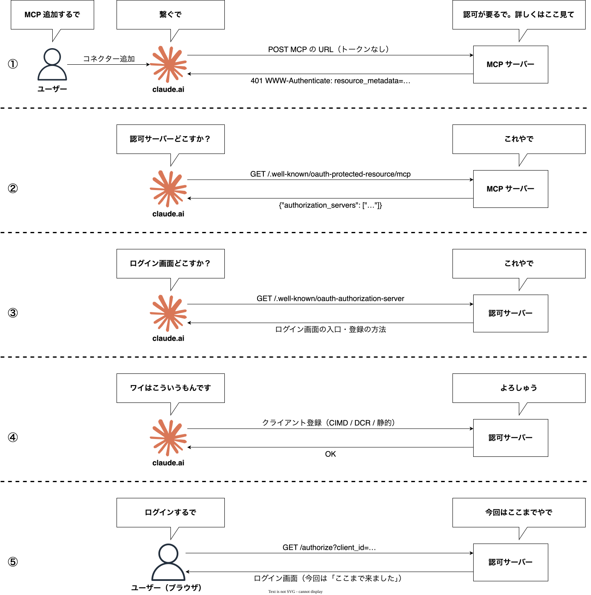

<!-- TODO: タイトルは仮 -->

## 今日の問い

[前回](https://qiita.com/kou1046/items/e21d28ebeadb1e0a4292)は、認可のない MCP サーバーを作って、claude.ai に繋ぎました。繋がりはしましたが、サーバーから見ると、来る人は全員 `anonymous` です。

今回から、ここに認可を足していきます。最初の一歩は、サーバーが「認可が要る」と言えるようにすることです。

MCP サーバーが「認可が要る」と返したとき、claude.ai はどうやってログイン画面の場所を知るのでしょうか。

[前々回](https://qiita.com/kou1046/items/8a45872acc41e9d14919)で軽く説明しましたが、今回はそれを実際に動かして、claude.ai が本当にその流れをたどるのかを確かめます。トークンの検証もログイン画面も、まだ作りません。「認可が要る」と返して、claude.ai がどこへ何を探しに行くのかを、後ろからついて行きます。

## 「認可が要る」はどう伝わるのか

仕様：[MCP 2026-07-28 Authorization](https://modelcontextprotocol.io/specification/2026-07-28/basic/authorization)、[RFC 9728](https://www.rfc-editor.org/rfc/rfc9728)

前々回の流れを、おさらいしておきます。今回確かめるのは、このうちログイン画面の入口までです。

<p align="center"></p>
<p align="center"><sub>図1：①〜⑤の順に、MCP サーバー、認可サーバーとやりとりして、ログイン画面の入口にたどり着く</sub></p>

### 401 と WWW-Authenticate

トークンを持たずに来たリクエストに、MCP サーバーは 401 を返します。そのとき、`WWW-Authenticate` ヘッダーで「詳しくはここを見て」と、メタデータの場所を教えます。

```http
HTTP/1.1 401 Unauthorized
WWW-Authenticate: Bearer resource_metadata="https://example.com/.well-known/oauth-protected-resource/mcp"
```

### MCP サーバーのメタデータ（RFC 9728）

教えた場所には、「このサーバーを守っている認可サーバーはここ」と書いた JSON を置きます。これが Protected Resource Metadata です。

```json
{
  "resource": "https://example.com/mcp",
  "authorization_servers": ["https://auth.example.com"]
}
```

置き場所は `/.well-known/oauth-protected-resource` です。MCP のパスが `/mcp` なら、`/.well-known/oauth-protected-resource/mcp` のように、パスを後ろに足した場所にも置きます。

### その先：認可サーバーのメタデータ（RFC 8414）

`authorization_servers` を知ったクライアントは、今度は認可サーバーのメタデータを取りに行きます。そこに、ログイン画面の入口（`authorization_endpoint`）や、クライアントの登録方法が書いてあります。本物の認可サーバーは次回立てるので、今回は偽物で受けます。

:::note info
OAuth なのに、ログイン（認証）もするの？

「認可が要る」と言いながら、最後にはログイン画面が出てきます。「OAuth は認可の仕組みだから、認証（ログイン）に使うな」と聞いたことがある人は、ここで引っかかるかもしれません。

そう言われるのは、クライアントが「アクセストークンを受け取れたから、この人はログインした」とみなす使い方です。クライアントにとって、アクセストークンは中身を確かめるものではありません。なので、別のアプリ宛てに発行されたトークンを持ち込まれても見分けられません。ログインしたいなら、OpenID Connect の ID トークンを使います。

MCP サーバーの立場は、これとは違います。MCP サーバーはトークンを受け取って確かめる側（リソースサーバー）で、MCP の仕様は、トークンが自分宛て（`aud`）かどうかを確かめることを求めています（[RFC 8707](https://www.rfc-editor.org/rfc/rfc8707) の `resource` とセット）。よそ宛てのトークンはそこで弾けるので、届いたトークンの持ち主（`sub`）を「誰か」として使ってかまいません。

トークンの確かめ方は、もう少し先の回で、実際に壊しながらやってみます。

:::

## 作ってみる

### 作るもの

前回の MCP サーバーに、2つ足します。

- トークンのないリクエストには、401 と `WWW-Authenticate` を返す。トークンの検証はまだしないので、今はどのリクエストも 401 になる
- `/.well-known/oauth-protected-resource` で、メタデータを返す。`authorization_servers` には、同じホストを書く

認可サーバーの役は、偽物に任せます。届いたリクエストをログに出しながら、メタデータを返し、登録（`/register`）を受け付け、ログイン画面の入口（`/authorize`）では「ここまで来ました」とだけ表示するサーバーです。

<!-- TODO: 図2。作るもの（MCP サーバーと偽の認可サーバー） -->

### 公開する

前回と同じく、cloudflared のトンネルと nginx の後ろに置きます。今回は、nginx でパスごとに振り分けます。

| パス | 行き先 |
|---|---|
| `/mcp`、`/.well-known/oauth-protected-resource…` | MCP サーバー |
| それ以外（認可サーバーのメタデータ、`/register`、`/authorize` など） | 偽の認可サーバー |

1つだけ、前回と違うところがあります。`/authorize` を開くのは claude.ai ではなく、利用者のブラウザです。なので、`/authorize` だけは IP の制限を外しています。中身は「ここまで来ました」の文字だけです。

<!-- TODO: 図3。構成図（Day 2 の図5 に偽の認可サーバーを足す） -->

### 実際に作ったもの

- https://github.com/kou1046/advent2026-mcp-authz/tree/main/days/12-03-protected-resource-metadata

```sh
make tunnel             # MCP サーバー・偽の認可サーバー・nginx・cloudflared を立ち上げる
make tunnel CIMD=false  # 偽の認可サーバーが CIMD を広告しないようにする（DCR=false も同じ）
make logs
make down
```

## claude.ai から繋いでみる

カスタムコネクターの設定を変えながら、4通り登録してみました。

| # | 認証 | OAuth クライアント |
|---|---|---|
| 1 | 今すぐサインイン | Claude の公開アイデンティティ（既定） |
| 2 | 今すぐサインイン | 自動的に登録 |
| 3 | 今すぐサインイン | 独自の OAuth クライアント |
| 4 | 必要なときにサインイン | 既定のまま |

### 今すぐサインイン（既定）

<!-- TODO: 実測。追加のダイアログの3段階、ブラウザで /authorize に着いたときのスクショとアドレスバーの URL（client_id、redirect_uri、code_challenge、resource） -->

### 届いたリクエストを見てみる

<!-- TODO: 実測。登録したときに届いた順の表（誰が、どのパスを、どの順で）。確認する係（python-httpx）とチャットする係（Claude-User）のどちらが 401 を受けて探しに行ったか -->

### 登録の方式を変えると

<!-- TODO: 実測。2（DCR）では /register に何が届いたか、3（静的）、4（必要なときに）ではいつサインインを求めてきたか。client_id の違いを表に -->

## 認可サーバーの広告を変えてみる

<!-- TODO: 実測。CIMD=false で既定（CIMD）の claude.ai が DCR に落ちるか。DCR=false CIMD=false ではどうなるか -->

## 感想

<!-- TODO -->

## まとめ

<!-- TODO: 実測を受けて。claude.ai が認可サーバーを見つけるまでに要るもの（401 と WWW-Authenticate、RFC 9728 のメタデータ、RFC 8414 のメタデータ）と、登録の方式ごとの違い -->

## 次回

今回、claude.ai はログイン画面の入口まで来て止まりました。偽の認可サーバーには、ログイン画面がないからです。

次回は、本物の認可サーバー（Keycloak）を立てて、ログイン画面を出すところまで進めます。
