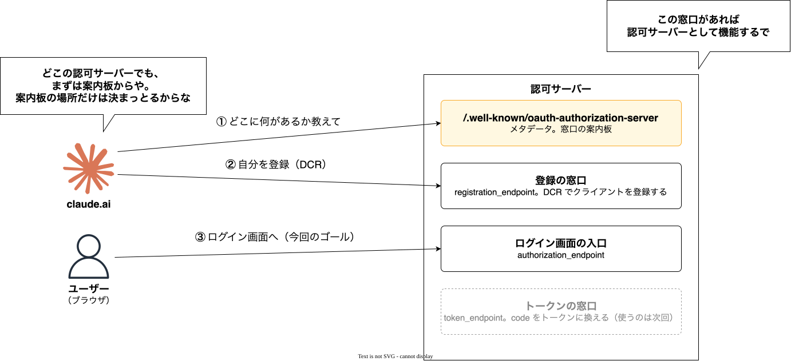

<!-- TODO: タイトルは仮 -->

## 今日の問い

[前回](https://qiita.com/kou1046/items/dcdedf12db7a88f255a7)は、MCP サーバーに 401 を返させて、claude.ai が認可サーバーを探しに行く様子を追いかけました。claude.ai はメタデータをたどって、ブラウザを `/authorize` まで連れて行ってくれました。ただ、待っていたのは「ここまで来ました」とだけ返すハリボテの認可サーバーです。

今回は、このハリボテを本物の認可サーバー（Keycloak）に置き換えます。

claude.ai が探しに来た認可サーバーは、何を返せばいいのでしょうか。そして、Keycloak はそれをそのまま返してくれるのでしょうか。

ゴールは、claude.ai からブラウザが Keycloak のログイン画面にたどり着くところまでです。ログインした先（トークンが MCP サーバーに届くところ）は、次回に回します。

## 認可サーバーは何を返すのか

仕様：[RFC 8414](https://www.rfc-editor.org/rfc/rfc8414)、[MCP 2026-07-28 Authorization](https://modelcontextprotocol.io/specification/2026-07-28/basic/authorization)

図1：認可サーバーには窓口がいくつかあり、その場所はメタデータ（案内板）に書いてある。今回は ①〜③ まで

前回の仮の認可サーバーが返していたメタデータを、もう一度見てみましょう。claude.ai が使っていたのは、このうち次のあたりです。

| 項目 | 何に使われたか |
|---|---|
| `issuer` | この認可サーバーの名前 |
| `authorization_endpoint` | ブラウザを連れて行く先（ログイン画面の入口） |
| `token_endpoint` | code をトークンに換える場所（前回はここまで来なかった） |
| `code_challenge_methods_supported` | PKCE の方式。`S256` が要る |
| `registration_endpoint`、`client_id_metadata_document_supported` | DCR、CIMD に対応しているか |

<!-- TODO: MCP の仕様で、メタデータに必須のもの（code_challenge_methods_supported がないとクライアントは断る、など）を確かめて1〜2行 -->

### Keycloak とは

今回、本物の認可サーバーとして使うのは [Keycloak](https://www.keycloak.org/) です。オープンソースの認証・認可サーバーで、OAuth 2.0 や OpenID Connect をひととおり話せます。ログイン画面やユーザー管理まで込みで、Docker ですぐ立てられます。

Keycloak には、[MCP との連携ガイド](https://www.keycloak.org/securing-apps/mcp-authz-server)まであります。DCR は正式に対応していて、CIMD と resource indicators（RFC 8707）は実験的な機能として対応しています。この先の回で使う token exchange（RFC 8693）も、[26.2 から正式に対応](https://www.keycloak.org/2025/05/standard-token-exchange-kc-26-2)しました（どれも 2026-11 時点）。

ほかにも、ログイン画面を自分で用意する前提の [Ory Hydra](https://github.com/ory/hydra) や、[ZITADEL](https://zitadel.com/)、[authentik](https://goauthentik.io/) などの選択肢があります。この連載で使う機能がひととおり揃っていて、MCP 向けの公式ガイドまであるので、Keycloak にしました。

Keycloak では、ユーザーやクライアントを「realm」という単位でまとめます。今回は `mcp` という realm を1つ作ります。

Keycloak も、もちろん前回と同じメタデータを返します。ただ、前回の仮の認可サーバーとは、置き場所が違います。

### issuer にパスが入ると、メタデータはどこに置かれるのか

前回の仮の認可サーバーの issuer は `https://bbb.trycloudflare.com` で、パスがありませんでした。なので、メタデータは素直に `/.well-known/oauth-authorization-server` に置けばよかったのです。

Keycloak の issuer は、`https://bbb.trycloudflare.com/realms/<realm 名>` のように、realm の名前がパスに入ります。こうなると、メタデータの置き場所の候補が増えます。MCP の仕様は、issuer にパスがあるとき、クライアントに次の順で探すよう求めています。

| 順 | 置き場所 | 決まりの出どころ |
|---|---|---|
| 1 | `/.well-known/oauth-authorization-server/realms/<realm 名>` | RFC 8414（パスを差し込む） |
| 2 | `/.well-known/openid-configuration/realms/<realm 名>` | OpenID Connect（パスを差し込む） |
| 3 | `/realms/<realm 名>/.well-known/openid-configuration` | OpenID Connect（パスの後ろに足す） |

<!-- TODO: この順番は仕様で要確認 -->

手元の Keycloak（26.4）で確かめると、1 と 3 は 200、2 だけ 404 でした。Keycloak は、RFC 8414 の置き場所（1）にもちゃんと置いてくれています。なので、claude.ai が仕様どおりに探すなら、最初の 1 で見つかるはずです。本当にそうなるのかは、ログで確かめます。

<!-- TODO: 「パスがあると 404 が並ぶ」はネタ帳の予想だったが、Keycloak 26.4 では並ばなそう。この小見出しを残すか、短くするか -->

<!-- TODO: 確認のメモ（手元の Keycloak 26.4.7）。/realms/mcp/.well-known/oauth-authorization-server も 200。registration_endpoint は /realms/mcp/clients-registrations/openid-connect。code_challenge_methods_supported は plain と S256。token_endpoint_auth_methods_supported に none はない（CIMD を有効にしても claude.ai は選ばないはず）。client_id_metadata_document_supported は出ていない -->

## 作ってみる

### 作るもの

前回の構成から、仮の認可サーバー（authserver）を Keycloak に置き換えます。MCP サーバーは、メタデータの `authorization_servers` を Keycloak の issuer に向けるだけで、コードは変えません。

<!-- 図：作るもの（前回の図2の認可サーバーを Keycloak に） -->

#### Keycloak（新規）

ログイン画面を出すには、Keycloak が claude.ai をクライアントとして知っている必要があります。知らない `client_id` で来られても、Keycloak はログイン画面ではなくエラーを返すからです。

今回は、claude.ai に DCR で自分を登録させます。前回は仮の認可サーバーだったので、`/register` に何が届いたかしか見られませんでした。今回は、Keycloak のクライアント一覧に、claude.ai が本当に登録されたことまで確かめます。

- realm を1つ作り、ダミーユーザーを1人置く
- DCR（Keycloak の Client Registration）を、認証なしで受け付けるようにする
- CIMD は有効にしない（有効にすると、前回の「おせっかい」で claude.ai は CIMD を選ぶはずなので）

Keycloak は、認証なしの DCR を最初から受け付けはしますが、「Trusted Hosts」というポリシーで止めています。そのままだと、claude.ai の登録は `Host not trusted`（403）で弾かれます。今回は、このポリシーを次のように緩めます。

| 設定 | 既定 | 今回 |
|---|---|---|
| 登録を送ってきたホストを確かめる | する | しない（送り元は nginx で Anthropic の IP に絞っているので） |
| 信頼するホスト | なし | `claude.ai` |
| `redirect_uris` が信頼するホストか確かめる | する | する |

つまり、「誰からの登録でも受け付けるが、戻り先は claude.ai だけ」にします。手元で試すと、`redirect_uris` がよそのドメインの登録は、ちゃんと 403 で弾かれました。

<!-- TODO: realm 名（手元では mcp）。匿名 DCR で登録されたクライアントは、Consent Required のポリシーで「同意が要る」になる。ログイン後に同意画面が出るはず（次回の話かも） -->

### 公開する

前回と同じく、MCP サーバーと認可サーバーを別々のトンネルで公開します。変わるのは、認可サーバー側の中身です。

- Keycloak は、自分が外からどの URL で見えているか（hostname）を知っている必要があります。トンネルの URL は立ててみるまでわからないので、前回の MCP サーバーと同じく、トンネルを先に立ててから Keycloak に渡します。
- ユーザーのブラウザが来るのは、`/authorize` だけではなくなります。ログイン画面の CSS や JavaScript、ログインの送信も、ブラウザから来ます。<!-- TODO: nginx で誰でも通すパスを確かめる -->
- 管理画面（`/admin`）は、外に出しません。

<!-- 図：構成（前回の図3の認可サーバーを Keycloak に） -->

### 実際に作ったもの

<!-- TODO -->

## claude.ai から繋いでみる

<!-- TODO: 実測。追加のダイアログの3段階、設定の画面の「検出済み」がどこに付くか -->

### 届いたリクエストを見てみる

<!-- TODO: 実測。well-known の 404 が並ぶか（1 → 2 → 3 の順か）、ほかに何を叩くか -->

### claude.ai は登録されたのか

<!-- TODO: 実測。/register（clients-registrations）に届いた中身と返事。Keycloak の管理画面のクライアント一覧に、claude.ai（client_name Claude）が増えているスクショ。連携し直すと、もう1つ増えるか -->

### ログイン画面

<!-- TODO: 実測。Keycloak のログイン画面のスクショ（アドレスバーの client_id が、登録で払い出されたものになっているか） -->

## 感想

<!-- TODO: メモ。標準（RFC 9728・8414・7591）のおかげで、仮の認可サーバーから Keycloak へすんなり差し替えられた。MCP サーバーのコードは変えず、authorization_servers の URL だけ。手間がかかったのは標準の外側の、製品ごとの既定値（Trusted Hosts、hostname、claude.ai の CIMD 条件の none）。後半の AuthZEN（標準の形なら PDP を差し替えられる）にもつながる -->

## まとめ

<!-- TODO -->

## 次回

今回は、ログイン画面まで来ました。次回は、claude.ai をクライアントとして登録し、ログインしてトークンが MCP サーバーに届くところまで進めます。
