## 今日の問い

[前回](https://qiita.com/kou1046/items/dcdedf12db7a88f255a7)は、MCP サーバーに 401 を返させて、claude.ai が認可サーバーを探しに行く様子を追いかけました。claude.ai はメタデータをたどって、ブラウザを `/authorize` まで連れて行ってくれました。ただ、待っていたのは「到達しました」とだけ返すハリボテの認可サーバーです。

今回は、このハリボテを本物の認可サーバー（Keycloak）に置き換えます。

claude.ai が探しに来た認可サーバーは、何を返せばいいのでしょうか。そして、本物の認可サーバーは、初対面の claude.ai の登録を、すんなり受け付けてくれるのでしょうか。

先に言ってしまうと、差し替え自体は、標準のおかげで拍子抜けするほど簡単。ただ、claude.ai の登録（DCR）だけは、Keycloak の設定のクセに引っかかって、すんなりとは通してもらえませんでした。

ゴールは、claude.ai からブラウザが Keycloak のログイン画面にたどり着くところまでです。ログインした先（トークンが MCP サーバーに届くところ）は、次回に回します。

## 認可サーバーは何を返すのか

仕様：[RFC 8414](https://www.rfc-editor.org/rfc/rfc8414)、[MCP 2026-07-28 Authorization](https://modelcontextprotocol.io/specification/2026-07-28/basic/authorization)

<p align="center">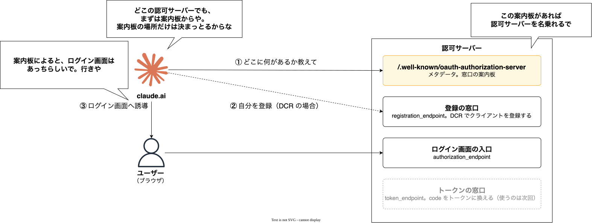</p>
<p align="center"><sub>図1：認可サーバーには窓口がいくつかあり、その場所はメタデータ（案内板）に書いてある。今回は ①〜③ まで</sub></p>

前回の仮の認可サーバーが返していたメタデータを、もう一度見てみましょう。claude.ai が使っていたのは、このうち次のあたりです。

| 項目 | 何に使われたか |
|---|---|
| `issuer` | この認可サーバーの名前 |
| `authorization_endpoint` | ブラウザを連れて行く先（ログイン画面の入口） |
| `token_endpoint` | code をトークンに換える場所（前回はここまで来なかった） |
| `code_challenge_methods_supported` | PKCE の方式。`S256` が要る |
| `registration_endpoint`、`client_id_metadata_document_supported` | DCR、CIMD に対応しているか |

<!-- TODO: MCP の仕様で、メタデータに必須のもの（code_challenge_methods_supported がないとクライアントは断る、など）を確かめて1〜2行 -->

### Keycloak とは

今回、本物の認可サーバーとして使うのは [Keycloak](https://www.keycloak.org/) です。オープンソースの認証・認可サーバーで、OAuth 2.0 や OpenID Connect をひととおり話せます。ログイン画面やユーザー管理まで込みで、Docker ですぐ立てられます。

Keycloak には、[MCP との連携ガイド](https://www.keycloak.org/securing-apps/mcp-authz-server)まであります。DCR は正式に対応していて、CIMD と resource indicators（RFC 8707）は実験的な機能として対応しています。この先の回で使う token exchange（RFC 8693）も、[26.2 から正式に対応](https://www.keycloak.org/2025/05/standard-token-exchange-kc-26-2)しました（どれも 2026-11 時点）。

ほかにも、ログイン画面を自分で用意する前提の [Ory Hydra](https://github.com/ory/hydra) や、[ZITADEL](https://zitadel.com/)、[authentik](https://goauthentik.io/) などの選択肢があります。この連載で使う機能がひととおり揃っていて、MCP 向けの公式ガイドまであるので、Keycloak にしました。

Keycloak には、独自の言葉がいくつかあります。今回出てくるのは、次の4つです。

<p align="center">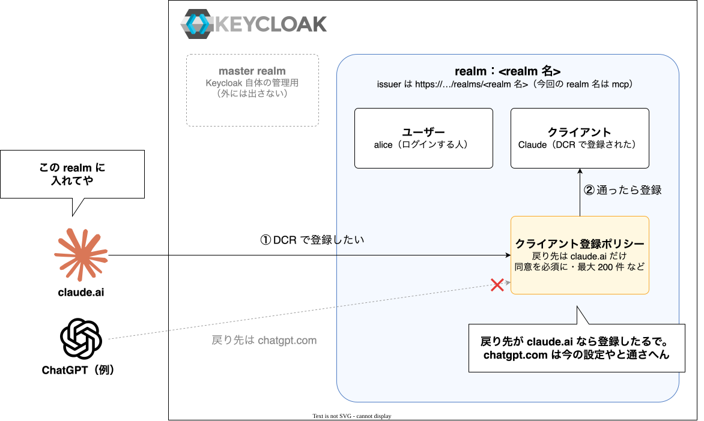</p>
<p align="center"><sub>図2：Keycloak の中は realm ごとに区切られている。claude.ai は、realm のクライアント登録ポリシーを通って、クライアントとして登録される。戻り先が claude.ai ではない ChatGPT は、今の設定だと弾かれる</sub></p>

| 用語 | 何か |
|---|---|
| realm | ユーザーやクライアントをまとめる区画。issuer は realm ごとに1つ。今回は `mcp` を作る |
| master realm | Keycloak 自体を管理するための realm。アプリ用には別の realm を作る |
| クライアント | ログインを頼みに来るアプリ。今回は claude.ai が DCR で自分を登録する |
| クライアント登録ポリシー | DCR を誰に、どこまで許すかの決まり |

Keycloak も、もちろん前回と同じメタデータを返します。ただ、前回の仮の認可サーバーとは、置き場所が違います。

### issuer にパスが入ると、メタデータはどこに置かれるのか

案内板の場所は、認可サーバーの名前（issuer）から決まります。RFC 8414 の決まりはこうです。

```
https://<issuer のホスト>/.well-known/oauth-authorization-server<issuer のパス>
```

前回の仮の認可サーバーの issuer は `https://bbb.trycloudflare.com` で、パスがなかったので、案内板はただの `/.well-known/oauth-authorization-server` でした。Keycloak の issuer には `/realms/mcp` が付くので、案内板は `/.well-known/oauth-authorization-server/realms/mcp` になります。

ややこしいのは、OpenID Connect が昔から別の決まりを使っていることです。OpenID Connect では、パスの後ろに足します。

```
https://<issuer のホスト><issuer のパス>/.well-known/openid-configuration
```

issuer にパスがなければ、どちらの決まりでも同じ場所なので、前回は気にせずに済みました。パスがあると、2つの決まりで場所がずれます。なので MCP の仕様は、issuer にパスがあるとき、クライアントに次の順で探すよう求めています。

| 順 | 置き場所 | 決まりの出どころ |
|---|---|---|
| 1 | `/.well-known/oauth-authorization-server/realms/<realm 名>` | RFC 8414（パスを差し込む） |
| 2 | `/.well-known/openid-configuration/realms/<realm 名>` | OpenID Connect（パスを差し込む） |
| 3 | `/realms/<realm 名>/.well-known/openid-configuration` | OpenID Connect（パスの後ろに足す） |

手元の Keycloak（26.4）で確かめると、1 と 3 は 200、2 だけ 404 でした。Keycloak は、RFC 8414 の置き場所（1）にも律儀に置いてくれています。なので、claude.ai が仕様どおりに探すなら、最初の 1 で見つかるはずです。


## 作ってみる

### 作るもの

前回の構成から、仮の認可サーバー（authserver）を Keycloak に置き換えます。MCP サーバーは、メタデータの `authorization_servers` を Keycloak の issuer に向けるだけで、コードは変えません。

<p align="center">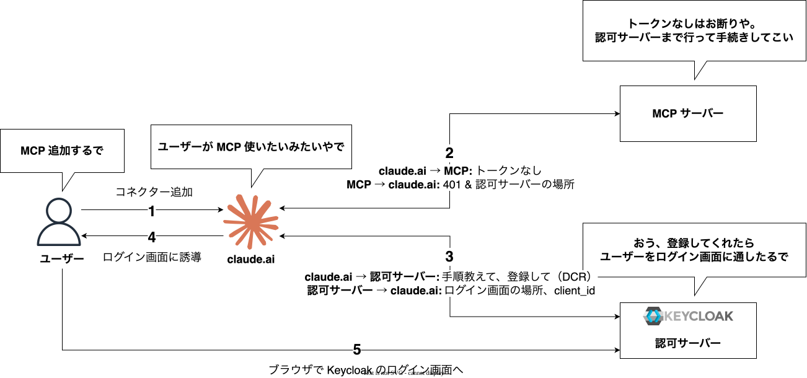</p>
<p align="center"><sub>図3：作成するもの。前回の仮の認可サーバーを Keycloak に置き換える。claude.ai は DCR で自分を登録し、ユーザーを Keycloak のログイン画面に連れて行く</sub></p>

#### Keycloak（新規）

ログイン画面を出すには、Keycloak が claude.ai をクライアントとして知っている必要があります。知らない `client_id` で来られても、Keycloak はログイン画面ではなくエラーを返すからです。

今回は、claude.ai に DCR で自分を登録させます。前回は仮の認可サーバーだったので、`/register` に何が届いたかしか見られませんでした。今回は、Keycloak のクライアント一覧に、claude.ai が本当に登録されたことまで確かめます。

- realm を1つ作り、ダミーユーザーを1人置く
- DCR（Keycloak の Client Registration）を、トークンなしで受け付けるようにする
- CIMD は有効にしない（有効にすると、前回の「おせっかい」で claude.ai は CIMD を選ぶはずなので）

### 公開する

前回と同じく、MCP サーバーと認可サーバーを別々のトンネルで公開します。変わるのは、認可サーバー側の中身です。

- Keycloak は、自分が外からどの URL で見えているか（hostname）を知っている必要があります。トンネルの URL は立ててみるまでわからないので、前回の MCP サーバーと同じく、トンネルを先に立ててから Keycloak に渡します。
- ユーザーのブラウザが来るのは、ログイン画面の入口だけではなくなります。ログイン画面の CSS や JavaScript、ログインの送信も、ブラウザから来ます。nginx では、次の3つを誰でも通します。
  - ログイン画面の入口（`/realms/mcp/protocol/openid-connect/auth`）
  - ログインの送信先（`/realms/mcp/login-actions/`）
  - CSS や JavaScript（`/resources/`）
- 管理画面（`/admin`）と、管理用の master realm（`/realms/master`）は、外に出しません。管理画面は手元から開きます。

<p align="center">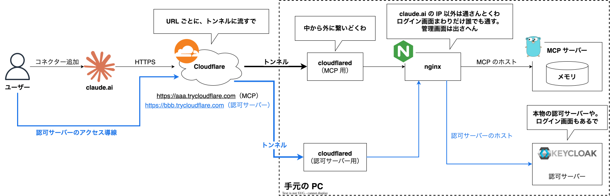</p>
<p align="center"><sub>図4：構成は前回と同じで、認可サーバーが Keycloak になった。nginx は、ログイン画面まわりだけ誰でも通し、管理画面は外に出さない</sub></p>

### 実際に作ったもの

- https://github.com/kou1046/advent2026-mcp-authz/tree/main/days/12-04-authorization-server

Docker、make、jq があれば、手元で試せます。`make tunnel` が表示する URL を claude.ai のカスタムコネクターに登録すると、Keycloak のログイン画面まで連れて行かれます。realm の設定（ダミーユーザー、DCR のポリシー）は、`deploy/local/keycloak-setup.sh` が立ち上げるたびに入れます。

```sh
make tunnel   # MCP サーバー・Keycloak・nginx・cloudflared（2本）を立ち上げて、登録する URL を表示する
make logs     # 届いたリクエストのログを見る
make down     # 試し終わったら、トンネルごと止める
```

## claude.ai から繋いでみる

`make tunnel` で立ち上げて、MCP の URL をカスタムコネクターに登録してみます。

追加のダイアログの3段階は、前回と同じく 401 → 200 → 200 で「サーバーが見つかりました」。設定の画面では、「OAuth クライアント」の「検出済み」が「自動的に登録」（DCR）に付きました。Keycloak は CIMD を広告していないので、狙いどおり。

### 登録できない

ところが、「追加」を押すと、こう言われました。

<p align="center">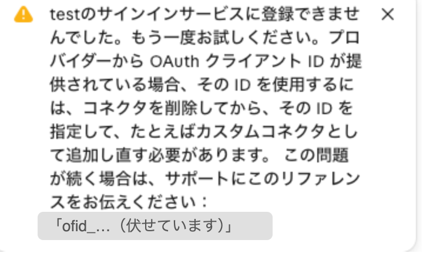</p>
<p align="center"><sub>図5：claude.ai が Keycloak に自分を登録できなかった</sub></p>

え、なんで？ Keycloak のログを見ると、こう出ていました。

```
Policy 'Allowed Client Scopes' rejected request to client-registration service.
Requested scope 'openid' not trusted
```

実は、Keycloak はトークンなしの登録に、最初からいくつも関門を付けています。そのうちの1つ（Trusted Hosts）は、手元で試したときに引っかかったので、事前に緩めておいたのですが、止められたのは別の関門でした。

### Keycloak の、DCR 登録の関門

DCR の仕様（RFC 7591）は、登録の窓口を2通りで運用してよいとしています。

| 運用 | 登録のリクエスト | Keycloak での呼び名 |
|---|---|---|
| 誰でも登録できる | トークンなしで送ってくる | anonymous |
| 許可した相手だけ登録できる | 管理者が前もって渡したトークン（Initial Access Token）を付けて送ってくる | authenticated |

claude.ai は、初対面の認可サーバーからトークンをもらっておくことはできないので、必ず anonymous のほうで来ます。

Keycloak は、anonymous の登録に、最初から「クライアント登録ポリシー」をいくつも付けています。登録のリクエストが来ると、それを順に確かめて、1つでも引っかかればそこで止めます。今回関わったのは、そのうちの2つです。

<p align="center">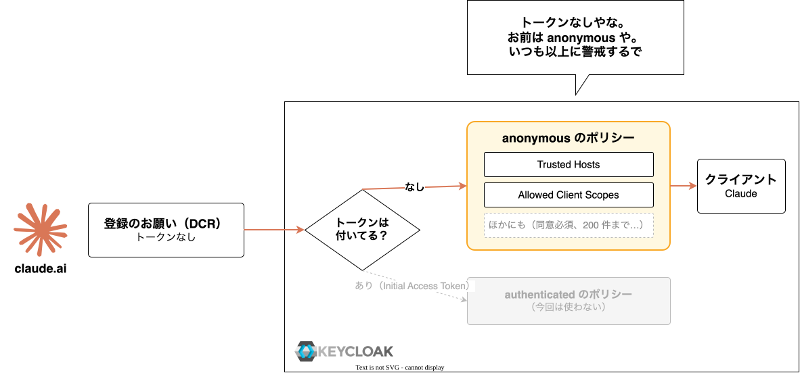</p>
<p align="center"><sub>図6：Keycloak は、トークンの付いていない登録を anonymous として扱い、anonymous 用のポリシー（Trusted Hosts、Allowed Client Scopes など）を当てる</sub></p>

ほかにも、「登録されたクライアントは同意画面が必須」「登録できるのは 200 件まで」といったポリシーが付いていますが、今回は止められなかったので、そのままにしています。

#### Trusted Hosts：事前に緩めていた関門

Trusted Hosts は、「誰から来たか」と「どこへ戻すか」を確かめます。

<p align="center">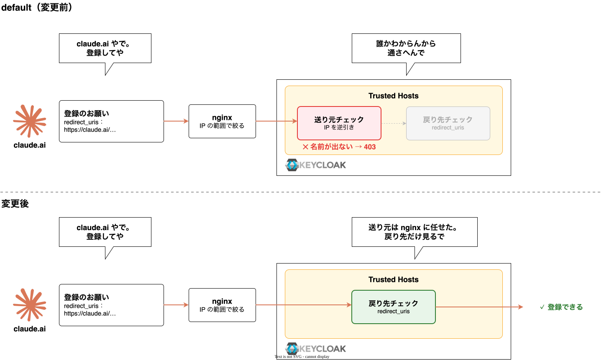</p>
<p align="center"><sub>図7：Trusted Hosts の中には、送り元チェックと戻り先チェックの2つがある。default では送り元チェックで止まる。変更後は送り元チェックを外し、戻り先チェックだけにした</sub></p>

| 確かめること | default | 変更後 |
|---|---|---|
| 登録を送ってきた相手（接続元）が、信頼するホストの一覧にあるか | 確かめる | 確かめない |
| 登録の中身の URI（`redirect_uris` など）が、信頼するホストの下にあるか | 確かめる | 確かめる |
| 信頼するホストの一覧 | 空っぽ | `claude.ai` |

default では一覧が空っぽなので、誰から来ても弾かれます。手元で試したとき、最初に `Host not trusted`（403）で止められたのは、これです。

送ってきた相手を確かめないことにしたのは、確かめようがないからです。Keycloak は、送ってきた相手の IP を逆引きして、その名前が信頼するホストに入っているかで確かめます（[Keycloak のドキュメント](https://www.keycloak.org/securing-apps/client-registration)）。IP の範囲（CIDR）で書く方法は、ドキュメントには見当たりません。

ところが、Anthropic が公開しているのは、送り元の IP の範囲（[`160.79.104.0/21` など](https://platform.claude.com/docs/en/api/ip-addresses)）だけです。実際に届いた登録の送り元の IP（`160.79.106.x`）を逆引きしてみても、名前は返ってきませんでした。名前がないので、信頼するホストに何を書いても一致しません。

なので、送り元は、範囲で書ける nginx の IP 制限に任せました。Keycloak に届く登録は、すでに Anthropic の範囲から来たものだけです。

そのかわり、戻り先は `claude.ai` だけにしました。手元で、nginx を通さずに Keycloak を直接叩き、戻り先をよそのドメインにして登録してみると、ちゃんと 403 で弾かれました。nginx の IP 制限が1段目、この戻り先の確かめが2段目。誰からの登録でも受け付けるけれど、戻り先は claude.ai だけ、という守りです。

#### Allowed Client Scopes：ここで弾かれた関門

今回止められたのは、こちらでした。Allowed Client Scopes は、「何を頼んでいるか」を確かめます。

claude.ai は、登録のリクエストに `scope`（スコープ）を付けていました。スコープは、クライアントが「何をしたいか」を認可サーバーに伝える文字列です（`profile` や `email` など）。登録で頼んだスコープは、そのクライアントに割り当てられ、トークンに何を載せられるかが決まります。

Allowed Client Scopes は、anonymous の登録で頼めるスコープを、realm の Default と Optional のスコープ（新しいクライアントにいつも付くものと、頼まれたら付けられるもの）に限っています。`openid` は、そこに入っていませんでした。

`openid` を許して試し直すと、今度は `service_account` で弾かれました。また？ Keycloak は、引っかかったところで止めるので、1つずつしか教えてくれません。まとめて言ってほしかったです。

見比べてわかったのは、claude.ai が、Keycloak の案内板の `scopes_supported`（「うちで頼めるスコープの一覧」）に並んだスコープを、全部まとめて頼んでいたことです。`openid` も `service_account` も、そこに載っていました。

<p align="center">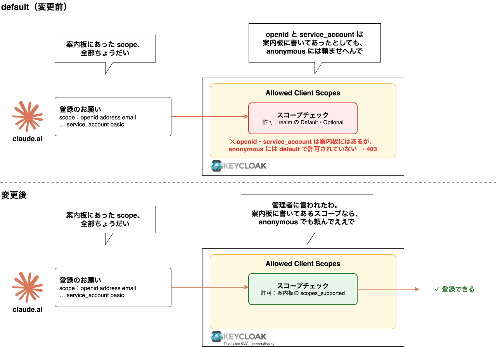</p>
<p align="center"><sub>図8：claude.ai は案内板のスコープを全部頼んでくる。default のスコープチェックは realm の Default・Optional しか許さないので、openid と service_account で止まる。変更後は、案内板の scopes_supported を許す</sub></p>

| スコープ | 案内板の `scopes_supported` | anonymous の登録で頼めるか（default） | 頼めない理由 |
|---|---|---|---|
| `openid` | ある | 頼めない | Keycloak のクライアントスコープの一覧に、そもそもない |
| `service_account` | ある | 頼めない | サービスアカウント専用で、新しいクライアントには付かないスコープ |
| ほかの11個 | ある | 頼める | |

案内板では「使える」と言っておいて、anonymous の登録では頼ませない。それ先に言ってくれ。claude.ai は案内板を素直に信じて頼んだだけなので、claude.ai が悪いわけではありません。

#### どう直したか

anonymous の登録で頼めるスコープを、案内板の `scopes_supported` そのものにしました。これで、案内板に書いてあることと、実際に頼めることが一致します。

3回目で、やっと登録が通りました。長かったです。

ただ、これは許すほうに寄せた直し方です。どこから来たかわからないクライアントでも、`service_account` や `offline_access`（リフレッシュトークン）を自分に割り当てられるようになりました。今回は戻り先を claude.ai だけに絞っているので、大きな問題はありません。

後から [Claude のドキュメント](https://claude.com/docs/connectors/building/authentication)を読むと、claude.ai が頼むスコープは、本来は MCP サーバーの側で決められるようでした。

> To control which scopes Claude requests, include a `scope` parameter in the `WWW-Authenticate` header on your `401` response. If you don't, Claude requests the scopes your protected resource metadata advertises in `scopes_supported`.

401 の `WWW-Authenticate` に `scope` を付けるか、MCP サーバーのメタデータに `scopes_supported` を書けば、それを頼む、ということです。今回の MCP サーバーは、どちらも書いていませんでした。その場合にどうするかはドキュメントに書いておらず、実際には認可サーバーの案内板のスコープを全部頼んできました。MCP サーバーの側で要るスコープだけを書いておけば、`openid` や `service_account` は頼まれず、そもそもここで詰まらなかったはずです。こっちのほうが筋がいいのですが、まだ試していません。

> [!NOTE]
> 同じところで詰まっている人もいる
>
> Keycloak と MCP の DCR の組み合わせで、同じ関門に止められている人もいるようです。claude.ai などの MCP クライアントが `openid` を頼んできて、Keycloak の default のポリシーに弾かれる話は [AKB のドキュメント](https://raw.githubusercontent.com/dnotitia/akb/main/docs/mcp-clients/web-connectors.md)に、VS Code の登録が Trusted Hosts に弾かれる話は [Phase Two の記事](https://phasetwo.io/blog/instant-mcp-authorization-keycloak/)にありました。

### 届いたリクエストを見てみる

| 届いた順 | 誰が | どこへ | 返したもの |
|---|---|---|---|
| 1 | claude.ai | MCP サーバー：`POST /mcp` | 401 |
| 2 | claude.ai | MCP サーバー：`/.well-known/oauth-protected-resource/mcp` | 200 |
| 3 | claude.ai | Keycloak：`/.well-known/oauth-authorization-server/realms/mcp` | 200 |
| 4 | claude.ai | Keycloak：登録の窓口（`/realms/mcp/clients-registrations/openid-connect`） | 201 |
| 5 | ユーザー（ブラウザ） | Keycloak：ログイン画面の入口（`/realms/mcp/protocol/openid-connect/auth`） | 200 |
| 6 | ユーザー（ブラウザ） | Keycloak：`/resources/…`（CSS、JavaScript、フォント） | 200 |

3 で、claude.ai は RFC 8414 の置き場所（パスを差し込む形）を最初に見に来て、一発で案内板を見つけました。窓口のパスは前回の仮の認可サーバーとまったく違いますが、案内板に書いてあるので、claude.ai は迷わずたどり着いています。

### ログイン画面

ブラウザは、Keycloak のログイン画面にたどり着きました。

<p align="center">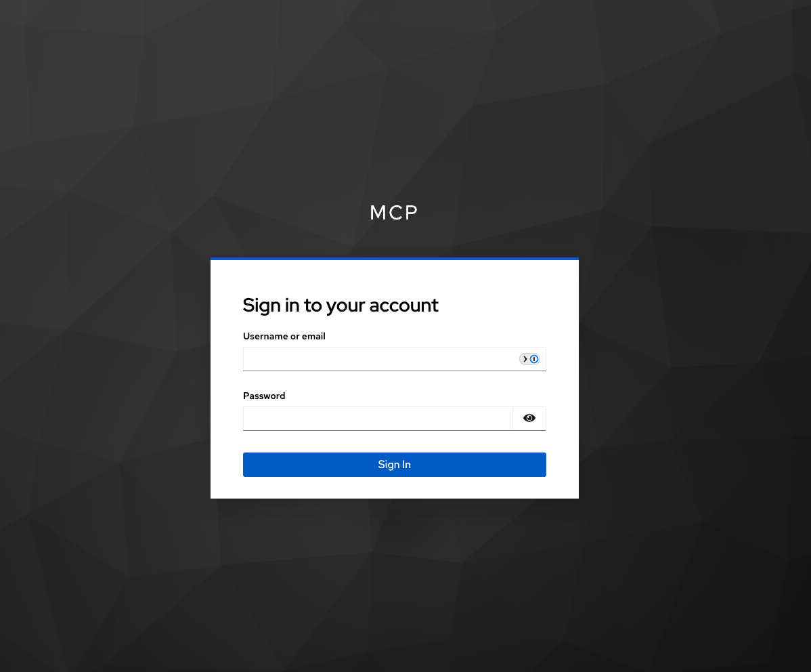</p>
<p align="center"><sub>図9：Keycloak のログイン画面。上の「MCP」は realm の名前</sub></p>

アドレスバーの URL には、前回の仮の認可サーバーのときとは違うところが3つありました。

| パラメーター | 今回の値 | 前回 |
|---|---|---|
| `client_id` | `532a3372-…`（Keycloak が登録で払い出した値） | `authserver-…`（DCR のとき） |
| `scope` | `openid address email … service_account basic`（`scopes_supported` の全部） | なし |
| `prompt` | `consent`（同意画面を必ず出して） | なし |

`redirect_uri`、PKCE（`code_challenge`）、`state`、`resource` は、前回と同じでした。`scope` は、登録のときに頼んだのと同じ一覧です。ここでも claude.ai は、認可サーバーの案内板を見て頼み方を変えています。

### claude.ai は登録されたのか

Keycloak の管理画面で、realm「mcp」のクライアント一覧を見ると、「Claude」という名前のクライアントが増えていました。おお、本当にいる。Client ID は、ログイン画面の URL の `client_id` と同じです。

もう1つ気になったのが、クライアントの種類です。

<p align="center">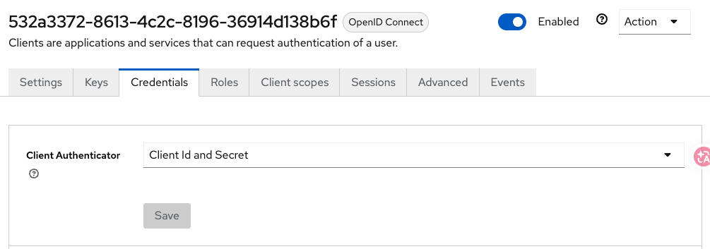</p>
<p align="center"><sub>図10：登録された claude.ai は、シークレットを持つクライアントになっていた</sub></p>

前回の仮の認可サーバーには、claude.ai は `token_endpoint_auth_method: none`（シークレットなし）で登録してきました。今回は「Client Id and Secret」、つまりシークレットありです。Keycloak のメタデータの `token_endpoint_auth_methods_supported` には、`none` がありません。手元で試すと、Keycloak は `none` での登録ならシークレットなしで登録してくれます。なので、claude.ai のほうが Keycloak に合わせて、しれっとシークレットありで登録してきたわけです。

ついでに、claude.ai からもう一度「連携」を押してみました。え、増えた。「Claude」がもう1つ登録されています。

<p align="center">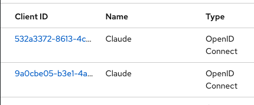</p>
<p align="center"><sub>図11：連携し直すと、別の Client ID で「Claude」がもう1つ登録された</sub></p>

DCR は、連携のたびに登録し直すようです。押すたびに増えるのは、ちょっと怖い。設定の画面の「アクセスの多いサーバーでは多数のクライアント登録が作成されます」は、このことだったんですね。

## 感想

### 標準のおかげで、差し替えるだけだった

仮の認可サーバーを Keycloak に置き換えても、MCP サーバーのコードは1行も変えていません。変えたのは、メタデータの `authorization_servers` に書く URL だけです。claude.ai も、相手が仮の認可サーバーか Keycloak かを気にせず、同じ手順でたどって来ました。間の取り決め（RFC 9728、8414、7591）が標準なので、両側とも差し替えに気づかないわけです。これ、地味にすごくね？

作る側は、相手がどのクライアントでも、どの認可サーバーでも、同じ決まりどおりに作ればいい。使う側も、相手を選ばずに繋げる。OAuth や OpenID Connect がここまで広まったのは、この「差し替えがきく」おかげなんだな、と今回の実装で痛感しました。

「誰か」を確かめてトークンを渡すところまでは、OAuth と OpenID Connect で、もう十分に標準が揃っています。一方で、「このユーザーが、このメモを読んでいいか」のような細かい認可は、これまでアプリごとにバラバラに書くしかありませんでした。最近は、ここにも標準化の流れが来ています。判断を問い合わせる API の [AuthZEN Authorization API 1.0](https://openid.net/wg/authzen/) が 2026 年 1 月に正式な仕様になり、MCP のツール呼び出しを AuthZEN に当てはめる [COAZ](https://openid.net/getting-cozy-with-coaz-securing-apis-and-ai-agents-with-standardized-authorization/) も、ドラフトとして進んでいます。認可も、差し替えがきく世界になるなら待望ですね。この連載の後半で、実際に試してみます。

### 標準どおりでも、製品ごとの設定のクセは残る

標準どおりに話していても、製品ごとの「設定のクセ」は残ります。今回手間がかかったのは、まさにそこでした。Keycloak の default の設定に合わせるために、Trusted Hosts に止められ、Allowed Client Scopes に2回止められ、管理画面も外向けの URL でログインしに行ってエラーになりました。どれも、安全側に倒した default なので、Keycloak が悪いわけではありません。

一方で、claude.ai のおせっかいは今回も健在でした。案内板の `scopes_supported` を見てスコープを全部頼み、`none` がないのを見てシークレットありで登録してきます。相手に合わせてくれるのはありがたいのですが、何を頼んでくるかは、ログを見るまでわかりませんでした。しかも、頼むスコープは MCP サーバーの側で決められたらしい。先にドキュメントを読んでおけばよかった、と今回も思いました。

## まとめ

- 標準のおかげで、仮の認可サーバーから Keycloak への差し替えに、手間はかからなかった
- ただ、Keycloak の設定のクセと DCR は、相性が悪かった
- MCP サーバーがスコープを書かないと、claude.ai は認可サーバーの案内板のスコープを全部頼んでくる
- claude.ai を、Keycloak のログイン画面まで連れて来られた

## 次回

今回は、ログイン画面まで来ました。次回は、実際にログインして、トークンが MCP サーバーに届くところまで進めます。登録されたクライアントは「同意が要る」設定になっていて、`prompt=consent` も付いていたので、同意画面も出てくるはずです。
