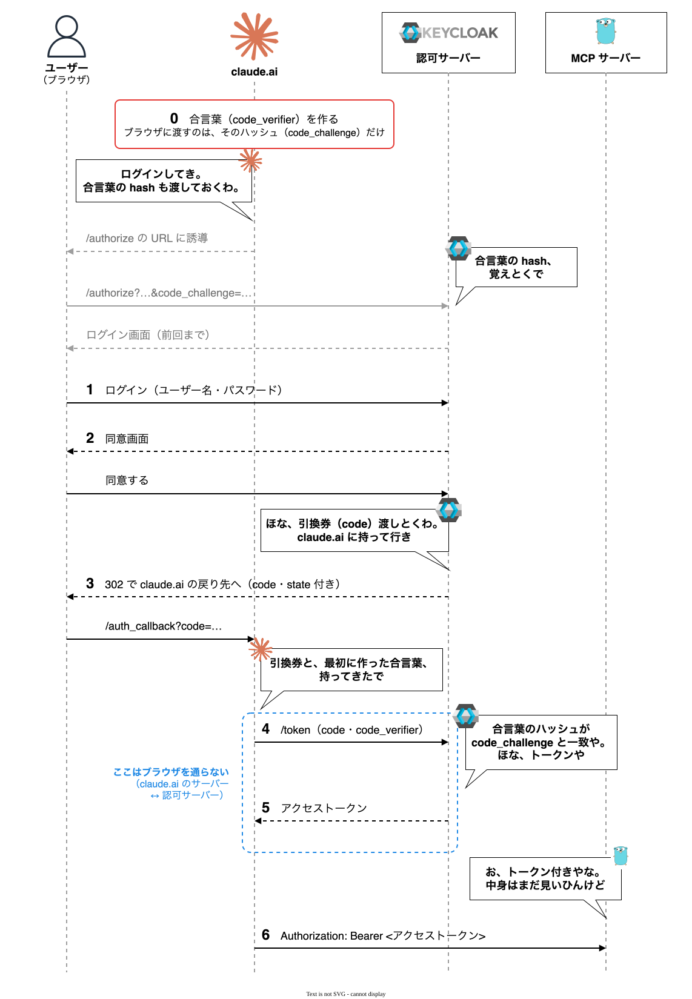
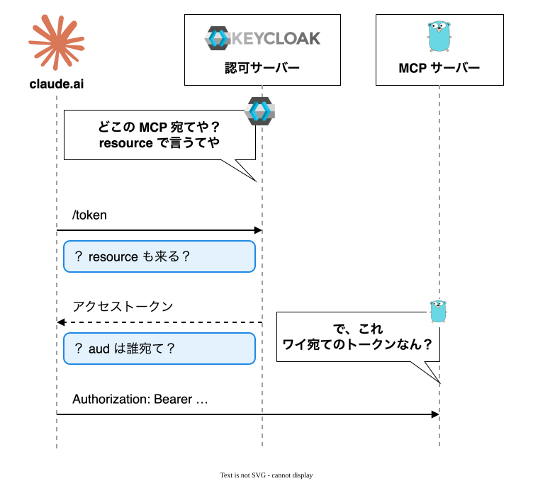
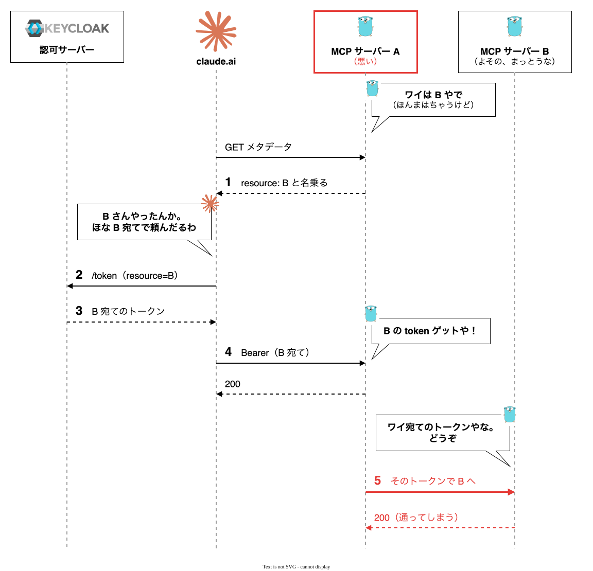
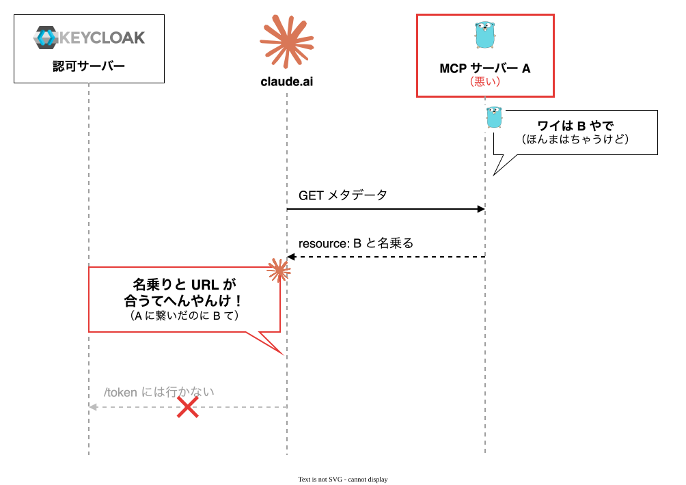
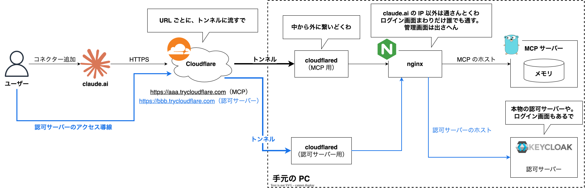
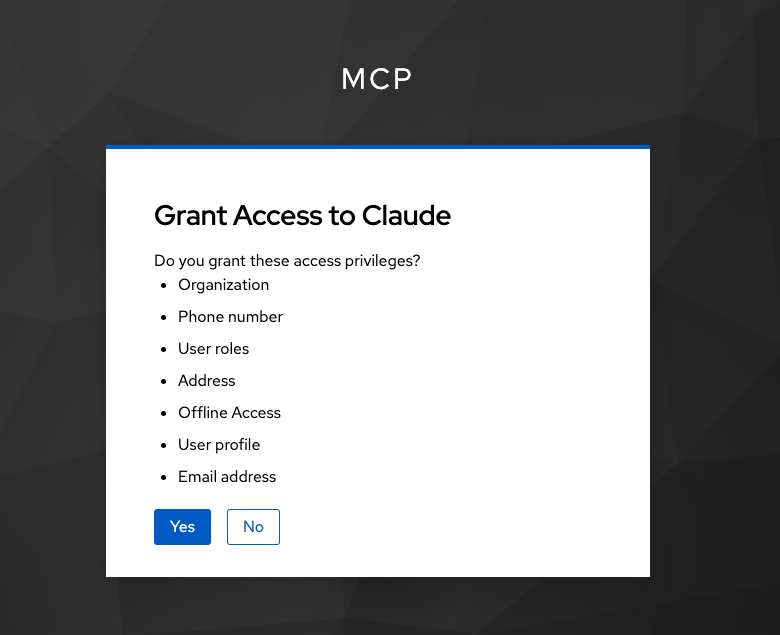
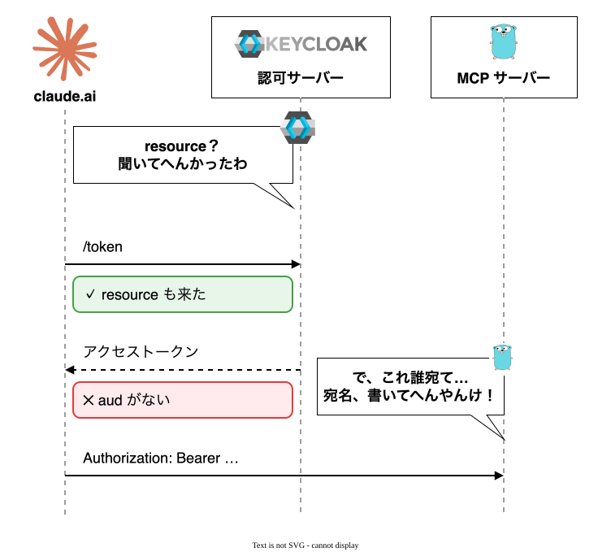
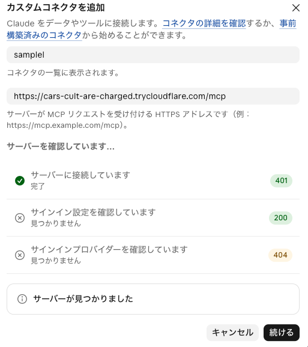
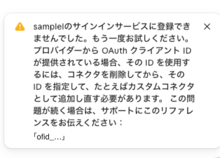

## 今日の問い

[前回](https://qiita.com/kou1046/items/e53ef45bdb4c8576ce09)は、仮の認可サーバーを Keycloak に置き換えて、claude.ai を DCR で登録させ、ブラウザを Keycloak のログイン画面まで連れて来ました。

今回は、いよいよログインします。

ここから先は、親の顔より見た OAuth の認可コードフローです。ログインして、同意して、引換券（`code`）をトークンに換える。

実は MCP は、OAuth にひとつだけ「このトークンは、どの MCP サーバー宛てか」を伝える仕組みを足しています。では、悪い MCP サーバーがその宛先を偽ってきたら、claude.ai は見抜けるのでしょうか。

まずはトークン付き（`Authorization: Bearer …`）のリクエストが MCP サーバーに届くところまで進めて、そのあと MCP サーバーに悪さをさせてみます。

## 認可コードフローのおさらい

仕様：[OAuth 2.1](https://datatracker.ietf.org/doc/draft-ietf-oauth-v2-1/)（認可コードフロー）、[RFC 7636](https://www.rfc-editor.org/rfc/rfc7636)（PKCE）

流れそのものは、[初回](https://qiita.com/kou1046/items/8a45872acc41e9d14919)で説明したとおりです。今回は、ログイン画面から先を見ます。

<p align="center"></p>
<p align="center"><sub>図1：ログインしてから、トークンが MCP サーバーに届くまで。4 と 5 はブラウザを通らない</sub></p>

0. （前々回まで）claude.ai が、合言葉の `code_verifier` を作る。ブラウザに持たせて `/authorize` に送るのは、そのハッシュ（`code_challenge`）だけ
1. ユーザーが、ログイン画面でユーザー名とパスワードを入れる
2. Keycloak が、同意画面を出す
3. Keycloak が、ブラウザを claude.ai の戻り先（`https://claude.ai/api/mcp/auth_callback`）に戻す。このとき、`code`（引換券）と `state` を付ける
4. claude.ai のサーバーが、Keycloak の `/token` に、`code` と `code_verifier`（合言葉）を持って行く
5. Keycloak が、`code_verifier` のハッシュが最初の `code_challenge` と一致するのを確かめて、アクセストークンを返す
6. claude.ai が、アクセストークンを付けて MCP サーバーにリクエストする

ブラウザを通るのは、引換券の `code` だけです。合言葉の `code_verifier` も、受け取ったトークンも、claude.ai のサーバーから外に出ません。`code` が途中で盗まれても、合言葉がなければトークンには換えられない。これが PKCE です。

ここまでは、本当にいつもどおりです。

## MCP だと、どこが違うのか

仕様：[MCP 2026-07-28 Authorization](https://modelcontextprotocol.io/specification/2026-07-28/basic/authorization)、[RFC 8707](https://www.rfc-editor.org/rfc/rfc8707)

MCP の仕様が OAuth に足しているのは、ほぼ1つだけです。トークンを頼むときに、「どの MCP サーバー宛てのトークンが欲しいか」を `resource` で伝えること。

仕様どおりなら、ログインから先はこう流れます。

<p align="center"></p>
<p align="center"><sub>図2：仕様どおりなら、resource で伝えた宛先が、トークンの aud に入る</sub></p>

### Resource Indicators（RFC 8707）

`resource` は、[RFC 8707](https://www.rfc-editor.org/rfc/rfc8707)（Resource Indicators for OAuth 2.0）で決められたパラメーターです。クライアントが「このトークンを、どのリソースサーバーで使うつもりか」を、URL で認可サーバーに伝えます。

なぜこんなものが要るのでしょうか。1つの認可サーバーの後ろには、ふつう複数のリソースサーバーがいます。宛先のないトークンを出すと、そのトークンはどのリソースサーバーでも通ってしまうかもしれません。つまり、トークンを渡した先のサーバーが、同じトークンで別のサーバーにも入れてしまう。

`resource` があれば、認可サーバーはそれを見て、トークンの `aud`（宛先）をその1つに絞れます。受け取った MCP サーバーは、`aud` が自分かどうかを見て、よそ宛てのトークンを断れます。手紙の宛名のようなものですね。

> [!NOTE]
> scope に宛先も入れられないの？
>
> scope は「何をしてよいか」を表すものですが、名前の付け方しだいで宛先も表せそうです。たとえば `notes:read` ではなく、`mcp-a:notes:read` のように、サーバーの名前ごと入れてしまう。実際、scope に宛先を背負わせるやり方が使われることもあるようです。
>
> ただ、これには事前の取り決めが要ります。認可サーバーと各サーバーが「`mcp-a:` で始まる scope は A 宛て」と約束しておき、クライアントもその名前を知っていなければいけません。MCP では、claude.ai が初めて知った MCP サーバーにその場で繋ぎに行くので、そんな約束はしておけません。
>
> だから宛先は、宛先専用の `resource` で、その場で伝える仕組みになっているわけです。

MCP の仕様では、クライアントは `/authorize` と `/token` の両方で `resource` を送らなければいけません（MUST）。MCP サーバーは誰でも繋ぎに来られる場所にいて、1つの認可サーバーで複数の MCP サーバーを守ることも多いので、宛先をはっきりさせておきたいわけです。

一方で、認可サーバーが `resource` をちゃんと見てくれるかは、製品次第です。Keycloak では、Resource Indicators への対応はまだ実験的な機能で、default では有効になっていません。

ここが本当に図2 のとおりになるのか、あとで確かめます。

<p align="center"></p>
<p align="center"><sub>図3：ここは本当に図2 のとおりになるのか</sub></p>

### その宛先は、誰が決めているのか

仕様：[RFC 9728 §3.3](https://www.rfc-editor.org/rfc/rfc9728#section-3.3)

ここで1つ気になることがあります。claude.ai は、`resource` に何を入れているのでしょうか。

素直に考えると、ユーザーが登録した MCP サーバーの URL を、そのまま使いそうです。ただ、[前々回](https://qiita.com/kou1046/items/dcdedf12db7a88f255a7#mcp-サーバーのメタデータrfc-9728)に見たとおり、MCP サーバーのメタデータ（RFC 9728）にも `resource` という項目があって、MCP サーバーが「自分はこの URL です」と名乗っています。つまり、宛先の候補は2つあるわけです。

この2つが食い違ったら、claude.ai はどちらを信じるのでしょうか。もし名乗りのほうを信じるなら、こんな悪さが思いつきます。

<p align="center"></p>
<p align="center"><sub>図4：悪い MCP サーバー A が B を名乗ると、B 宛てのトークンが A に届き、A はそれで B に入れてしまう</sub></p>

1. 悪い MCP サーバー A が、メタデータで別の MCP サーバー B を名乗る（`resource` に B の URL を、`authorization_servers` に B の認可サーバーを書く）
2. claude.ai がそれを信じて、`resource` に B を入れてトークンを頼む
3. 認可サーバーは、B 宛てのトークンを出す（認可サーバーが `resource` を見てくれる場合）
4. claude.ai は、そのトークンを A に渡す（繋いでいるのは A なので）
5. A は、そのトークンを持って B に行く。B は「自分宛てのトークンだ」と通してしまう

宛先の仕組みが、逆に悪用されるわけです。

もちろん、仕様はこれを見越しています。RFC 9728 には、「メタデータの `resource` が、実際に繋ぎに行った URL と一致しなければ、そのメタデータを使ってはいけない」とあります。

ただ、RFC 9728 が決めているのは「使ってはいけない」までで、そのあとどうするかは書いていません。では、claude.ai はそこからどうするのでしょうか。予想は、こうです。

<p align="center"></p>
<p align="center"><sub>図5：予想。claude.ai は名乗りと URL が違うことに気づいて、トークンを頼みに行かない</sub></p>

本当にこうなるのか、試してみましょう。

### 確かめたいこと

| 確かめたいこと | 気になる理由 | 予想 |
|---|---|---|
| `/token` にも `resource` が来るか | Claude のドキュメントには「`/authorize` と `/token` の両方で送る」とある | 来る |
| トークンの `aud` に何が入るか | Keycloak の Resource Indicators 対応は、default ではオフ | MCP サーバーの URL は入らない |
| メタデータで別のホストを名乗ったら、claude.ai は断るか | RFC 9728 は「一致しなければ使ってはいけない」 | 断る |

## 作ってみる

### 作るもの

前回の構成から、MCP サーバーだけ少し変えます。

#### MCP サーバー（前回のものに変更）

前回までの MCP サーバーは、トークンが付いていても、問答無用で 401 を返していました。これだと、せっかくトークンを持ってきても追い返されてしまいます。

今回は、トークンが付いていれば、中身を確かめずに通します。

- `Authorization: Bearer …` が付いていれば通す。付いていなければ、これまでどおり 401
- トークンの中身（`iss`、`aud`、`sub`、`scope`、`exp` など）をログに出す。トークンそのものは出さない
- メモの中身は、これまでどおり全部伏せる
- メタデータの `resource` を、起動するときに好きな値に変えられるようにする（宛先を偽る実験用）

本来は、届いたトークンの署名や中身（`iss`、`aud`、`exp` など）を確かめるのが普通ですが、今回は手を付けません。次回やります。

#### Keycloak（前回のまま）

Keycloak は、前回のまま何も足しません。トークンに何が入るかを、まずは default のまま見てみたいからです。

### 公開する

構成は、前回とまったく同じです。

<p align="center"></p>
<p align="center"><sub>図6：構成は前回と同じ。nginx は、ログイン画面まわりだけ誰でも通し、管理画面は外に出さない</sub></p>

- MCP サーバーと認可サーバー（Keycloak）を、別々のトンネルで公開する
- nginx は、claude.ai の IP の範囲だけを通す。ユーザーのブラウザが来るログイン画面まわり（ログインの送信や同意画面も含む）だけは、誰でも通す
- `/token` に来るのは claude.ai のサーバーなので、IP で絞ったまま。今回は、ここに届いた本文をログに出す設定だけ足した

### 実際に作ったもの

- https://github.com/kou1046/advent2026-mcp-authz/tree/main/days/12-05-authorization-code-flow

```sh
make tunnel   # 前回と同じ。表示された URL を claude.ai に登録する
make logs     # 届いたリクエストとトークンの中身を見る
make resource RESOURCE=https://example.com/mcp   # トンネルはそのままで、メタデータでよその URL を名乗る
make down     # 試し終わったら、トンネルごと止める
```

偽る先は、存在しない `example.com` か、自分のトンネルにします。他人の本物のサービスを名乗るのはやめておきましょう。

## claude.ai から繋いでみる

### ログインして、同意する

`make tunnel` で立ち上げて、claude.ai に MCP サーバーを登録し、Keycloak のログイン画面で `alice` としてログインしました。すると、同意画面が出てきます。

<p align="center"></p>
<p align="center"><sub>図7：Keycloak の同意画面。claude.ai が頼んだスコープが並ぶ</sub></p>

前回、claude.ai は案内板の `scopes_supported` を全部頼んで登録してきました。それがそのまま、同意画面に並んでいます。「Yes」を押すと claude.ai の画面に戻り、チャットからツールが使えるようになりました。ここまでは、本当にいつもの OAuth です。

### `/token` に届いたもの

先に、図3 の「？」に答えを入れておきます。

<p align="center"></p>
<p align="center"><sub>図8：resource は届いた。でも、トークンに宛名（aud）はなかった</sub></p>

nginx のログに出した、`/token` に届いたリクエストの本文です（`code` と `code_verifier` は伏せています）。

| 項目 | 値 |
|---|---|
| `grant_type` | `authorization_code` |
| `client_id` | `a520ff28-…`（前回の DCR で払い出されたもの） |
| `redirect_uri` | `https://claude.ai/api/mcp/auth_callback` |
| `code` | （伏せ） |
| `code_verifier` | （伏せ） |
| `resource` | `https://aaa.trycloudflare.com/mcp`（MCP サーバーの URL） |
| クライアントの認証 | Authorization ヘッダーで Basic |

`/token` にも、ちゃんと `resource` が付いてきました。Claude のドキュメントどおりです。

ついでに、クライアントの認証は Basic（`client_id` とシークレット）でした。前回、claude.ai はシークレットありのクライアントとして登録されていたので、その裏付けも取れました。

### トークンの中身

MCP サーバーのログに出した、届いたトークンの中身です。

| クレーム | 値 |
|---|---|
| `iss` | `https://bbb.trycloudflare.com/realms/mcp`（Keycloak） |
| `aud` | なし |
| `sub` | `4c695761-…`（alice） |
| `azp` | `a520ff28-…`（claude.ai のクライアント） |
| `scope` | `openid organization phone address offline_access profile microprofile-jwt email` |
| 有効期限 | 発行から5分 |

`aud` は、MCP サーバーの URL が入らないどころか、項目ごとありませんでした。claude.ai は `/authorize` にも `/token` にも `resource` を付けてきたのに、Keycloak は default だとそれを聞き流して、宛名のないトークンを出しています。[Keycloak の MCP のガイド](https://www.keycloak.org/securing-apps/mcp-authz-server)にも、`resource` を `aud` に入れる機能（Resource Indicators）は実験的な機能で、有効にしないと使えないとあります。こちらも、ドキュメントどおりです。

`aud` を入れるのも、それを MCP サーバーで確かめるのも、次回やっていきます。

### 宛先を偽ってみる

本題です。MCP サーバーに、メタデータで自分の URL（`https://aaa.trycloudflare.com/mcp`）とは違う `https://example.com/mcp` を名乗らせて、claude.ai に新しく追加してみます。

<p align="center"></p>
<p align="center"><sub>図9：メタデータは 200 で返しているのに、「見つかりません」</sub></p>

200 で返しているのに「見つかりません」？ ログを見ると、こうなっていました。

見てほしいのは2か所です。1つは 2 と 3 で、MCP サーバーは 200 でメタデータを返しているのに、ダイアログは「見つかりません」になっています。もう1つは 4 と 5 で、本来なら認可サーバー（Keycloak）に行くはずの案内板や登録のリクエストが、MCP サーバーに来ています。

| 届いた順 | どこへ | 返したもの | ダイアログ |
|---|---|---|---|
| 1 | MCP サーバー：`POST /mcp` | 401 | サーバーに接続しています：完了 |
| 2 | MCP サーバー：`/.well-known/oauth-protected-resource/mcp`（偽の `resource`） | 200 | サインイン設定を確認しています：見つかりません |
| 3 | MCP サーバー：`/.well-known/oauth-protected-resource`（パスなし） | 200 | 〃 |
| 4 | MCP サーバー：`/.well-known/oauth-authorization-server` | 404 | サインインプロバイダーを確認しています：見つかりません |
| 5 | MCP サーバー：`POST /register` | 404 | （ダイアログのあと） |

claude.ai は、`resource` が繋ぎに行った URL と合わないメタデータを、ちゃんと捨てていました。メタデータは 200 なのに「見つかりません」です。パスなしの置き場所も試して、やっぱりダメ。

面白いのはその先です。メタデータが使えないとわかると、claude.ai は MCP サーバーのホストそのものを認可サーバーとみなして、案内板や登録の窓口を探しに来ました。昔の MCP の仕様（2025-03-26）にあった「メタデータがなければ、同じホストを認可サーバーとみなす」というフォールバックと、同じ動きです。このフォールバックは、2025-06-18 からの仕様には載っていません。

もちろん MCP サーバーにそんな窓口はないので、全部 404 です。偽のメタデータに書いた `authorization_servers`（Keycloak）も一緒に捨てられていて、Keycloak には一度もリクエストが来ませんでした。

ダイアログの「続ける」を押して、設定の画面で「追加」を押すと、こう出ました。

<p align="center"></p>
<p align="center"><sub>図10：登録できずに止まった（リファレンスの ID は伏せています）</sub></p>

図5 のとおり、claude.ai はトークンを頼みに行く前に止まりました。B 宛てのトークンを盗む攻撃は、入口で防がれたわけです。ただ、止まるまでの道のりは、図5 で描いたものより少し回り道でした。

<p align="center"></p>
<p align="center"><sub>図11：実際の claude.ai。偽のメタデータを捨てて、A のホストに窓口を探しに行き、見つからずに止まる。Keycloak には行かない</sub></p>

### 答え合わせ

| 確かめたいこと | 予想 | 結果 |
|---|---|---|
| `/token` にも `resource` が来るか | 来る | 来た |
| トークンの `aud` に何が入るか | MCP サーバーの URL は入らない | `aud` そのものがなかった |
| メタデータで別のホストを名乗ったら、claude.ai は断るか | 断る | 断った（メタデータを捨てて、登録できずに止まった） |

予想は全部当たりました。ただ、断り方は予想と違いました。メタデータを捨てたあと、claude.ai はすぐにはあきらめず、A のホストに窓口を探しに行っています。[前々回](https://qiita.com/kou1046/items/dcdedf12db7a88f255a7)の登録方式の選び直しに続いて、ここでも claude.ai のおせっかいが顔を出しました。

## 感想

claude.ai は、偽の宛先を一度も使いませんでした。仕様どおりで、安心です。

ただ、図10 のトーストには「登録できませんでした」としか書いてありません。メタデータの `resource` が合わなかった、とは一言もない。今回は自分で偽ったので理由がわかりますが、うっかりメタデータの `resource` を間違えてしまった開発者は、claude.ai のおせっかいな挙動に難儀しそうです。認可サーバーに行くはずのリクエストが、なぜか自分の MCP サーバーに来るのですから。

## まとめ

- MCP サーバーが宛先を偽っても、claude.ai は見抜いて止まった
- ただ、止まるまでに回り道をして、理由は教えてくれない
- 偽らなければ `resource` はちゃんと届く。でも Keycloak は default だと聞き流し、`aud` は付かないので注意しよう

## 次回

今回は、トークンが MCP サーバーに届くところまで来ました。ただ、MCP サーバーはトークンを確かめずに通していますし、そもそもトークンには宛名（`aud`）がありません。次回は、Keycloak に `aud` を入れさせたうえで、届いたトークンの何を確かめればいいのかを、1つずつ省いて壊しながら見ていきます。
