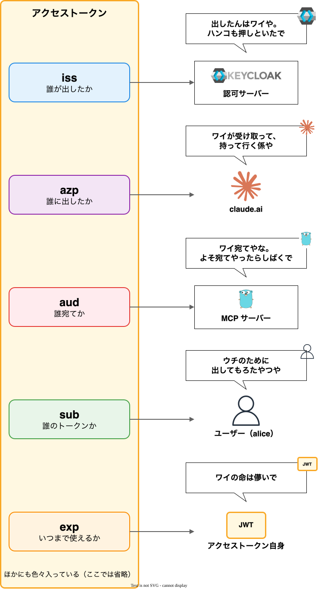
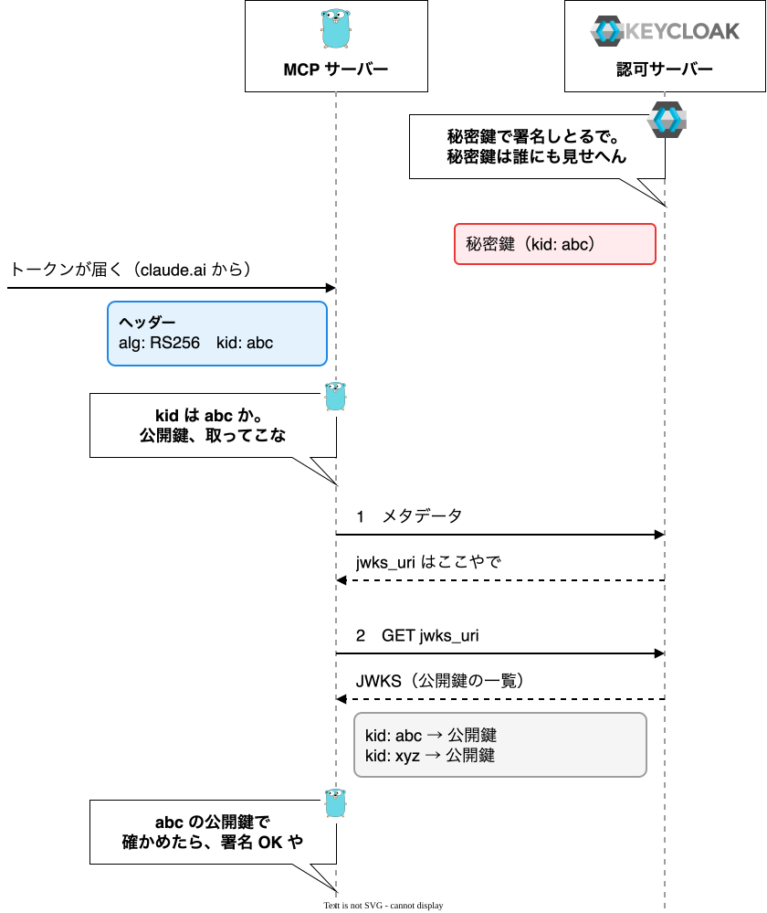
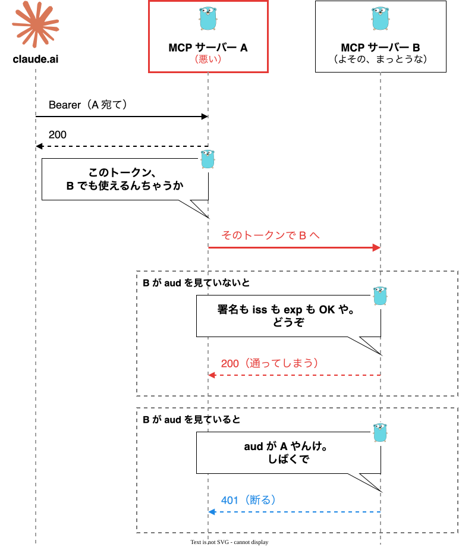
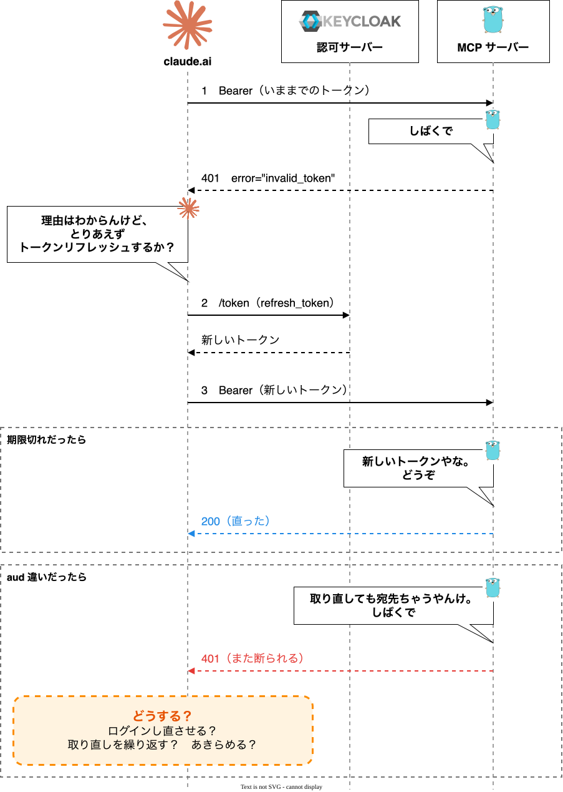
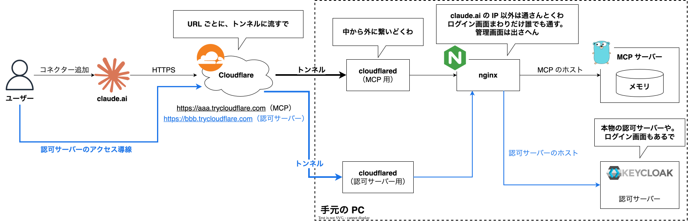
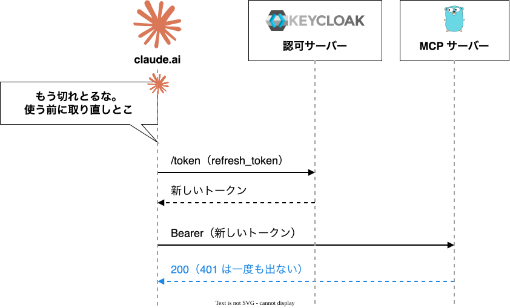
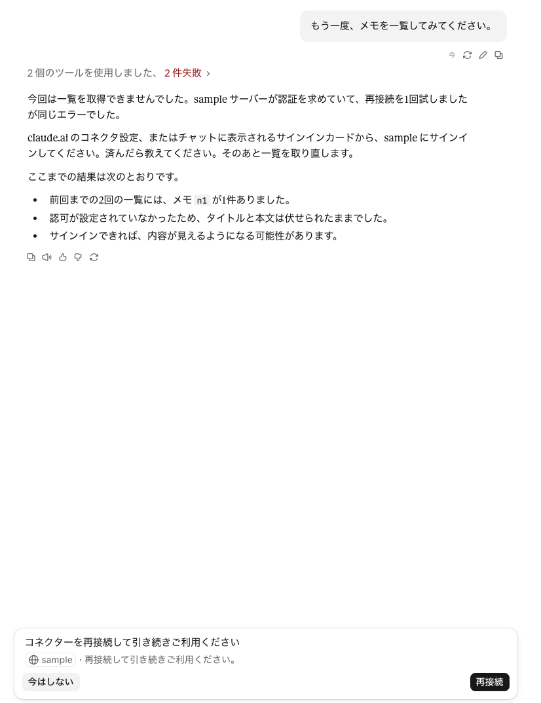
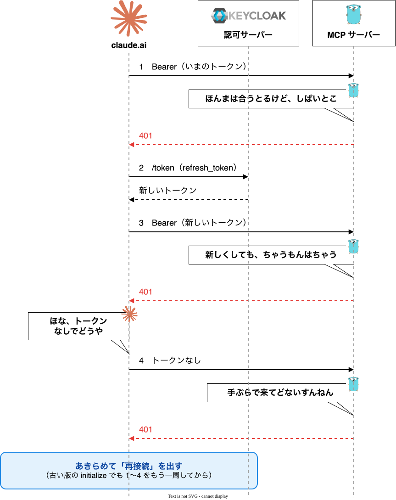

## 今日の問い

[前回](https://qiita.com/kou1046/items/43a1cb1599580cbd5439)は、Keycloak にログインして、トークン付きのリクエストが MCP サーバーに届くところまで進めました。

ただ、MCP サーバーは、届いたトークンを中身も見ずに通していました。`Authorization: Bearer` の後ろに何が書いてあっても、です。しかも、トークンには宛名（`aud`）すらありませんでした。

今回は、ちゃんと確かめて、ダメなトークンは 401 で断ります。では、MCP サーバーが断るようになったら、claude.ai はどうするのでしょうか。

先に言ってしまうと、claude.ai は断られるとけっこう足掻きます。でも、なぜ断られたのかは最後まで教えてくれません。

## トークンの何を確かめるのか

仕様：[MCP 2026-07-28 Authorization](https://modelcontextprotocol.io/specification/2026-07-28/basic/authorization)、[RFC 9068](https://www.rfc-editor.org/rfc/rfc9068)（JWT のアクセストークン）

アクセストークンは、JWT で払い出されることが多いです（Keycloak もそうです）。中には、こんなことが書いてあります。

<p align="center"></p>
<p align="center"><sub>図1：トークンには、誰が出したか（iss）、誰に出したか（azp）、誰宛てか（aud）、誰のトークンか（sub）、いつまで使えるか（exp）が書いてある</sub></p>

ほかにも、名前やメールアドレスなど色々入っていますが、MCP サーバーが確かめるのは、このうちの一部と署名です。MCP の仕様では、MCP サーバーは届いたトークンを確かめなければいけません（MUST）。特に、**「そのトークンが自分宛てに出されたものか」は、名指しで求められています**。

| 確かめるもの | 何を見るか | 省くと、何が通ってしまうか |
|---|---|---|
| 署名 | 認可サーバーの秘密鍵で署名されているか | 中身を自分で書き換えたトークン |
| `iss` | 自分が信じる認可サーバーが出したか | よその認可サーバー（別の realm）が出したトークン |
| `aud` | 自分宛てか | 別の MCP サーバー宛てのトークン |
| `exp` | 期限が切れていないか | 期限切れのトークン |

### 署名は、どう確かめるのか

仕様：[RFC 7517](https://www.rfc-editor.org/rfc/rfc7517)（JWK）、[RFC 8414](https://www.rfc-editor.org/rfc/rfc8414)（認可サーバーのメタデータ）

署名には、公開鍵の方式が使われます。認可サーバーは秘密鍵で署名し、MCP サーバーは、認可サーバーが公開している公開鍵（JWKS）で確かめます。

<p align="center"></p>
<p align="center"><sub>図2：MCP サーバーは、認可サーバーの JWKS から公開鍵を取ってきて、署名を確かめる</sub></p>

1. 認可サーバーのメタデータを読んで、`jwks_uri` を知る
2. `jwks_uri` から JWKS を取ってくる。中には、公開鍵が `kid`（鍵の ID）付きで並んでいる
3. トークンのヘッダーの `kid` を見て、JWKS から同じ `kid` の公開鍵を選び、署名を確かめる

JWKS は毎回取りに行くわけではなく、キャッシュしておきます。知らない `kid` が来たときだけ取り直す、というのが `kid` の使いどころです。

### なぜ aud がそんなに大事なのか

仕様：[MCP Security Best Practices（Token Passthrough）](https://modelcontextprotocol.io/specification/2026-07-28/basic/security_best_practices#token-passthrough)

前回、悪い MCP サーバー A が、別の MCP サーバー B を名乗って B 宛てのトークンを盗む、という攻撃を考えました。そのときは、claude.ai が入口で止めてくれました。

ただ、トークンを持ってくるのは claude.ai だけとは限りません。たとえば、A が自分宛てにもらったトークンを、そのまま B に持って行ったらどうでしょう。B が `aud` を見ていなければ、「Keycloak が出した、期限内の、正しい署名のトークン」として通してしまいます。

<p align="center"></p>
<p align="center"><sub>図3：A 宛てのトークンを、A が B に持って行く。B が aud を見ているかどうかで、結果が分かれる</sub></p>

だから、**B は自分で `aud` を見て、よそ宛てのトークンを断らないといけません**。

MCP の仕様は、自分宛てでないトークンを受け付けることを禁じています（MUST NOT）。受け付けたトークンをそのまま下流に流すことは Token Passthrough と呼ばれていて、こちらも禁止です。今回は、受け付ける側の話です。

### 確かめたいこと

ここまでで、何を確かめればいいかはわかりました。では、実際に MCP サーバーで確かめるようにしたら、どうなるのでしょうか。

気になるのは、MCP サーバーが 401 で断るようになったら、claude.ai はどうするのか、です。これまでは、トークンさえ付けてくれば素通しだったので、claude.ai が断られる場面はありませんでした。

仕様：[RFC 6750 §3.1](https://www.rfc-editor.org/rfc/rfc6750#section-3.1)

断り方には、標準があります。トークンがダメなときは、401 を返して、`WWW-Authenticate` に `error="invalid_token"` を付けます。期限切れでも、`aud` 違いでも、署名が壊れていても、同じ `invalid_token` です。理由を `error_description` に文で添えることもできますが、それは人が読むためのものです。

つまり、claude.ai には、なぜ断られたのかがわかりません。ただ、結果まで同じとは限りません。claude.ai が「とりあえずトークンを取り直す」とすると、期限切れなら新しいトークンで通ります。でも `aud` 違いなら、取り直しても宛先は同じなので、また断られるはずです。そのとき、claude.ai はどうするのでしょうか。

<p align="center"></p>
<p align="center"><sub>図4：同じ 401 でも、取り直して直るときと、直らないときがある</sub></p>

| 確かめたいこと | 気になる理由 | 予想 |
|---|---|---|
| 401 が返ると、claude.ai はどうするか | 期限切れも `aud` 違いも、同じ `invalid_token` で、claude.ai には区別がつかない | まずリフレッシュトークンで取り直す |
| 取り直しても直らないとき（`aud` 違い）、claude.ai はどうするか | 取り直しても、同じ宛先のトークンしか来ない | ログインし直させる |
| `error_description` に理由を書いたら、claude.ai はユーザーに見せるか | 401 だけでは、何がダメだったのか外からはわからない | 見せない |

## 作ってみる

### 作るもの

前回の構成に、トークンの検証を足します。

#### MCP サーバー（前回のものに変更）

- 届いたトークンの署名・`iss`・`aud`・`exp` を確かめる。どれかがダメなら 401 を返し、`WWW-Authenticate` に `error="invalid_token"` と、`error_description`（何がダメだったか）を付ける
- 公開鍵は、Keycloak の JWKS から取ってくる。受け付ける `alg` は `RS256` だけにする
- 自分宛てとみなす `aud` の値を、起動するときに変えられるようにする（`aud` が違うときの claude.ai を見る実験用）
- 確かめたあとのトークンの中身（`sub` など）を、ログに出す

#### Keycloak（前回のものに設定を足す）

前回見たとおり、Keycloak は default だと `aud` を入れてくれません。なので、少し設定をいじって、`aud` に MCP サーバーの URL を入れさせます。

- Audience マッパーを持ったクライアントスコープを作り、`aud` に MCP サーバーの URL を入れる
- そのクライアントスコープを realm の既定にして、DCR で登録された claude.ai にも付くようにする

`aud` は固定値で入れているだけで、Keycloak は今回も `resource` を聞き流しています。`resource` を `aud` に入れる Resource Indicators は、Keycloak ではまだ実験的な機能で、使うには Keycloak を新しくしたうえで、MCP サーバーをクライアントとして登録するなどの準備も要ります。今回は見送りました。

### 公開する

構成は、前回とまったく同じです。

<p align="center"></p>
<p align="center"><sub>図5：構成は前回と同じ。nginx は、ログイン画面まわりだけ誰でも通し、管理画面は外に出さない</sub></p>

### 実際に作ったもの

- https://github.com/kou1046/advent2026-mcp-authz/tree/main/days/12-06-token-validation

```sh
make tunnel   # 前回と同じ。表示された URL を claude.ai に登録する
make logs     # 届いたリクエストと、断った理由を見る
make audience AUDIENCE=https://example.com/mcp   # トンネルはそのままで、本物のトークンをよそ宛てとみなす
make down     # 試し終わったら、トンネルごと止める
```

トークンの検証は、ライブラリを使わずに Go の標準ライブラリだけで書きました（`cmd/mcp/token.go`）。署名を確かめるところは、RSA の公開鍵で `RS256` の署名を確かめるだけなので、思ったより短く済みます。ただ、これは中身を見るための手書きです。本番では、ちゃんとした JWT のライブラリを使いましょう。

## 繋いでみる

### まずは普通に繋ぐ

`make tunnel` で立ち上げて、claude.ai に登録し、`alice` でログインしました。ツールは、そのまま使えます。

MCP サーバーのログを見ると、トークンの `aud` に MCP サーバーの URL が入っていて、検証を通っていました。図1 の登場人物と並べると、こうです。

| クレーム | 意味 | 値 |
|---|---|---|
| `iss` | 誰が出したか | `https://bbb.trycloudflare.com/realms/mcp`（Keycloak） |
| `azp` | 誰に出したか | `8214b688-…`（DCR で登録された claude.ai） |
| `aud` | 誰宛てか | `https://aaa.trycloudflare.com/mcp`（MCP サーバーの URL） |
| `sub` | 誰のトークンか | `9cf73add-…`（alice） |

前回は項目ごとなかった `aud` が、ちゃんと入りました。

### 期限が切れると、claude.ai はどうするか

まずは、期限切れからです。トークンの有効期限は5分なので、5分待ってからツールを使ってみました。

さて、401 が返って、claude.ai が取り直しに行く……と思いきや、MCP サーバーには 401 が一度も出ていません。ログを並べると、こうなっていました。

| 時刻 | 何が起きたか |
|---|---|
| 0:00 | 最初のトークンが出る（`authorization_code`） |
| 5:00 | トークンの期限が切れる |
| 6:24 | ツールを使う前に、claude.ai が `/token` に `refresh_token` を送る（`resource` 付き） |
| 6:24 | 新しいトークンで、MCP サーバーにリクエスト。200 |

<p align="center"></p>
<p align="center"><sub>図6：期限切れのとき。claude.ai は使う前に取り直すので、401 は一度も出ない</sub></p>

先回りされた。**claude.ai は、期限が切れているのを知っていて、使う前に自分から取り直していました**。トークンをもらうときに、`/token` は有効期限（`expires_in`）も一緒に返しているので、それを覚えているのでしょう。期限切れのトークンは、そもそも MCP サーバーまで来ません。

取り直すときにも、claude.ai は `resource` をちゃんと付けてきていました。新しいトークンにも `aud` が入っていましたが、こちらは Audience マッパーが入れた固定値です。

ちなみに、期限が短いのには理由があります。MCP サーバーは JWT を手元で確かめるだけなので、認可サーバー側でトークンが取り消されても、それに気づけません。ログアウトさせても、`exp` までは通ってしまいます。だから、命を短くしておくわけです。図1 の「ワイの命は儚いで」は、伊達ではありません。

### aud が違うと、claude.ai はどうするか

本題です。期限切れでは 401 が出なかったので、claude.ai が「まだ使える」と思っているトークンを、MCP サーバーに断らせてみます。

とはいえ、`aud` の違うトークンは claude.ai からは来ません。なので、MCP サーバーに演技をさせます。トークンは本物のまま、MCP サーバーに「自分は `https://example.com/mcp` や」と思い込ませて、届いたトークンを「宛先ちゃうやんけ」と断らせます。

```sh
make audience AUDIENCE=https://example.com/mcp
```

この状態で、claude.ai にメモの一覧を頼むと、こうなりました。

<p align="center"></p>
<p align="center"><sub>図7：ツールが失敗して、「再接続」を求められる</sub></p>

この画面、なかなかレアかもしれません。期限切れなら claude.ai が先回りして取り直すので、途中まで使えていたトークンを、MCP サーバーが急に断ったときしか出てきません。演技させた甲斐がありました。

画面には「認証を求めていて」とだけ出ています。MCP サーバーは `error_description` に `aud does not include https://example.com/mcp` と理由を書いて返しているのですが、**どこにも出てきません**。

裏では、こう動いていました。1回の呼び出しで、こうです。

| 順 | claude.ai がしたこと | 結果 |
|---|---|---|
| 1 | いまのトークンで、MCP サーバーにリクエスト | 401 |
| 2 | `/token` に `refresh_token` を送る | 新しいトークンが出る |
| 3 | 新しいトークンで、もう一度リクエスト | 401 |
| 4 | トークンを付けずに、もう一度リクエスト | 401 |
| 5 | 古い版のやり方（2025-11-25 以前の `initialize` から始める形）で、1〜4 をやり直す | 全部 401 |

予想どおり、まずはリフレッシュして取り直していました。面白いのはその先です。**取り直してもダメだと、今度はトークンを付けずに送っています**。認可をやり直すために、トークンなしの 401 をもらい直しているようにも見えます。それでもダメなら、古い版のやり方でもう一周。なかなか律儀です。

<p align="center"></p>
<p align="center"><sub>図8：aud 違いのとき。リフレッシュ、トークンなしと試してから、あきらめる</sub></p>

図7 の「再接続」を押すと、ログイン画面が出ます。このとき claude.ai は、メタデータを読み直して、DCR でクライアントを登録し直していました。再接続のたびに、Keycloak にはクライアントが1つずつ増えていくわけです。[前々回](https://qiita.com/kou1046/items/e53ef45bdb4c8576ce09)見たとおり、Keycloak の DCR には「登録できるのは 200 件まで」というポリシーが付いています。再接続を繰り返していると、いつかそこにぶつかりそうです。

### 答え合わせ

| 確かめたいこと | 予想 | 結果 |
|---|---|---|
| 401 が返ると、claude.ai はどうするか | まずリフレッシュトークンで取り直す | 当たり。ただし期限切れでは、401 になる前に取り直していた |
| 取り直しても直らないとき（`aud` 違い）、claude.ai はどうするか | ログインし直させる | だいたい当たり。トークンなしでも試してからあきらめ、「再接続」を出す。再接続は DCR からやり直し |
| `error_description` に理由を書いたら、claude.ai はユーザーに見せるか | 見せない | 当たり |

## 感想

同じ 401 でも、期限切れと `aud` 違いで結果が分かれるはず。そう思って図4 を描いたのですが、期限切れの側は、claude.ai に先回りされて実験になりませんでした。思っていたより、claude.ai はしっかりしています。やるやん。

`aud` を確かめるのは、MCP サーバーの側の仕事です。そして、確かめて断っても、claude.ai はその理由をユーザーに伝えてくれません。

前回は「claude.ai が理由を教えてくれない」と書きましたが、今回は逆の立場で同じことが起きました。**MCP サーバーがいくら丁寧に `error_description` を書いても、ユーザーに見えるのは「再接続してください」だけです**。`aud` の設定を間違えた MCP サーバーの開発者は、再接続しても直らない、ログインし直しても直らない、という状況にハマりそうです。そして DCR だと、再接続のたびに、認可サーバーにはクライアントがひっそり増えていくので、何かしらの上限ポリシーにひっかかりそうです。

## まとめ

- MCP サーバーが確かめるのは、署名・`iss`・`aud`・`exp`。`aud` は自分で見ないと、よそ宛てのトークンが通ってしまう
- MCP サーバーが断ると、claude.ai はリフレッシュ → トークンなし → 再接続、とけっこう足掻く
- でも、なぜ断られたのか（`error_description`）は、ユーザーに見せてくれない

## 次回

今回で、MCP サーバーは「誰が来たか」（`sub`）がわかるようになりました。次回は2人目のユーザーを作って、自分のメモだけ読み書きできるようにします。
