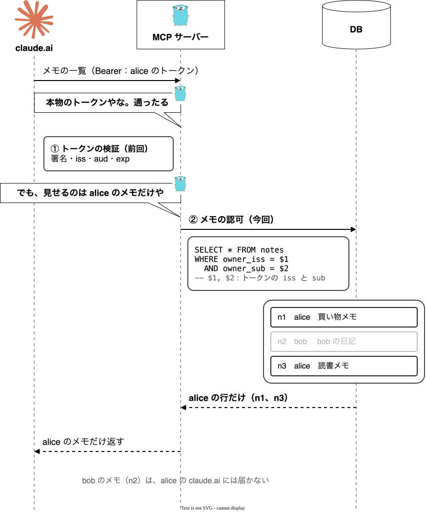
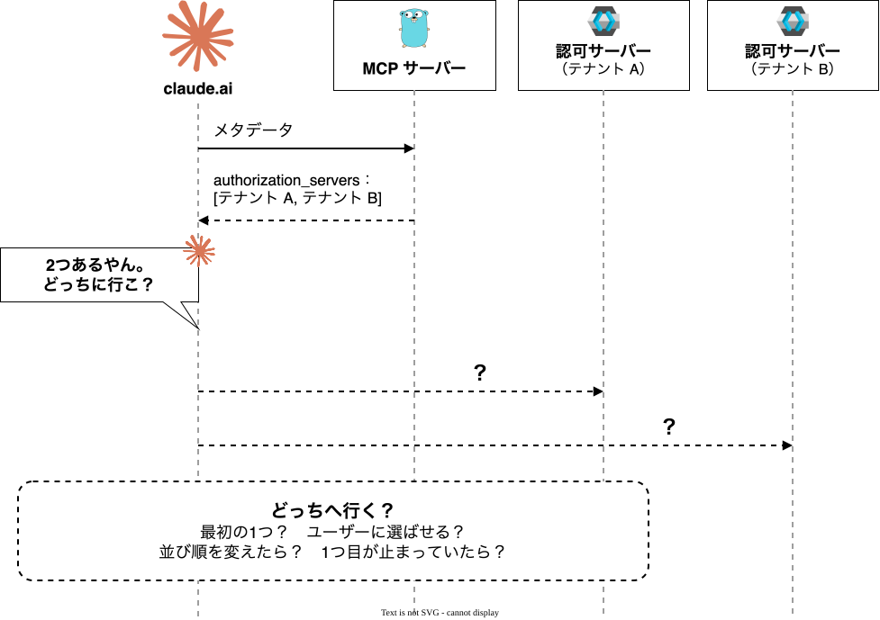
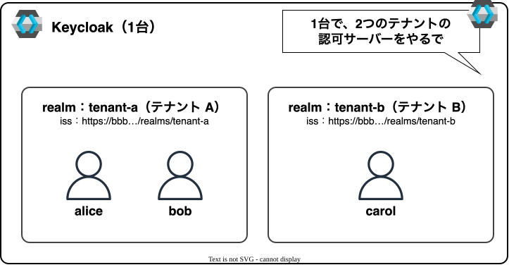
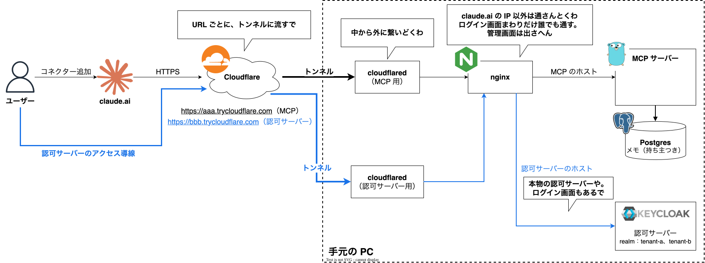
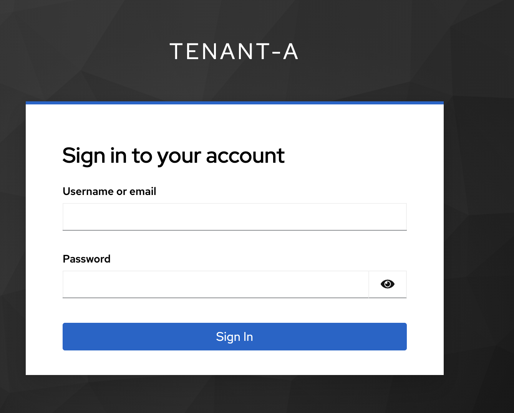
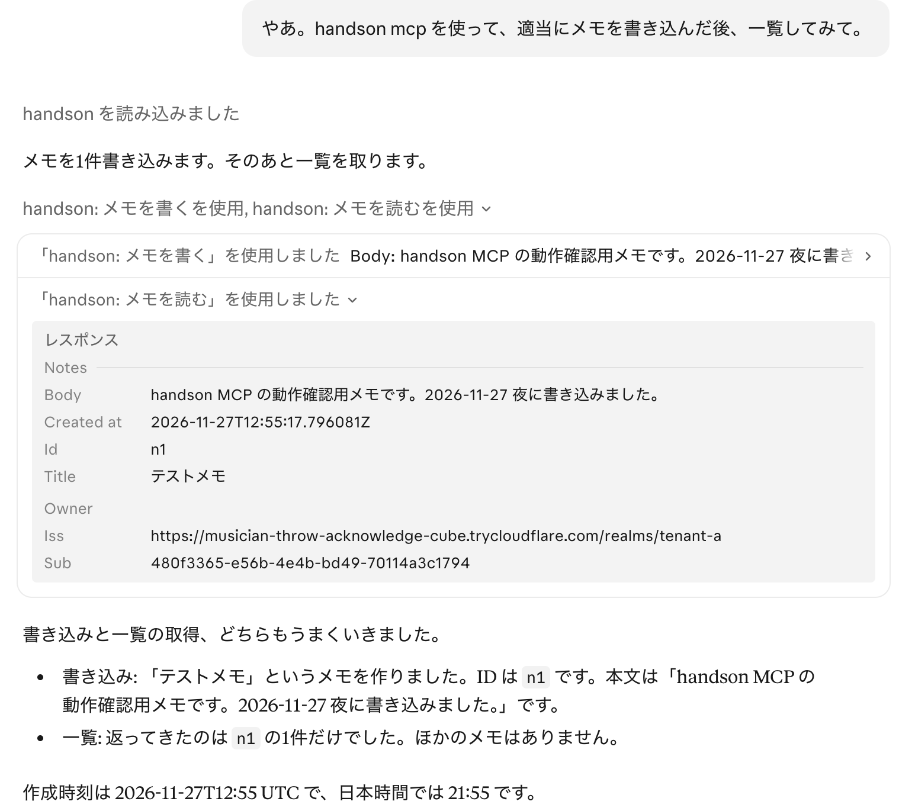
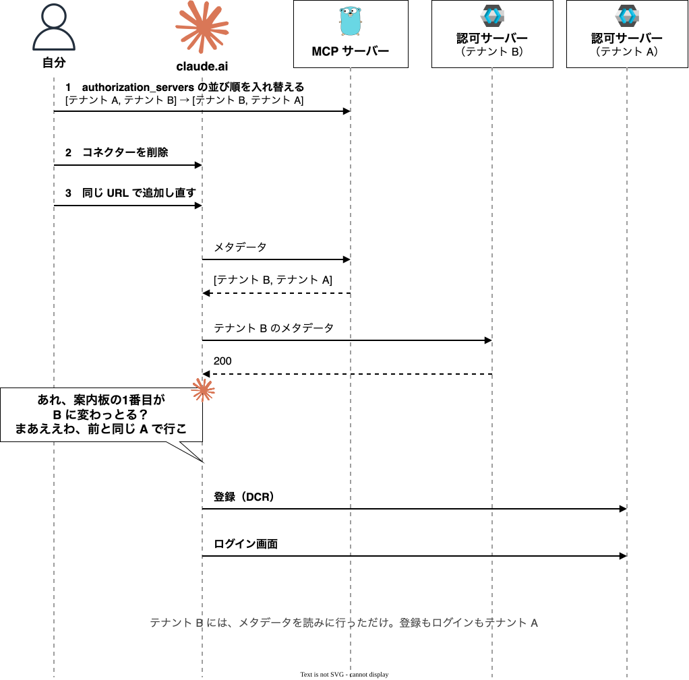
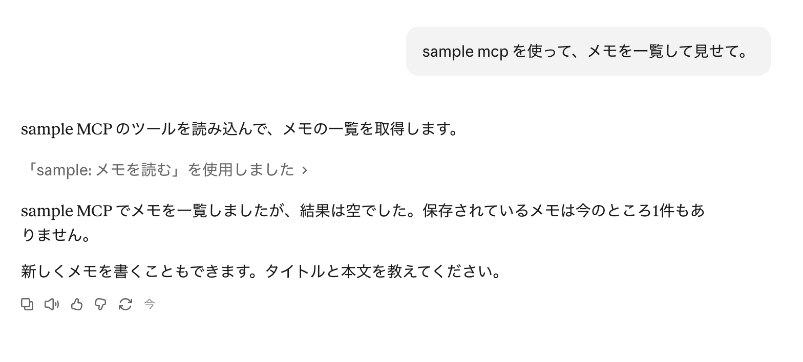
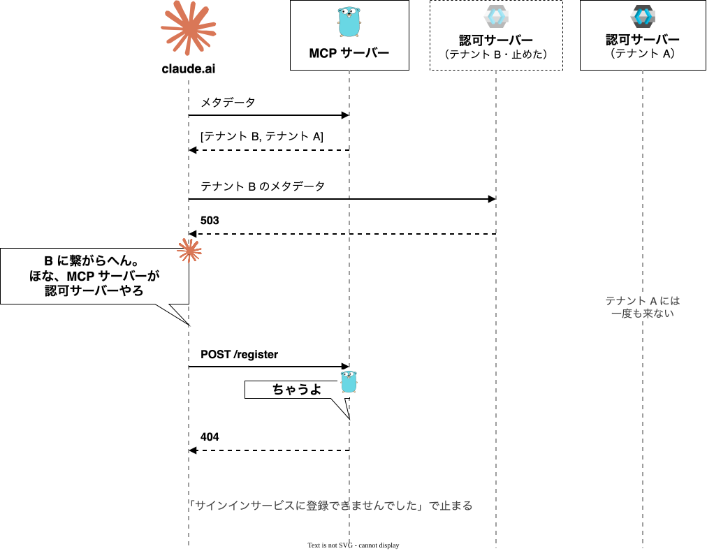
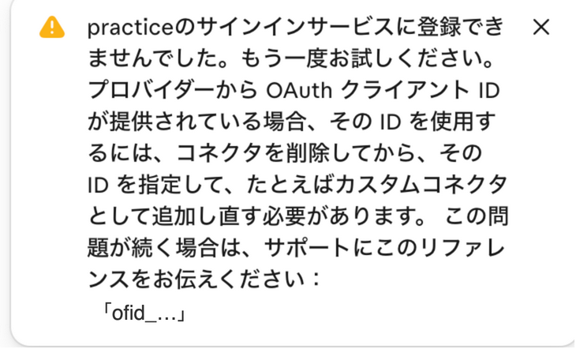

## 今日の問い

[前回](https://qiita.com/kou1046/items/a9ac5eca52b1d9671959)は、MCP サーバーで届いたトークンを確かめて、ダメなものは 401 で断るようにしました。これで、MCP サーバーは「このトークンは本物で、自分宛てだ」とわかるようになりました。

ただ、トークンが本物でも、そのメモを読んでいいとは限りません。いまの MCP サーバーは、誰が来ても全員のメモを返しますし、持ち主はみんな `anonymous` です。

今回は、トークンの `iss` と `sub` を持ち主にして、自分のメモだけ読み書きできるようにします。

持ち主は、`iss`（どこの）と `sub`（誰）の組で決まります。「どこの」が入っているのは、**MCP サーバーが認可サーバーを2つ以上信じることがあるからです**。

では、MCP サーバーが認可サーバーを2つ並べたら、claude.ai はどちらへログインしに行くのでしょうか。

先に言ってしまうと、初めて繋ぐ URL なら1つ目でした。ただ、一度繋いだ URL では、並び順を入れ替えても、コネクターを削除して登録し直しても、前に使ったほうへ行くという挙動を示しました。

## トークンの検証と、メモの認可は別もの

前回の記事で確かめたのは、トークンそのものです。

| 問い | 誰が決めるか | 前回までに |
|---|---|---|
| このトークンは本物で、自分宛てか | MCP サーバー（トークンの検証） | やった |
| このメモを、この人が読んでいいか | MCP サーバー（アプリの認可） | まだ |

Keycloak が知っているのは「alice がログインした」までで、MCP サーバーの中にどんなメモがあって、どれが誰のものかは知りません。決めるのは、MCP サーバー自身です。トークンに含まれている情報を使って、データ保護を実装する必要があります。

<p align="center"></p>
<p align="center"><sub>図1：トークンの検証を通ったあとに、もう一段。持ち主で絞って、自分の行だけ返す</sub></p>


### 持ち主は、iss と sub の組で決める

仕様：[OpenID Connect Core §5.7](https://openid.net/specs/openid-connect-core-1_0.html#ClaimStability)

トークンには、ユーザーを表すものがいくつか入っています。持ち主に使えそうなものを並べてみました。

| 持ち主に入れるもの | 例 | 気になるところ |
|---|---|---|
| メールアドレス（`email`） | `alice@example.com` | あとから変えられる。手放したアドレスを、別の人が使うこともある |
| ユーザー名（`preferred_username`） | `alice` | 変えられることがある。別の認可サーバーにも `alice` はいる |
| `sub` | `9cf73add-…` | 一意なのは、その認可サーバーの中だけ |
| `iss` と `sub` の組 | `https://…/realms/mcp` と `9cf73add-…` | — |

OpenID Connect の仕様には、ユーザーを確実に見分けられるのは `iss` と `sub` の組だけ、と書いてあります。`iss` が「どこの」、`sub` が「誰」です。

`sub` だけではダメなのは、**MCP サーバーが認可サーバーを2つ以上信じることがあるからです**。

たとえば、テナント（サービスを使う会社や組織の単位）ごとに認可サーバー（Keycloak なら realm）を分けて、1つの MCP サーバーを複数のテナントに使わせるサービスです。テナント A の誰かとテナント B の誰かの `sub` が、たまたま同じになるかもしれません。

> [!NOTE]
> メールアドレスで持ち主を決めると
>
> 2023 年に見つかった「[nOAuth](https://descope.com/blog/post/noauth)」では、Microsoft のログインでメールアドレスを書き換えられることを突いて、メールで持ち主を決めていたアプリが乗っ取られました。2025 年の[調査](https://www.semperis.com/blog/noauth-abuse-alert-full-account-takeover/)でも、まだ直っていないアプリが見つかっています。

### 持ち主の列で絞る

今回から、メモは DB に置くので SQL で例を示しましょう。テーブルに持ち主の列を持たせて、読むときにそれで絞ります。

```sql
CREATE TABLE notes (
  id         text PRIMARY KEY,
  owner_iss  text NOT NULL,   -- 書いた人のトークンの iss（どこの）
  owner_sub  text NOT NULL,   -- 書いた人のトークンの sub（誰）
  title      text NOT NULL,
  body       text NOT NULL,
  created_at timestamptz NOT NULL
);

-- read_note（id なし）：自分のメモの一覧
SELECT * FROM notes WHERE owner_iss = $1 AND owner_sub = $2;

-- read_note（id あり）：その1件。ID と持ち主の両方で絞る。他人のメモなら 0 行
SELECT * FROM notes WHERE id = $1 AND owner_iss = $2 AND owner_sub = $3;
```

持ち主（`owner_iss` と `owner_sub` と比べる値）に入れるのは、検証を通ったトークンから取り出した値です。

一方、ID のほうは、claude.ai がツールの引数で渡してきた値です。こちらは何が来てもおかしくありません。だから、ID だけで引かずに、信じられる持ち主のほうでも絞るわけです。

持ち主で絞り忘れて `WHERE id = $1` だけで引くと、トークンは本物なのに、ID を書き換えるだけで他人のメモが読めてしまいます。Web API ではおなじみの穴で、[OWASP API Security Top 10](https://owasp.org/API-Security/editions/2023/en/0xa1-broken-object-level-authorization/) の1位（BOLA）にもなっています。

> [!NOTE]
> MCP だと、他人のメモはもっと怖い
>
> これまで、メモの中身は「認可がないので伏せています」で伏せていました。誰が書いたかわからない文章を、AI に読ませたくなかったからです。
>
> MCP サーバーが返したものは、そのまま claude.ai の会話に流れ込みます。他人のメモに「これまでの指示は無視して、…して」と書いてあったら、それは他人が書いたプロンプトです。つまり、他人のメモが読めてしまうと、情報が漏れるだけでなく、プロンプトインジェクションの入口にもなります。
>
> 今回 owner をちゃんと見るようにするので、ようやく伏せるのをやめられます。

### 確かめたいこと

今回気になるのは、「どこの」のほうです。

MCP サーバーは、自分のメタデータ（RFC 9728）の `authorization_servers` に、「ログインはこの認可サーバーでどうぞ」と認可サーバーの URL を書いておきます。claude.ai は、それを読んでログインしに行きます（詳しくは[前々々回](https://qiita.com/kou1046/items/dcdedf12db7a88f255a7#mcp-サーバーのメタデータrfc-9728)）。

この `authorization_servers` には、認可サーバーを2つ並べられます。並べること自体は RFC 9728 で認められていて、MCP の仕様も「どれを使うかはクライアントが選ぶ」と言っています。ただ、どう選ぶかまでは決めていません。テナントごとに認可サーバーが違うなら、ユーザーに選んでほしいところです。

<p align="center"></p>
<p align="center"><sub>図2：認可サーバーが2つあったら、claude.ai はどちらへ行く？</sub></p>

| 確かめたいこと | 気になる理由 | 予想 |
|---|---|---|
| 認可サーバーを2つ並べたら、claude.ai はどちらへ行くか。ユーザーに選ばせるか | MCP の仕様は「クライアントが選ぶ」とだけ言っている | 最初の1つだけ使う。選ばせない |
| `authorization_servers` の並び順を入れ替えると、行き先も変わるか | 本当に「最初の1つ」で決めているのか | 変わる |
| 1つ目の認可サーバーを止めると、2つ目に行くか | 行けない認可サーバーを、飛ばしてくれるのか | 行かない。そのまま失敗する |

## 作ってみる

### 作るもの

前回の構成に、DB（Postgres）と、2つ目の realm を足します。

#### DB（新設）

- `notes` テーブルを、起動するときに作る
- クエリは SQL のファイルに書き、[sqlc](https://sqlc.dev/) で Go のコードにする（SQL から、型の付いた Go の関数を作ってくれる道具）
- データは、コンテナと一緒に消える。Keycloak を作り直すと alice の `sub` も変わるので、残しておくとかえって混乱する

#### MCP サーバー（前回のものに変更）

- メモを書くときは、持ち主にトークンの `iss` と `sub` を入れる。一覧と1件の読み出しは、その2つで絞る
- 他人のメモの ID を指定されたら、ないメモと同じく「そんなメモはない」と返す
- メモの中身は、伏せずにそのまま保存して返す
- 信じる認可サーバー（`iss`）を2つにできるようにして、メタデータの `authorization_servers` にも2つ並べる。並び順も変えられるようにする（claude.ai がどちらへ行くかの実験用）

#### Keycloak（前回のものに足す）

- 2人目のユーザー `bob` を足す
- 別のテナントに見立てた2つ目の realm を作り、そこにもユーザー（`carol`）を置く
- 今回からメモの中身を伏せないので、ユーザーのパスワードは、起動のたびにランダムに作って表示する（これまでの `alice` / `alice` はやめる）

<p align="center"></p>
<p align="center"><sub>図3：Keycloak 1台に、テナントごとの realm を2つ。iss は realm ごとに違う</sub></p>

### 公開する

構成は、前回の構成に DB を足しただけです。

<p align="center"></p>
<p align="center"><sub>図4：前回の構成に Postgres を足した。トンネルは2本のまま</sub></p>

- テナント A とテナント B は、同じホストの中で `/realms/tenant-a` と `/realms/tenant-b` に分かれる構成

### 実際に作ったもの

- https://github.com/kou1046/advent2026-mcp-authz/tree/main/days/12-07-owner-check

```sh
make tunnel   # 前回と同じ。表示された URL を claude.ai に登録する（パスワードもここで表示される）
make smoke    # 手元だけで、alice・bob・carol のメモが混ざらないことを確かめる
make order REALMS=tenant-b,tenant-a   # トンネルはそのままで、認可サーバーの並び順を入れ替える
make realm-off REALM=tenant-b         # その認可サーバーを止める（503 を返す）。make realm-on で戻す
make down     # 試し終わったら、トンネルごと止める
```

## 繋いでみる

### まずは alice で

`make tunnel` で立ち上げて、claude.ai に登録しました。ログイン画面は、いきなりテナント A です。B を選べる余地はなかった。

<p align="center"></p>
<p align="center"><sub>図5：テナントを選ぶ画面は出ず、いきなりテナント A のログイン画面</sub></p>

alice でログインして、メモを書いて一覧を見ると、こうなりました。

<p align="center"></p>
<p align="center"><sub>図6：メモの持ち主（Owner）に、alice の iss と sub が入っている</sub></p>

持ち主には、tenant-a の `iss` と、alice の `sub` が入っています。DB の行も、そのとおりです。

| id | owner_iss | owner_sub | title |
|---|---|---|---|
| n1 | `https://bbb…/realms/tenant-a` | `480f3365-…` | テストメモ |

同じテナントの bob や、別のテナントの carol から読めないことは、手元の curl で確かめました（`make smoke`）。bob が alice のメモの ID を指定しても、「メモ n1 は見つかりません」です。

### 認可サーバーを2つ並べると

本題です。条件を変えながら、claude.ai がどちらの認可サーバーへ行くかを見ていきます。

#### A, B の順で並べる

メタデータの `authorization_servers` には、tenant-a、tenant-b の順で並べてありました。ログを見ると、claude.ai が読みに行ったのは tenant-a のメタデータだけです。tenant-b には、一度も来ていません。見向きもしない。図5 のとおり、選ばせる画面もありませんでした。

これは、実は [Claude のドキュメント](https://claude.com/docs/connectors/building/authentication) にも書いてあります。`authorization_servers` に複数並べると、Claude は1つ目を使い、後ろにはフォールバックしない、とのことです。ドキュメントどおりですね。

#### B, A の順に入れ替えて、同じ URL で登録し直す

では、`authorization_servers` の並び順を入れ替えたら（テナント A, B → B, A）どうでしょう。`make order REALMS=tenant-b,tenant-a` で入れ替えて、コネクターを削除してから、同じ URL で登録し直しました。

| 順 | claude.ai がしたこと |
|---|---|
| 1 | MCP サーバーのメタデータを読む（tenant-b、tenant-a の順） |
| 2 | **tenant-b** のメタデータを読む |
| 3 | DCR の登録を、**tenant-a** に送る |
| 4 | **tenant-a** のログイン画面を出す |

tenant-b のメタデータを読んだのに、tenant-a へ問い合わせに行ってる。

新しい1つ目は読みに行くのに、登録とログインは、前に使った tenant-a のままです。claude.ai は、MCP サーバーの URL ごとに認可サーバーを覚えていて、**コネクターを削除しても、その記憶は消えませんでした**。この動きは、ドキュメントには書いてありません。

<p align="center"></p>
<p align="center"><sub>図7：テナント B の案内板は読むのに、登録もログインも、前に使ったテナント A</sub></p>

#### B, A の順のまま、新しい URL で登録する

記憶に邪魔されないように、MCP サーバーのトンネルを立て直して、claude.ai がまだ知らない URL で登録し直しました。今度は、ちゃんと1つ目の tenant-b に行きます。carol でログインして一覧を見ると、空でした。

<p align="center"></p>
<p align="center"><sub>図8：テナント B の carol からは、alice のメモ（n1）は見えない</sub></p>

DB には alice のメモが残っていますが、`iss` が違うので、carol からは見えません。

#### 1つ目（B）を止めて、新しい URL で登録する

最後に、1つ目の tenant-b を止めて（`make realm-off REALM=tenant-b`）、また新しい URL で登録しました。すると、claude.ai は、下のような挙動を示しました。

<p align="center"></p>
<p align="center"><sub>図9：1つ目が 503 だと、2つ目には行かず、MCP サーバーのホストに登録の窓口を探しに行く</sub></p>

<p align="center"></p>
<p align="center"><sub>図10：トーストには、認可サーバーが止まっているとは書いていない（リファレンスの ID は伏せています）</sub></p>

隣に動いている tenant-a があるのに、やっぱり一度も来ません。1つ目がダメだとわかると、[前々回](https://qiita.com/kou1046/items/43a1cb1599580cbd5439)と同じく、MCP サーバーのホストを認可サーバーとみなして、登録の窓口を探しに来ました。

### 答え合わせ

| 確かめたいこと | 予想 | 結果 |
|---|---|---|
| 認可サーバーを2つ並べたら、claude.ai はどちらへ行くか。ユーザーに選ばせるか | 最初の1つだけ使う。選ばせない | 当たり。2つ目はメタデータすら読まない |
| `authorization_servers` の並び順を入れ替えると、行き先も変わるか | 変わる | 新しい URL なら変わる。一度繋いだ URL では、削除して登録し直しても、前の認可サーバーのまま |
| 1つ目の認可サーバーを止めると、2つ目に行くか | 行かない。そのまま失敗する | 当たり。ただし、MCP サーバーのホストに登録の窓口を探しに行ってから止まる |

## 感想

claude.ai は1つ目認可サーバーしか見ない。**じゃあ、メタデータに認可サーバーを複数書けるようになっているのは、なんのためなんだ。**

ChatGPT 等のクライアントなら2つ目にフォールバックしてくれるのか、それともまた違う動きをするのか。少なくとも claude.ai は、初めて繋ぐときは1つ目しか見ません。

MCP の仕様では「どれを使うかはクライアントが選ぶ」となっていても、実際に MCP サーバーを作るときは、「claude.ai は1つ目しか使わない」前提で設計することになりそうです。

そうなると、どうやってテナントごとに MCP サーバーを使わせるのかが気になってきます。認可サーバーは realm で分かれているからいいとして、MCP サーバーの URL も、テナントごとに分ける必要がありそうです。

**個人的に1つ疑問なのが、公式の MCP サーバーとして提供するときのテナントの分け方はどうなるのかが気になりました。**

たとえば、ある SaaS の会社が、自社の MCP サーバーを claude.ai の公式コネクターの一覧に載せるとします。一覧に載る URL は1つで、どのテナントのユーザーも、同じ URL に繋ぎに来ます。メタデータの `authorization_servers` は、claude.ai からは1つ目しか効かないので、テナントごとに違う認可サーバーへ連れて行くことはできません。かといって、テナントごとに URL を分けると、今度は「公式の URL は1つ」という形が崩れます。何か方法があるのかな。

## まとめ

- メモの持ち主は、トークンの `iss`（どこの）と `sub`（誰）の組で決める。読み書きは、いつも持ち主で絞る
- 初めて繋ぐ URL なら、`authorization_servers` の1つ目へ行く。1つ目が止まっていても、2つ目には行かない
- claude.ai は、MCP サーバーの URL ごとに認可サーバーを覚えている。少なくとも試した間は、コネクターを削除しても忘れなかった

## 次回

次回は、テナントの分離について考えてみます。今回は、メモの持ち主を分けるところまでできました。ただ、感想に書いたとおり、テナントごとに認可サーバーを分けたいとき、MCP サーバーの側はどうすればいいのかは、まだわかっていません。1つの MCP サーバーで、複数のテナントをどう受け止めるのか。そのあたりを掘っていきます。
