## 今日の問い

[前回](https://qiita.com/kou1046/items/15c81d7decf9dddd874e)は、MCP サーバーのメタデータの `authorization_servers` に、テナントごとの認可サーバーを2つ並べてみました。結果、claude.ai は1つ目しか見ず、どちらの認可サーバーへ行くかを選ばせてくれませんでした。

では、テナントは、どこで選ばせればいいのでしょうか。

とくに困るのは、2つのテナントに属している人です。たとえば、テナント A とテナント B の両方で仕事をしているユーザーがいるとします。仮に dave としましょう。dave は、claude.ai から、どうやって「いまはテナント A として使う」「いまはテナント B として使う」を選べばいいのでしょうか。

今回は、テナントを選ばせるやり方を2つ考えて、それぞれ試してみます。

## TL;DR

- MCP サーバーの URL をテナントごとに分けると、会話の中で Claude が選ぶ（聞いてくるか、両方使う）
- 認可サーバーのログイン画面で選ばせると、dave がログインのときに選ぶ。今回試した範囲では、切り替えはログインし直し
- 前者は標準の範囲、後者は認可サーバーの独自機能（Keycloak の Organizations）頼み

## テナントを選ばせる場所

前回の感想では、テナントごとに URL を分けると「公式の URL は1つ」という形が崩れる、と悩んでいました。でも、調べてみると、URL は1つとは限らないようです。[Claude のドキュメント](https://claude.com/docs/connectors/building/authentication#servers-with-per-customer-urls)によると、公式のコネクターでも、顧客ごとに違う URL（たとえば `https://tenant-a.mcp.example.com/mcp`）で繋がせることができるそうです。

URL を分けるのもありだとすると、テナントを選ばせる場所は2つありそうです。

| | やり方1：URL で選ばせる | やり方2：ログイン画面で選ばせる |
|---|---|---|
| MCP サーバーの URL | テナントごと | 1つ |
| 認可サーバー（realm） | テナントごと | 1つ |
| テナントの見分け方 | URL と `iss` | トークンの中の何か |
| dave のコネクター | テナントの数だけ | 1つ |
| dave のアカウント | テナントの数だけ（realm ごとに別の人） | 1つ（1人が2つの組織に属する） |

### やり方1：URL で選ばせる

MCP サーバーの URL をテナントごとに分けて、それぞれのメタデータに、そのテナントの認可サーバーだけを書きます。

```
https://tenant-a.mcp.example.com/mcp   → メタデータには tenant-a の認可サーバーだけ
https://tenant-b.mcp.example.com/mcp   → メタデータには tenant-b の認可サーバーだけ
```

URL ごとにメタデータを置けば、claude.ai が1つ目しか見なくても困りません。

<p align="center">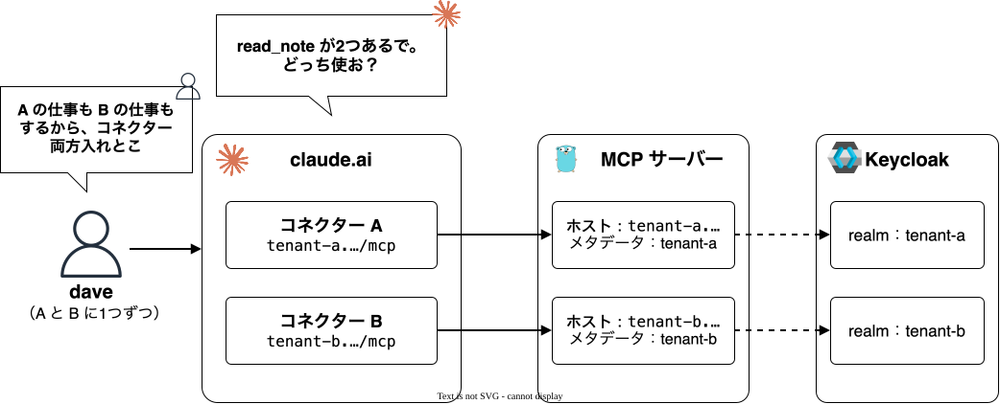</p>
<p align="center"><sub>図1：やり方1。テナントごとにコネクター、URL、realm が分かれる。ツールは2つ並ぶ</sub></p>

このやり方だと、dave はテナント A と B のコネクターを、両方登録することになります。すると、同じ名前のツール（`read_note`）が2つ並びます。

**dave が「メモを見せて」と頼んだら、claude.ai はどちらのツールを使うのでしょうか。**

### やり方2：ログイン画面で選ばせる

URL を1つのままにしたいなら、認可サーバーのほうも1つにしてしまう手があります。

ただ、そうすると「どのテナントの人か」を、どこで見分ければいいのでしょうか。前回は、テナントごとに認可サーバー（realm）が違ったので、トークンの `iss` で見分けられました。認可サーバーが1つなら、`iss` もみんな同じです。

トークンの中に、テナントを書いてもらえないでしょうか。

<p align="center">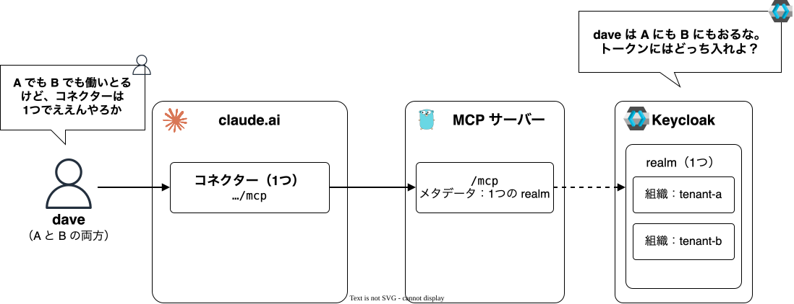</p>
<p align="center"><sub>図2：やり方2。コネクターも URL も realm も1つ。テナントは realm の中の組織</sub></p>

Keycloak のドキュメントを探すと、Organizations という仕組みがありました。

[ドキュメント](https://www.keycloak.org/docs/latest/server_admin/index.html)によると、realm の中に組織（テナント）を作って、ユーザーを所属させられるそうです。realm ごとに、設定で Organizations をオンにして使います。

組織の情報は、`organization` スコープを頼むとトークンに入ります。`organization` スコープは、すべてのクライアントに「頼めば付く（optional）」スコープとして、はじめから付いているそうです。特定の組織だけを頼むときは、`organization:tenant-a` のように書きます。

あれ、`organization` スコープ。どこかで見覚えがあります。[前々々回](https://qiita.com/kou1046/items/43a1cb1599580cbd5439#%E3%83%88%E3%83%BC%E3%82%AF%E3%83%B3%E3%81%AE%E4%B8%AD%E8%BA%AB)、claude.ai のトークンの `scope` を見たときに、並んでいました。claude.ai は、認可サーバーのメタデータの `scopes_supported` に並んだスコープを全部頼んでくるので、`organization` も頼んできていたわけです。

つまり、Keycloak にはトークンにテナントを入れる仕組みはありそうです。では、2つの組織に属する dave のトークンには、どちらが入るのでしょうか。

もし両方入ってしまったら、MCP サーバーは、dave がどちらのテナントとして来たのかを決められません。そのときは、ツールの引数でテナントを渡してもらうことになりそうです。ただ、その値は claude.ai が渡してくるものなので、そのまま信じるわけにはいきません。

トークンの中の所属と突き合わせて、本当にそのテナントに属しているかを確かめる必要があります。

> [!NOTE]
> テナントが違うのに、realm は1つでいいの？
>
> realm は、Keycloak の中でいちばん強い仕切りです。ユーザー、クライアント、ログイン画面、鍵（`iss`）まで、realm ごとに丸ごと別になります。別の realm のユーザー同士は、同じ名前でも別人です。
>
> Organizations は、1つの realm の中に作る、もっと軽い仕切りです。ユーザーやログイン画面、鍵は realm で共有したまま、「このユーザーはどの組織に属しているか」だけを持ちます。同じ realm の中なので、1人のユーザーが2つの組織に属することもできます。
>
> 仕切りの強さを落としてでも、ユーザーを共有したい、`iss` を1つにしたい、というときの選択肢のようです。

### 確かめたいこと

| 確かめたいこと | 気になる理由 | 予想 |
|---|---|---|
| やり方1：dave がテナント A と B のコネクターを両方登録して「メモを見せて」と頼むと、claude.ai はどちらのツールを使うか | 同じ名前のツールが2つ並ぶ | 聞き返さずに、どちらか片方を使う |
| やり方2：dave のトークンには、どちらのテナントが入るか。ログインのときに選ばされるか | claude.ai は、テナントを1つ選ぶ頼み方をしてこない | 両方入る。選ばされない |

<p align="center">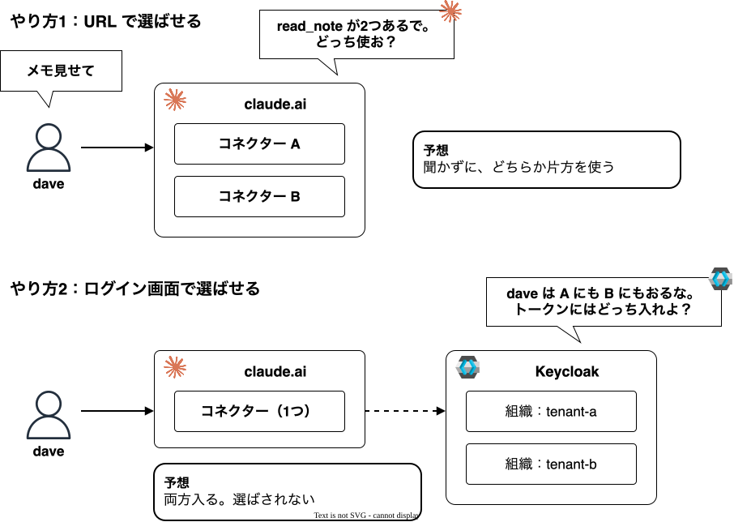</p>
<p align="center"><sub>図3：確かめたいことと、予想</sub></p>

やり方1 の「どちらのツールを使うか」は、claude.ai の仕組みというより、Claude がその場でどう選ぶかの話です。同じ頼み方でも、毎回同じとは限りません。なので、頼み方を変えて試します。

## 作ってみる

### 作るもの

前回の構成のまま、やり方1 と やり方2 を、1つの MCP サーバーに同居させます。来たホスト名で出し分けます。パスはどれも `/mcp` です（パスで分けなかった理由は、[別の記事](https://qiita.com/kou1046/items/ffde6d39ea9ab4f54abf)に書きました）。

| MCP サーバーのホスト | 認可サーバー | テナントの決め方 |
|---|---|---|
| テナント A 用、テナント B 用 | realm `tenant-a`、`tenant-b`（前回のまま） | ホスト名と `iss` |
| それ以外（1つ） | realm `shared`（新設。Organizations をオン） | トークンの `organization` クレーム |

#### DB（前回のものに変更）

- `notes` テーブルに `tenant` の列を足す
- 一覧と1件の読み出しは、持ち主（`iss` と `sub`）に加えて、テナントでも絞る
- やり方2 は `iss` が全員同じで、dave の `sub` も1つ。持ち主だけで絞ると、テナント A と B のメモが混ざってしまう

#### MCP サーバー（前回のものに変更）

やり方1（テナントごとのホスト）
- ホストごとにメタデータを置く。`authorization_servers` には、そのテナントの認可サーバーだけを書く
- そのホストで受け付けるのは、そのテナントの認可サーバーが出したトークン（`iss`）だけ。テナントはホスト名で決まる

やり方2（それ以外のホスト）
- メタデータの `authorization_servers` には、realm `shared` だけを書く
- トークンの `organization` クレームを読む
  - 組織が1つなら、それをテナントにする
  - 2つ以上なら、ツールの引数 `tenant` で選んでもらう。クレームに入っていないテナントを指定されたら断る
  - 1つも入っていなければ、「テナントがわからない」と返す

両方
- ツールの結果に、どのテナントとして読み書きしたか（`tenant`）を入れて返す

#### Keycloak（前回のものに足す）

- realm `tenant-a` と `tenant-b`（やり方1 用）：前回の realm（alice と bob、carol）に、dave を両方に足す。dave は realm ごとに別のアカウントになる
- realm `shared`（やり方2 用）：Organizations をオンにして、組織 `tenant-a` と `tenant-b` を作る。alice を `tenant-a` に、dave を両方に所属させる
- 所属は、管理者が決める値にする。ユーザーが自分で書き換えられる値（メールアドレスなど）からは決めない（前回の nOAuth の話）

<p align="center">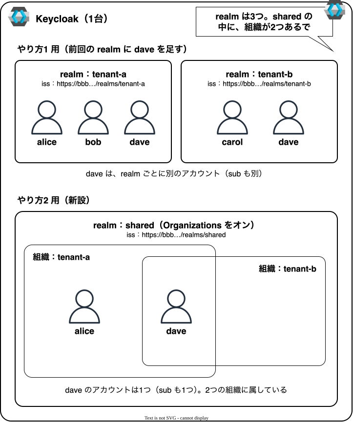</p>
<p align="center"><sub>図4：Keycloak 1台に realm を3つ。dave は、やり方1 では realm ごとに別人、やり方2 では1人で2つの組織に属する</sub></p>

### 公開する

構成は、前回とほぼ同じです。MCP サーバー用のトンネルだけ、テナントの分だけ増えます。

- MCP サーバー用のトンネルは3本（やり方2 用、テナント A 用、テナント B 用）。サブドメインが違うので、ホスト名がそれぞれ違う。どれも同じ MCP サーバーに届く
- Keycloak のホストは1つのまま、`/realms/tenant-a`、`/realms/tenant-b`、`/realms/shared` に分かれる

<p align="center">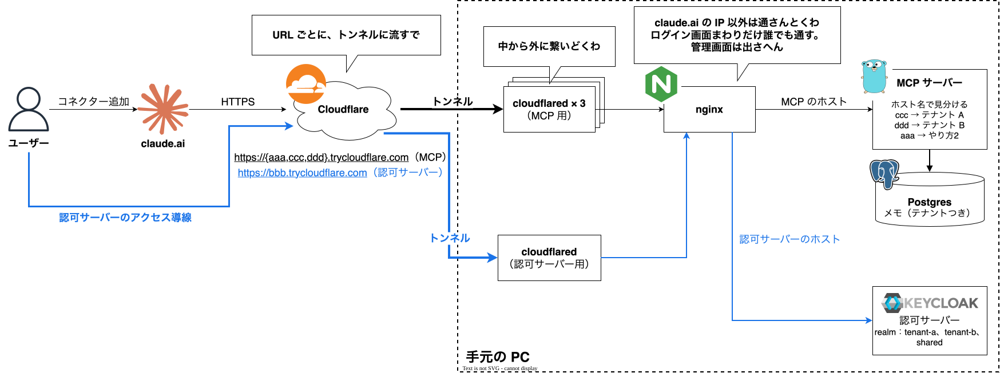</p>
<p align="center"><sub>図5：MCP サーバー用のトンネルが3本に。MCP サーバーはホスト名でテナントを見分ける</sub></p>

### 実際に作ったもの

- https://github.com/kou1046/advent2026-mcp-authz/tree/main/days/12-08-tenant-separation

```sh
make tunnel   # claude.ai に登録する URL が3つ（テナント A 用、テナント B 用、やり方2 用）表示される（パスワードもここで表示される）
make smoke    # 手元だけで、テナントと持ち主の両方で絞られていることを確かめる
make down     # 試し終わったら、トンネルごと止める
```

## 繋いでみる

### やり方1：URL で選ばせる

テナント A 用とテナント B 用の URL を、別々のコネクターとして登録します。ログインは、それぞれの realm の dave です。

まずはテナント A だけを繋いでみます。ふつうに使えました。

両方を登録して、「tenant mcp を使って、メモを適当に書いて一覧してみて」と頼んでみます。

<p align="center">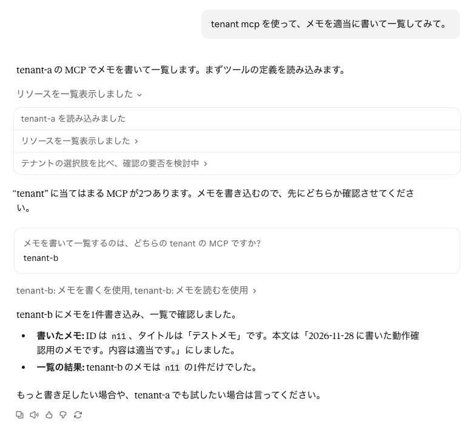</p>
<p align="center"><sub>図6：どちらのテナントか聞いてきて、選んだテナント B にだけ書いた</sub></p>

ちゃんと聞いてきた。てっきり、黙ってどちらかを使うと思っていたのですが、ハズレでした。

今度は、新しいチャットで「メモを見せて」とだけ頼んでみます。

<p align="center">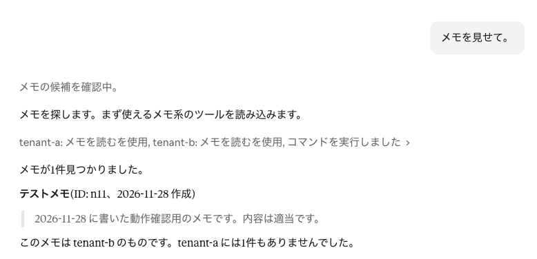</p>
<p align="center"><sub>図7：聞かずに、両方読んでまとめた</sub></p>

両方のツールを呼んで、まとめてきました。どのメモがどのテナントのものかも、ちゃんと分けて書いています。ツールの結果に `tenant` を入れておいたのが効いていそうです。

### やり方2：ログイン画面で選ばせる

URL を1つだけ、`handson` という名前で登録して、realm `shared` の dave でログインします。

ユーザー名を入れたところで、見慣れない画面が出ました。

<p align="center">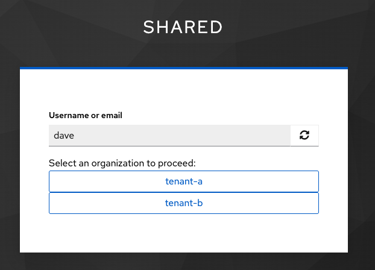</p>
<p align="center"><sub>図8：Keycloak が、どの組織で入るかを聞いてきた</sub></p>

おお、選ばせてくれるんだ。claude.ai が頼んできたのは、素の `organization` スコープです。2つの組織に属している dave には、Keycloak のほうが、どちらで入るかを聞いてくれました。

tenant-a を選んで繋ぐと、トークンの `organization` クレームには `tenant-a` だけが入っていました。

```json
"organization": ["tenant-a"]
```

<p align="center">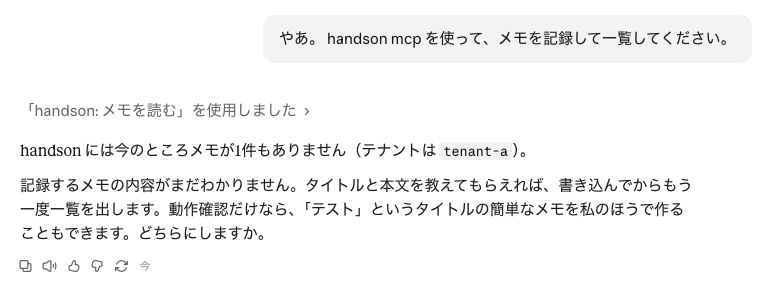</p>
<p align="center"><sub>図9：ログインで選んだテナント A として使えた</sub></p>

では、このままテナント B のメモを頼むとどうなるでしょうか。

<p align="center">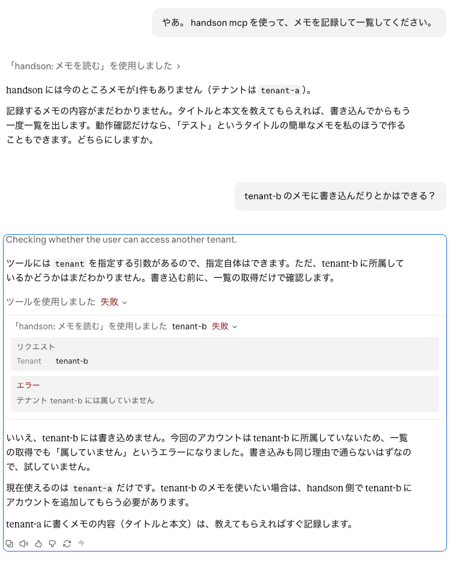</p>
<p align="center"><sub>図10：引数で tenant-b を指定してきたが、MCP サーバーが断った</sub></p>

Claude は、ツールの引数 `tenant` に `tenant-b` を入れてきました。MCP サーバーは、トークンの所属（`tenant-a` だけ）と突き合わせて断っています。ここは狙いどおりです。

ただ、Claude の返事は「tenant-b に所属していない」「アカウントを追加してもらう必要がある」でした。いや、dave は tenant-b にも属しているんですよね。このログインで tenant-a を選んだだけです。MCP サーバーの断り文句が「属していません」だったので、Claude はそれを素直に受け取ったようです。

テナント B を使うには、コネクターを再接続して、ログインし直します。もう一度、組織を選ぶ画面が出たので、tenant-b を選ぶと、トークンの中身も `tenant-b` に変わりました。

<details><summary>寄り道：ログインし直さずに、両方使えないか（試したけど諦めた）</summary>

テナントを替えるたびにログインし直すのは、ちょっと面倒です。両方まとめてトークンに入れてもらえないでしょうか。

Keycloak には、`organization:*` というスコープの頼み方もあります。手元でログイン画面を通さずにトークンを取ってみると、これなら dave の `organization` には `tenant-a` と `tenant-b` の両方が入りました。逆に、素の `organization` で取ると、何も入りませんでした。素の `organization` は、ログイン画面で1つ選ばせる前提のようです。

あとは、claude.ai に `organization:*` を頼ませれば勝ち、と思ったのですが、ここから3回断られました。

<p align="center">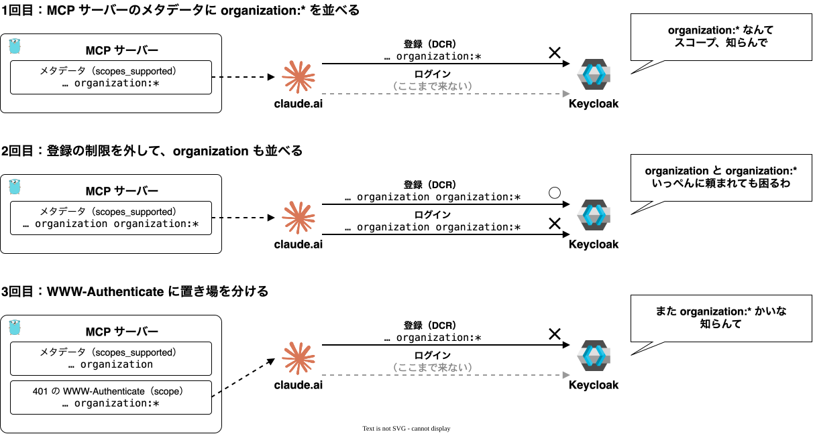</p>
<p align="center"><sub>図11：organization:* を頼ませようとして、3回断られた</sub></p>

1回目。claude.ai が頼んでくるのは、ふだんは認可サーバーのメタデータの `scopes_supported` に並んだスコープで、そこには素の `organization` しかありません。MCP サーバーのメタデータにも `scopes_supported` を書けるので、`organization:*` を並べてみました。claude.ai は、ちゃんとそちらを頼んでくるようになりました。ところが、今度は Keycloak がコネクターの登録（DCR）を断りました。`organization:*` は、スコープの名前としては存在しないからです。

2回目。登録の制限を外して、`organization` も並べてみると、今度は登録は通りましたが、ログイン画面の手前で「スコープが正しくない」と断られました。`organization` と `organization:*` を一緒に頼むと、Keycloak は受け付けないようです。かといって `organization` を外すと、登録したクライアントに `organization` スコープが付かず、`organization:*` も効きません。

3回目。登録では `organization` を、ログインでは `organization:*` だけを頼んでくれればいいので、401 の `WWW-Authenticate` の `scope` に `organization:*` の一覧を書いて、置き場を分けてみました。ところが、claude.ai は登録にもそちらの一覧を使ってきて、また登録で断られました。

ここで見送りました。claude.ai は、登録とログインで同じスコープの一覧を使います。Keycloak は、登録とログインで違う一覧を求めます。この食い違いは、MCP サーバーの側からはどうにもできませんでした。なお、この試行はリポジトリには入れていません。

</details>

### 答え合わせ

| 確かめたいこと | 予想 | 結果 |
|---|---|---|
| やり方1：dave がテナント A と B のコネクターを両方登録すると、claude.ai はどちらのツールを使うか | 聞き返さずに、どちらか片方を使う | どちらか聞いてくる、または聞かずに両方使う |
| やり方2：dave のトークンには、どちらのテナントが入るか。ログインのときに選ばされるか | 両方入る。選ばされない | ログインで選んだ1つだけ。Keycloak が選ばせる |

<p align="center">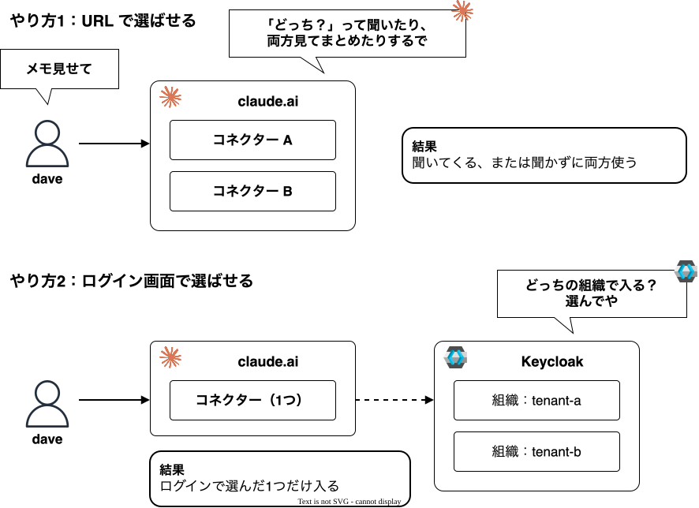</p>
<p align="center"><sub>図12：答え合わせ</sub></p>

予想は、全部ハズレでした。

やり方1 では、テナントを選ぶのは Claude です。試した2回では、黙ってどちらかを使うことはなく、迷ったら聞く、または全部使ってまとめる、という動きでした。

やり方2 では、テナントを選ぶのは dave 自身で、場所はログイン画面です。今回の作りでは、1つのコネクターで同時に使えるのは1つのテナントだけで、切り替えるにはログインからやり直しでした。「作るもの」で用意した、組織が2つ以上入っていたら引数 `tenant` で選ぶ分岐は、claude.ai からは一度も通りませんでした。

## 感想

試してわかった違いを、並べてみます。

| | やり方1：URL で選ばせる | やり方2：ログイン画面で選ばせる |
|---|---|---|
| dave が用意するもの | コネクターもアカウントも、テナントの数だけ | コネクターもアカウントも1つ |
| テナントの切り替え | 会話の中で（Claude が聞いてくるか、両方使う） | 再接続して、ログインし直す |
| 同時に使えるテナント | 両方 | 1つだけ |
| 1つの会話にテナントが混ざるか | 混ざりうる | 混ざらない |
| テナントが増えると | realm とアカウントが増える | 組織を足すだけ |
| 頼っているもの | 標準の範囲（`iss`） | Keycloak の独自機能（Organizations） |

やり方1 は、テナントごとに専用の URL を用意するだけです。標準のプロトコルの範囲に収まるので、作るのは楽です。

そのかわり、**ユーザーはテナントの数だけ URL を登録して、ログインしないといけません**。2つならまだしも、5つあったらうんざりしそうです。

**やり方2 は、URL が1つで済みます。登録は1回だけ。ユーザーから見たら、始めるのはこっちのほうが断然楽です**（今回の作りでは、テナントを替えるたびにログインし直しの必要はありますが）。

そのかわり、テナントをトークンに入れるところに、認可サーバーの独自機能が入り込みます。今回は Keycloak の Organizations でしたが、別の認可サーバーに替えたら作り直しです。作る側と運用する側は大変そうです。ここは標準化される余地がないのか、気になりました。

**結局、ユーザーの楽さを取るか、作る側の楽さを取るか**、だと思いました。どちらが正解というより、何を優先するかを決めないといけない。要はバランス。なにごとも。

## 次回

次回は、claude.ai が MCP サーバーに繋ぐときの、OAuth のログインの流れを壊してみます。MCP の仕様では PKCE が必須になっていますが、PKCE や redirect_uri・state を省いたら、何が起きるのでしょうか。
****

