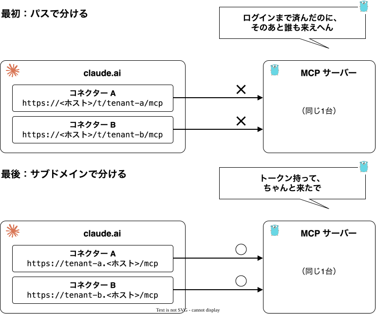
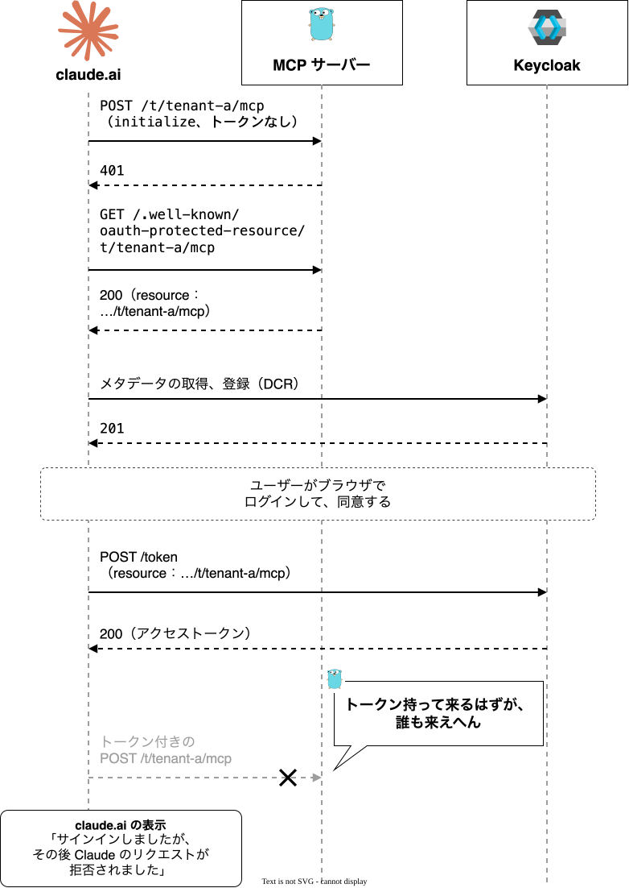

## TL;DR

MCP サーバーの URL を、同じホストのままパスで分けると、claude.ai はログインまで済ませたあと、MCP サーバーを呼びに来ませんでした。

```
✕ https://<ドメイン>/t/tenant-a/mcp   → テナント A
✕ https://<ドメイン>/t/tenant-b/mcp   → テナント B
```

ホスト（サブドメイン）で分けて、パスを `/mcp` だけにしたら繋がりました。

```
○ https://tenant-a.<ドメイン>/mcp   → テナント A
○ https://tenant-b.<ドメイン>/mcp   → テナント B
```

同じ報告が [issue #878](https://github.com/anthropics/claude-ai-mcp/issues/878) にあり、まだ解決していません。

## きっかけ

[アドベントカレンダーの記事](https://qiita.com/kou1046/items/edd5128cedd69bf2660c)の実験中のことです。

1つの MCP サーバーで、テナントごとに別の URL を出したくなりました。最初は、ホストは1つのまま、パスでテナントを分けていました。

```
https://<ホスト>/t/tenant-a/mcp   → テナント A
https://<ホスト>/t/tenant-b/mcp   → テナント B
```

顧客（テナント）ごとに URL を分けるやり方は、[Claude のドキュメント](https://claude.com/docs/connectors/building/authentication#servers-with-per-customer-urls)にも「Servers with per-customer URLs」として載っています。公式のコネクターでも、顧客ごとに違う URL で繋がせることができるそうです。

パスで分ければ、ホスト名も1つで済むし、誰でも一度は考えそうな形です。ところが、claude.ai のカスタムコネクターに登録すると、これが繋がりませんでした。

試した条件は次のとおりです。

- MCP サーバー：Go で書いた自作のもの。Cloudflare の quick tunnel（`trycloudflare.com`）で公開し、手前に nginx を置いている
- 認可サーバー：Keycloak 26.4.7（同じく quick tunnel で公開）
- claude.ai のコネクターの登録：DCR（動的クライアント登録）

<p align="center">/t/tenant-a/mcp など）。ログインまでは済むが、そのあと claude.ai は MCP サーバーに来ない。最後はサブドメインで分けた（https://tenant-a.<ホスト>/mcp など）。トークンを持って来た。MCP サーバーはどちらも同じ1台" width="700"></p>
<p align="center"><sub>図1：パスで分けると繋がらず、サブドメインで分けると繋がった</sub></p>

## 起きたこと

コネクターを追加すると、ログイン画面まではふつうに進みます。ログインして同意すると、claude.ai にこう言われます。

> （サービス名）にサインインしましたが、その後 Claude のリクエストが拒否されました。（サービス名）のアカウントで Claude からのアクセスが許可されていないか、ファイアウォールが Claude をブロックしている可能性があります。

拒否？と思って、MCP サーバーと認可サーバー（Keycloak）の手前に置いた nginx のログを見ました。

```
時刻      ホスト              リクエスト                                                        状態  User-Agent
03:21:23  MCP サーバー        POST /t/tenant-a/mcp                                               401   python-httpx
03:21:23  MCP サーバー        GET  /.well-known/oauth-protected-resource/t/tenant-a/mcp          200   python-httpx
03:21:24  認可サーバー        GET  /.well-known/oauth-authorization-server/realms/tenant-a       200   python-httpx
03:21:27  認可サーバー        POST /realms/tenant-a/clients-registrations/openid-connect         201   python-httpx
03:21:28  認可サーバー        GET  /realms/tenant-a/protocol/openid-connect/auth?…               200   （ブラウザ）
03:21:43  認可サーバー        POST /realms/tenant-a/login-actions/authenticate?…                       （ブラウザ）
03:21:46  認可サーバー        POST /realms/tenant-a/protocol/openid-connect/token                200
（ここから先、MCP サーバーへのリクエストは1件もない）
```

- MCP サーバーへの最初のリクエスト（トークンなしの `initialize`）は 401。メタデータ（`/.well-known/oauth-protected-resource/t/tenant-a/mcp`）も、ちゃんと読みに来ている
- DCR、ログイン、同意と進んで、`/token` は 200 でトークンを渡せている
- `/token` に送られた `resource` には、パス付きの URL（`https://<ホスト>/t/tenant-a/mcp`）が入っている
- なのに、そのあと MCP サーバーには、リクエストが1件も来ない

流れを図にすると、こうなります。

<p align="center"></p>
<p align="center"><sub>図2：トークンまでは取れるのに、そのあと MCP サーバーに来ない</sub></p>

拒否したくても、そもそも来ていません。nginx にも、cloudflared にも、何も残っていませんでした。

## 切り分け

同じホスト、同じ認可サーバーのまま、少しずつ変えてみました。

| URL | 認可サーバー（realm） | 結果 |
|---|---|---|
| `https://<ホスト>/mcp` | `shared` | 繋がる |
| `https://<ホスト>/t/tenant-a/mcp` | `tenant-a` | 繋がらない |
| `https://<ホスト>/t/shared/mcp` | `shared` | 繋がらない |
| `https://<ホスト>/shared/mcp` | `shared` | 繋がらない |
| `https://<テナント A のホスト>/mcp` | `tenant-a` | 繋がる |

realm を同じにしても、パスが `/mcp` だけでなければダメでした。段数（`/t/x/mcp` か `/x/mcp` か）も関係ありません。ホストを分けて `/mcp` だけにすれば、繋がります。

`/mcp` のときは、トークンを取った直後に、`Claude-User` という User-Agent でリクエストが来ていました。

```
03:24:46  MCP サーバー        POST /mcp                                                          200   Claude-User
```

`/mcp` 以外では、この `Claude-User` が一度も来ていません。claude.ai の側で、呼ぶ前に止まっているように見えます。

MCP サーバーの側が壊れているわけでもなさそうです。

- 同じパス（`/t/tenant-a/mcp`）には、最初の 401 とメタデータの読み出しが、claude.ai から同じトンネルを通って届いています。外から届かないパスではありません
- 手元からトークン付きで同じパスを叩くと、メモの読み書きもできていました

## 同じ報告があった

引っかかった人はいないのかと探してみると、ありました。

- [anthropics/claude-ai-mcp #878](https://github.com/anthropics/claude-ai-mcp/issues/878)「OAuth completes (POST /token 200) but claude.ai never sends the authenticated MCP call — only for endpoint paths other than exactly /mcp」

同じホストで、`/mcp` だけが成功して、ほかのパスは全部ダメ、というまさに同じ話でした。報告者は、同じ URL に ChatGPT や別の OAuth クライアントからは繋がることも確かめていました。2026年8月から Open のままで、Anthropic からの返事はまだ付いていません。6月にも同じ報告（[#423](https://github.com/anthropics/claude-ai-mcp/issues/423)）があり、こちらは別の issue の重複として閉じられています。原因はわかっていません。

コメントには、マルチテナントの MCP サーバーを運営している人が「まさにこれが理由で、全部 `/mcp` で出している」と書いていました。同じ理由でパスを諦めている人が、すでにいたわけです。

ちなみに、パス付きの URL がダメというわけではなさそうです。[Claude のドキュメント](https://claude.com/docs/connectors/building/authentication)には、次のように書かれています。

- メタデータの `resource` は、パスも含めて、ユーザーが claude.ai に入力した URL と一致させること
- メタデータの場所が示されていないときは、`/.well-known/oauth-protected-resource/<MCP のパス>` を先に探す

どちらも、`/mcp` 以外のパスがあることを前提にしています。仕様で禁じられているというより、不具合に近いように見えます。

## 回避策

パスが `/mcp` だけでないと通らないなら、パスでテナントを分ける形は、どう書いても通りません。残るのはホストです。ホストを分けて、パスは `/mcp` だけにします。

```
https://tenant-a.<ドメイン>/mcp   → テナント A
https://tenant-b.<ドメイン>/mcp   → テナント B
```

MCP サーバーは、来たホスト名でテナントを見分けます。[Claude のドキュメント](https://claude.com/docs/connectors/building/authentication#servers-with-per-customer-urls)でも、顧客ごとの URL の例はサブドメイン（`^https://[a-z0-9-]+\.mcp\.example\.com/mcp$`）でした。

ただ、この URL の形（URL pattern）は正規表現で書くので、`^https://mcp\.example\.com/t/[a-z0-9-]+/mcp$` のように、パスで分ける形も書けてしまいます。ドキュメントの上では、パスで分けるのも許されているように見えます。それなのに claude.ai では繋がらない、というのが、今回いちばん引っかかったところです。
